# AMACA DESIGN SYSTEM — `design.md`

> **Version** 4.3.2 — 2026.09.26
> **Author** Angelo Macaione
> **Audience** AI coding assistants (Cursor, Copilot, Claude Code, Cline, Aider, Continue) and humans pairing with them inside an IDE.
> **Purpose** Single-file context. Paste the whole document into the model's system prompt, project rules file (`.cursor/rules`, `CLAUDE.md`, `.continuerules`, `.windsurfrules`), or repo root. Every output the model produces against this system should sound, look, and behave like the rest of the work.

---

## Overview

**Amaca** is a dark-first design system for AI coding assistants and the humans pairing with them — a single file that defines every acceptable token, component, and rule so that any output, by a human or a model, sounds, looks, and behaves like the rest of the work. It follows the Google Labs [`design.md`](https://github.com/google-labs-code/design.md) standard: the eight canonical sections below carry the normative spec; the YAML front matter holds the machine-readable token roles; extension sections after the eighth preserve Amaca's full richness (Motion, Iconography, Accessibility, Code conventions, Multi-deploy, IDE).

This is a **specification + a contract**. Treat it as canonical. When code or output disagrees with this file, this file wins.

### For the human

Keep this file at repo root. Update the version line on every breaking change. The system is dark-first, dark-only at v1.x — light-mode resolution is planned for v2.

### Quick reference · cheat sheet for prompts

When pasted into an IDE assistant, these one-liners cover 80% of decisions.

```
Color:    --obsidian-* for surfaces & text. --primary-500 for CTAs only. 85/10/5.
Type:     Satoshi everywhere. Scale: micro 10 / small 13 / body 15 / lead 18 / h6-h1.
Spacing:  4px grid. Tokens: --s-1 (4) … --s-32 (128). No raw px.
Radius:   --r-md (8) for inputs/buttons, --r-lg (12) for cards. Range 8–12.
Motion:   --d-quick (200) + --ease-standard for user-triggered UI. --d-base + --ease-decel for reveals.
                  Spring/overshoot on spatial props (transform/size) only — never color/opacity.
                  Always: @media (prefers-reduced-motion: reduce){ transitions: none }
Focus:    Dual-ring on pressables (outline + magenta halo). Glow on inputs.
Voice:    Spec register in code/docs. Editorial in marketing. No AI tells.
A11y:     Color + shape + label. Persistent labels. 44×44 touch. No auto-advance.
```

## Colors

All tokens live in `styles/tokens.css` and are exposed as CSS custom properties. **Reference by name, never copy the value.**

`downloads/tokens.dtcg.json` is the same vocabulary as a **generated projection** — DTCG types, one token per custom property, never edited by hand. Direction is one-way: `tokens.css` is the source and the JSON follows it, in the same commit. Check 25 holds the round-trip — every custom property has its DTCG token and vice versa, values matching — and the file stamps its own release in `$extensions.amaca.version`, which check 14 keeps in step with this frontmatter.

### Color · neutrals (Obsidian scale)

| Token | Hex | Use |
|---|---|---|
| `--obsidian-950` | `#07090B` | Page background |
| `--obsidian-900` | `#0B0E12` | Surface |
| `--obsidian-850` | `#10141A` | Elevated surface |
| `--obsidian-800` | `#161B22` | Card · subtle border |
| `--obsidian-700` | `#1E242D` | Border |
| `--obsidian-600` | `#2A313B` | Border strong |
| `--obsidian-500` | `#3A4451` | Muted edge |
| `--obsidian-400` | `#5B6573` | Disabled text · control outline |
| `--obsidian-300` | `#8A94A3` | Secondary text |
| `--obsidian-200` | `#B8C0CB` | Tertiary text |
| `--obsidian-100` | `#E3E7EC` | **Primary text on dark** |
| `--obsidian-050` | `#F4F6F8` | Bone (max contrast) |

### Color · semantic (v5.0.0)

Role aliases on the obsidian ramp: no new values, a name for what each step does. A component reaches for the role; the ramp stays the vocabulary of values. Role names follow Atlassian's elevation and border tokens. Until v5.0.0 the ramp's own comments called `--obsidian-700` the strong border and `--obsidian-600` the normal one; the CSS has always used them the other way round, and the comments now say what the CSS does.

| Token | Resolves to | Role |
|---|---|---|
| `--surface` | `--obsidian-950` | The page |
| `--surface-sunken` | `--obsidian-900` | Sidebar, wells |
| `--surface-field` | `--obsidian-850` | Inputs and choice controls at rest |
| `--surface-raised` | `--obsidian-800` | Card, menu, modal |
| `--border-subtle` | `--obsidian-800` | Dividers, table rows |
| `--border` | `--obsidian-700` | Card, chip, panel |
| `--border-strong` | `--obsidian-600` | Hover, emphasis |
| `--border-input` | `--obsidian-400` | A control's outline — 3.13 : 1 on `--surface-field`, the WCAG 1.4.11 floor (§ 6) |

### Color · brand (Magenta primary)

| Token | Hex | Use |
|---|---|---|
| `--primary-100` | `#FFE3F8` | Tints, soft highlights |
| `--primary-200` | `#FFB5EC` | |
| `--primary-300` | `#FF85DF` | Hover state on magenta links |
| `--primary-400` | `#F868D8` | Links on dark, mono accents |
| `--primary-500` | `#F051D5` | **Primary brand · CTAs · focus rings** |
| `--primary-600` | `#C93BB0` | Pressed state |
| `--primary-700` | `#9A2D87` | Deep brand accents |
| `--primary-800` | `#66195A` | Reserved |
| `--primary-950` | `#1D0519` | Data canvas: the ground of a chart or a timeline, its lanes, and text on a light primary fill |

### Color · supporting

| Token | Hex | Role |
|---|---|---|
| `--secondary-500` | `#00FFF2` | Electric cyan (rare; data viz only). The ramp's `--secondary-400` was a copy of this value until v5.0.0; it is now `#19FFF3`, one step between 300 and 500 |
| `--tertiary-500` | `#0C6078` | Petrol teal (deep dive accents) |
| `--success` | `#3AFFC7` | Confirmation only |
| `--warning` | `#F6C65B` | Caution only |
| `--danger` | `#FF5B5B` | Error / destructive only |
| `--info` | `#5CC8FF` | Inline info, links in long-form |

**The 85/10/5 law (§ Law, L1):** ≥ 85% of any surface uses `--obsidian-*`. ≤ 10% is `--primary-*` and `--secondary-*` (cyan) together. ≤ 5% is semantic. Violations are visible at a glance.

## Typography

Single typeface — **Satoshi** — across the whole system. Both family tokens resolve to it.

**Usage**

*Use it when*
- Long-form text left-aligned, at most 80 characters per line.

*Use something else when*
- Body text centred or wider than 80 characters → left-align it and cap the measure.


**`--font-mono` is a register, not a typeface.** The name is historical and is kept for compatibility; the value is Satoshi, same as `--font-sans`. What makes the mono register read as mono is the *treatment*, not the family: `--tr-mono` letter-spacing (`0.06em`), uppercase, small sizes (`--t-micro` / `--t-caption`), and `font-variant-numeric: tabular-nums` where figures must align. Labels, badges, timestamps, token names, breadcrumbs and table headers all ride it.

**`code`, `kbd`, `samp`, `pre` ride the register too.** The browser's default for those elements is a real monospaced typeface, so the reset overrides it: `font-family: var(--font-mono); letter-spacing: var(--tr-mono)`. Without that line the system quietly runs two typefaces on every inline code fragment — 704 of them on the site before v3.4.0, and the two sat two lines apart inside the same card.

**A real monospaced stack is off-system.** `ui-monospace, SFMono-Regular, Menlo, monospace` hardcoded anywhere is a violation — it introduces a second typeface into a single-typeface system, and it does so invisibly, because at 10–12px uppercase the two read almost alike until you put them side by side.

| Token | Size | Typical use |
|---|---|---|
| `--t-display` | `112px` | Marketing hero only |
| `--t-h1` | `76px` | Page title (one per page) |
| `--t-h2` | `52px` | Section title |
| `--t-h3` | `38px` | Subsection title |
| `--t-h4` | `30px` | Card title |
| `--t-h5` | `24px` | Small heading |
| `--t-h6` | `20px` | Eyebrow heading |
| `--t-lead` | `18px` | Page lede / intro paragraph |
| `--t-body` | `15px` | **Default body text** |
| `--t-small` | `13px` | Captions, table cells |
| `--t-caption` | `12px` | Smallest readable text |
| `--t-micro` | `10px` | Mono labels, eyebrows, kbd keys |

**Fluid headings (v5.0.0).** Below the 860px breakpoint the headings ride a fluid clamp; the px live in these tokens and nowhere else. Above it the fixed scale applies.

| Token | Value | Use |
|---|---|---|
| `--t-display-fluid` | `clamp(48px, 14vw, 80px)` | Display, small screens |
| `--t-h1-fluid` | `clamp(40px, 9vw, 64px)` | Page title, small screens |
| `--t-h2-fluid` | `clamp(32px, 9vw, 48px)` | |
| `--t-h3-fluid` | `clamp(26px, 7vw, 36px)` | |
| `--t-h4-fluid` | `clamp(22px, 6vw, 28px)` | Subsection title, small screens |
| `--t-h5-fluid` | `clamp(var(--t-lead), 5vw, 22px)` | |
| `--t-lead-fluid` | `clamp(16px, 3.6vw, var(--t-h6))` | Page lede, small screens |

| Line height | Value | Use |
|---|---|---|
| `--lh-tight` | `1.05` | Display text |
| `--lh-snug` | `1.2` | Headings |
| `--lh-normal` | `1.45` | UI text |
| `--lh-loose` | `1.65` | Running body copy |

| Tracking | Value | Use |
|---|---|---|
| `--tr-tight` | `-0.04em` | Display |
| `--tr-snug` | `-0.02em` | Headings |
| `--tr-normal` | `0` | Body |
| `--tr-wide` | `0.04em` | Small caps |
| `--tr-mono` | `0.06em` | All-caps mono labels |

**Rules:**
- One H1 per page. Always.
- Mono labels: 10px, uppercase, `--tr-mono`, `--primary-400` for brand context or `--obsidian-400` for neutral.
- Never use a font-size outside this scale. If the eye demands an in-between value, the issue is the surrounding hierarchy — fix that.

## Layout

### Spacing — 4px grid

| Token | Px | Common use |
|---|---|---|
| `--s-0` | `0` | |
| `--s-px` | `1` | Hairline offsets, visually-hidden clip (v5.0.0) |
| `--s-0-5` | `2` | Micro gaps, knob inset, label-to-meta (v5.0.0) |
| `--s-1` | `4` | Hairline gap (icon ↔ text) |
| `--s-2` | `8` | Tight pair |
| `--s-3` | `12` | Inline gap |
| `--s-4` | `16` | Default content gap |
| `--s-5` | `20` | Compact section gap |
| `--s-6` | `24` | Card padding · subsection rhythm |
| `--s-8` | `32` | Card padding (generous) |
| `--s-10` | `40` | Block separator |
| `--s-12` | `48` | Section margin |
| `--s-16` | `64` | Major section break |
| `--s-20` | `80` | Page-level rhythm |
| `--s-24` | `96` | Hero spacing |
| `--s-32` | `128` | Long-form vertical breathing |

**Rule:** every margin, padding, gap is a token. No `13px`, no `20px;` literals in component CSS — and none in the site's inline styles either (v5.0.0). Below `--s-1` the scale has two steps, `--s-px` and `--s-0-5`, the pattern of Polaris (`space-025` / `space-050`), Tailwind (`px` / `0.5`) and Carbon (`spacing-01`); a value under 4px snaps to them, not to zero.

### Layout

| Token | Value | Use |
|---|---|---|
| `--sidebar-w` | `260px` | Sidebar nav width |
| `--content-max` | `1180px` | Max content width |
| `--gutter` | `24px` | Column gutter |
| `--bp-sm` | `480px` | Breakpoint: phone |
| `--bp-md` | `720px` | Breakpoint: small tablet |
| `--bp-lg` | `900px` | Breakpoint: tablet; the fluid headings start below it |

**Breakpoints (v5.0.0).** Three, and every `@media` width in the CSS and the site is one of them — media queries cannot read `var()`, so the tokens are the contract and check 53 holds the queries to them. Until v5.0.0 the site used five (480, 600, 720, 860, 900); 600 snapped to 480 and 860 to 900 by the scale rule.

12-col grid. Sidebar is fixed; content breathes.

### Stacking

**Seven layers. No others.** Every floating component takes its `z-index` from this scale. The values name the system as built — this scale did not renumber anything.

| Token | Value | Layer |
|---|---|---|
| `--z-sticky` | `10` | Sticky chrome — sidebar, pinned headers |
| `--z-scrim` | `15` | Drawer scrim |
| `--z-menu` | `20` | Mobile drawer, anchored menus (`.select-menu`) |
| `--z-popover` | `30` | Anchored floating layers — date/time popovers, tooltip |
| `--z-overlay` | `100` | Full-screen overlays — lightbox, modal |
| `--z-toast` | `200` | Toast region |
| `--z-max` | `1000` | Skip link, and nothing else |

**Rule:** in-component stacking below `10` (`z-index: 1 / 2 / 5`) is composition, literal by design — the same vocabulary-vs-composition split § Code conventions draws for runtime token values. A raw `z-index` of 10 or more is a violation, greppable per line.

**Grids.** The layout grid and its column presets are components, not conventions — spec in § 3.2.

## Elevation & Depth

### Shadow

**Usage**

*Use it when*
- Depth: an element that sits above another, on the elevation scale.

*Use something else when*
- Emphasis → type weight or colour, never a shadow.


| Token | Use |
|---|---|
| `--sh-1` | Resting card |
| `--sh-2` | Hover lift |
| `--sh-3` | Floating panel, drawer |
| `--sh-4` | Modal |
| `--sh-glow` | Brand bloom — the `.btn-primary` hover, listed before `--sh-3` so the bloom paints over the drop |
| `--sh-glow-soft` | Ambient brand glow (rare) |
| `--sh-menu` | Select menu and native picker — a floating list over content |
| `--scrim` | The page behind a modal, dimmed — `--obsidian-950` at 60%, `#07090B99`. A translucent colour: a veil, never a surface |
| `--surface-glass` | A control floating over content, read through `--blur-glass` — `--obsidian-950` at 70%, `#07090BB3`. The floating button, the lightbox close, the figure hint |
| `--surface-bar` | A bar that stays on top while the page scrolls, read through `--blur-bar` — `--obsidian-950` at 80%, `#07090BCC`. The top bar, the sidebar, the lightbox |
| `--blur-veil` | `4px` — the blur of `--scrim` |
| `--blur-glass` | `8px` — the blur of `--surface-glass` |
| `--blur-bar` | `16px` — the blur of `--surface-bar` |
| `--blur-light` | `96px` — the light of the feature card (§ 3.32): it blurs the card's own glow, never what is behind it, so it is not a material |
| `--ring-halo` | Focus ring on pressables — the § 6.2 pressable halo |
| `--ring-field` | Focus ring on text fields — the § 6.2 field glow |
| `--ring-field-danger` | The field glow's error twin, on a focused `aria-invalid` field |

**Materials (v5.0.0).** A translucent fill always blurs what it covers, and the fill and its blur travel together: the more the fill covers, the more it blurs. Three, closed:

| Material | Fill | Blur | For |
|---|---|---|---|
| Veil | `--scrim` (60%) | `--blur-veil` (4px) | the page behind an overlay: Modal, Drawer, the mobile sidebar, the full-page Loader |
| Glass | `--surface-glass` (70%) | `--blur-glass` (8px) | a control over the content: the floating button, the figure hint, the lightbox close, the chat media tag |
| Bar | `--surface-bar` (80%) | `--blur-bar` (16px) | a bar or a viewer over the content: the top bar, the sidebar, the lightbox; the navigation bar wears it with a fading edge, the floating bar with its line all round |

A translucent fill without its blur, a blur without its fill, or a fill and a blur from two materials is off-system. **Fading edge:** a bar that ends in a mist instead of a line carries its material on a layer that reaches `--s-6` past its edge, the fill running from the token to transparent and the layer masked from 55% down; the blur stays the material's own.

Shadows are inset-first, low-key. Never use them as decoration — only for depth hierarchy.

## Shapes

### Radius

**Usage**

*Use it when*
- Rectangles inside the 8–12px working range; `--r-xl` for the hero of a case study, `--r-2xl` for a hero block.
- `--r-full` as a shape, not a size: it makes a pill or a circle (button, chip, switch, radio, avatar, status dots, slider track and thumb, the segmented control's track and thumb, skeleton circle, the key-point dot of a case study, the floating navigation bar).

*Use something else when*
- A small rectangle past 16px → it reads as a toy: stay in the working range, or make it a pill.


| Token | Px | Use |
|---|---|---|
| `--r-none` | `0` | Tables, dense data |
| `--r-xs` | `2` | Code chips |
| `--r-sm` | `4` | Tags, kbd keys |
| `--r-md` | `8` | **Default — buttons, inputs, small cards** |
| `--r-lg` | `12` | **Large cards, panels** |
| `--r-xl` | `16` | Case study hero |
| `--r-2xl` | `24` | Hero block |
| `--r-full` | `999px` | Pills, status dots |

**Working range is 8–12px.** If a component asks for more, justify it.

### Border width (v5.0.0)

| Token | Px | Use |
|---|---|---|
| `--bw-1` | `1` | Every hairline: card, field, divider, control outline |
| `--bw-2` | `2` | Emphasis lines: the tab indicator, the checkbox tick |

Two steps, the pattern of Primer (`thin` / `thick`) and Atlassian (`border.width` / `border.width.selected`). A width between them snaps by the same rule as every scale; v5.0.0 moved the 1.5px choice-control outline to `--bw-1`.

### Focus (v5.0.0)

| Token | Value | Use |
|---|---|---|
| `--focus-width` | `2px` | The pressable ring's outline width (§ 6.2) |
| `--focus-offset` | `3px` | The pressable ring's offset (§ 6.2) |

### Size (v5.0.0)

Dimensions that are part of a component's contract take a token; the widths of the documentation site's demo layouts are site geometry and stay outside the rule.

| Token | Px | Use |
|---|---|---|
| `--icon-xs` | `14` | Icon beside a label in a button (§ 3.6) and in small controls · `.icon-xs` |
| `--icon-sm` | `16` | Inline icon, control glyph |
| `--icon-md` | `20` | Standalone icon |
| `--icon-lg` | `24` | Icon in a large control or an empty state |
| `--target-dense` | `32` | Hit area on dense desktop (§ 6, floor #7) |
| `--target-touch` | `44` | Hit area on touch (§ 6, floor #7) |
| `--w-tooltip` | `220` | The widest a tooltip runs before it wraps (§ 3.25) |
| `--w-popover-min` | `200` | The narrowest popover (§ 3.23) |
| `--w-popover` | `360` | The widest popover (§ 3.23) |
| `--w-modal` | `480` | The widest modal (§ 3.21) |
| `--w-toast` | `360` | The width of the toast region (§ 3.17) |

**Sub-scale hairlines (ratified exception).** Shapes 4px or smaller — the nav-label dot and the menu-toggle bars — carry a literal `1px` radius. Below `--r-xs` the scale has no step, and rounding them to 2px changes the shape rather than the corner. Closed list, two instances, greppable. Everything larger takes a token.

#### Size index

The aggregate of every component's dimensions: its box, its padding, its type, its radius and its icon. A generator sizes a component from this table and never measures a screenshot. A dimension here is a token, or a sum of tokens; a box marked *content* takes the height of its padding and its line.

| Component | Size | Box | Padding | Type | Radius | Icon |
|---|---|---|---|---|---|---|
| `.btn` | sm | min-height `--s-8` | `0 --s-4` | `--t-small` 500 | `--r-full` | `--icon-xs` |
| `.btn` | md | min-height `--s-10` | `0 --s-6` | `--t-body` 500 | `--r-full` | `--icon-xs` |
| `.btn` | lg | min-height `--s-12` | `0 --s-8` | `--t-body` 500 | `--r-full` | `--icon-xs` |
| `.btn-icon` | sm · md · lg | square `--s-8` · `--s-10` · `--s-12` | `0` | — | `--r-full` | `--icon-sm` |
| `.btn-floating` | — | min-height `--s-10` | `0 --s-5 0 --s-4` | `--t-small` 500 | `--r-full` | `--icon-xs` |
| `.input` `.textarea` `.select` | — | min-height `--s-10` | `--s-2 --s-3` | `--t-small` | `--r-md` | `--icon-sm` |
| `.input-action` | — | square `--s-8` | — | — | `--r-sm` | `--icon-sm` |
| `.select-option` | — | content | `--s-2` | `--t-small` | `--r-md` − `--r-xs` | `--icon-xs` |
| `.check input` | — | square `--s-4` | — | label `--t-small` | `--r-xs` | — |
| `.radio input` | — | square `--s-4` | — | label `--t-small` | `--r-full` | — |
| `.switch input` | — | `--s-8` × (`--s-4` + `--s-0-5`) | — | label `--t-small` | `--r-full` | — |
| `.slider-input` | — | row `--s-8` · track `--s-1` · thumb `--s-5` | `0` | — | `--r-full` | — |
| `.chip` | default | content · pressable target `--target-touch` | `--s-1 --s-3` | `--t-small` 500 | `--r-full` | — |
| `.chip` | dense | content | `--s-1 --s-2` | `--t-micro` | `--r-full` | — |
| `.chip-dismiss` | — | square `--s-4` · target `--target-touch` | — | — | `--r-full` | — |
| `.badge` | — | content | `--s-2 --s-4` | `--t-small` 500 | `--r-md` | — |
| `.avatar` | sm · md · lg · xl | square `--s-6` · `--s-8` · `--s-10` · `--s-12` | `0` | `--t-micro` · `--t-caption` · `--t-body` · `--t-lead` 700 | `--r-full` | — |
| `.loader` | xs · sm · md · lg | square `--loader-xs` · `--loader-sm` · `--loader-md` · `--loader-lg` | — | — | — | — |
| `.tab` | — | content | `--s-3 --s-4` | `--t-small` 500 | — | — |
| `.segmented` | — | content · `.segmented-fill` the container's width | `--s-1` | — | `--r-full` | — |
| `.segmented-item` | — | height `--s-10` | `0 --s-4` | `--t-small` 500 | `--r-full` | `--icon-md` |
| `.nav-item` | — | content | `--s-2 --s-3` | `--t-small` | `--r-md` | — |
| `.navbar` | — | min-height `--s-12` | item `0 --s-4` | `--t-small` 500 | — | `--icon-sm` |
| `.pagination-link` | — | height `--s-8` · min-width `--s-8` | `0 --s-2` | `--t-small` | `--r-md` | `--icon-sm` |
| `.list-item` | — | min-height `--s-12` | `--s-3 --s-4` | `--t-small` | — | `--icon-sm` |
| `.acc-trigger` | — | min-height `--s-12` + `--s-2` | `--s-4 --s-6` | `--t-body` | — | `--icon-xs` |
| `.table` | cell · header | content | `--s-3 --s-4` | `--t-small` · `--t-micro` | `--r-md` | — |
| `.dp-day` | — | height `--s-8` | — | `--t-small` | `--r-sm` | — |
| `.stepper-dot` | — | square `--s-6` · current `--s-8` | — | `--t-caption` 600 | `--r-full` | — |
| `.progress-track` | default · sm | height `--s-2` · `--s-1` | — | — | `--r-full` | — |
| `.tooltip` | — | max-width `--w-tooltip` | `--s-1 --s-2` | `--t-caption` | `--r-sm` | — |
| `.popover` | — | `--w-popover-min` to `--w-popover` | `--s-4` | `--t-small` | `--r-lg` | — |
| `.modal` | — | max-width `--w-modal` | `--s-6` | — | `--r-lg` | — |
| `.toast` | — | region `--w-toast` | `--s-4` | `--t-small` | `--r-md` | `--icon-sm` |
| `.card` | default · row · feature | content | `--s-6` · `--s-3` · `--s-8` | — | `--r-lg` · `--r-lg` · `--r-xl` | — |

## Components

Every component below maps 1:1 to a class in `styles/components.css`. **Reuse classes; don't reinvent components.** The registry below is the closed list — if it isn't there, it isn't a component.

### § 3.0 Component registry

**The closed inventory.** The token rule ("is it in § 2? no → stop, ask the owner") is executable because § 2 is a closed list. This table does the same job one level up: it is the closed list of components, so a model can detect non-coverage instead of inventing.

**Four states, no others:**

| State | Meaning | What a generator does |
|---|---|---|
| `canonical` | Full spec in this file | Build from the spec. Don't re-derive it from the CSS |
| `css-only` | Shipped in `components.css`, spec not yet written | Use the class as-is. Never extend it, never add variants. Transitional — every row carries a milestone |
| `off-system` | Does not exist in the system | **Stop and ask the owner.** Do not invent it |
| `site-only` | Documentation-site chrome living in `components.css` | Not part of the contract. Treat as `off-system` |

**Closure clause.** A component not listed below is `off-system`. A CSS class not listed below is not a component — it is either a part of a listed component or `site-only`.

| Component | Classes | State | Spec |
|---|---|---|---|
| Icon | `.icon` `.icon-xs` `.icon-md` `.icon-lg` `.icon-muted` `.icon-fill` | canonical | § 3.1 — the album is the registry; `.alert-icon` and `.toast-icon` stay with their components |
| Grid system | `.grid` `.grid-2` `.grid-3` `.grid-4` `.grid-6` | canonical | § 3.2 |
| Page shell | `.app` `.main` `.content` `.section` `.topbar` `.topbar-actions` | canonical | § 3.3 |
| Skip link | `.skip-link` | canonical | § 3.4 — behaviour in § 6.2 |
| Brand mark | `.brand` `.brand-mark` `.brand-text` | canonical | § 3.5 |
| Button | `.btn` · `.btn-primary` `.btn-secondary` `.btn-ghost` `.btn-outline` `.btn-danger` · `.btn-floating` · `.btn-sm` `.btn-lg` · `.btn-icon` | canonical | § 3.6 |
| Link | `.link` `.link-quiet` | canonical | § 3.7 |
| Checkbox · Switch · Radio | `.check` `.switch` `.radio` | canonical | § 3.8 |
| Slider | `.slider` `.slider-head` `.slider-value` `.slider-scale` `.slider-input` `.slider-pair` | canonical | § 3.9 |
| Input · textarea | `.field` `.label` `.input` `.textarea` `.input-wrap` `.input-action` `.help` | canonical | § 3.10 |
| Dropdown · Select · Menu | `.select` · `.select-wrap` `.select-trigger` `.select-value` `.select-menu` `.select-option` `.select-option-label` `.select-check` `.select-kbd` `.select-group` `.select-divider` `.select-option-danger` · menu: `.select-menu-actions` · slider: `.select-menu-slider` | canonical | § 3.11 — three variants share the panel: listbox, Slider (dialog), Menu |
| Time input | `.tp-wrap` `.tp-popover` `.tp-wheels` `.tp-wheel` `.tp-wheel-list` `.tp-wheel-item` `.tp-sep` | canonical | § 3.12 |
| Date picker | `.dp-wrap` `.dp-popover` `.dp-header` `.dp-nav` `.dp-title` `.dp-dow` `.dp-grid` `.dp-day` `.dp-range` `.dp-months` `.dp-month-title` `.dp-presets` `.dp-preset` `.dp-year-grid` `.dp-year` `.dp-footer` `.dp-today-btn` | canonical | § 3.13 |
| Badge | `.badge` `.badge-brand` `.badge-solid` `.badge-success` `.badge-warn` `.badge-danger` `.badge-info` | canonical | § 3.14 |
| Chip | `.chip` · `.chip-brand` `.chip-success` `.chip-warn` `.chip-danger` `.chip-info` · `.chip-dot` `.chip-dismiss` | canonical | § 3.15 |
| Alert | `.alert` `.alert-icon` `.alert-title` `.alert-body` `.alert-success` `.alert-warn` `.alert-danger` `.alert-info` | canonical | § 3.16 |
| Toast | `.toast-region` `.toast` `.toast-icon` `.toast-body` `.toast-title` `.toast-action` `.toast-dismiss` `.toast-success` `.toast-warn` `.toast-danger` | canonical | § 3.17 |
| Progress | `.progress` `.progress-sm` `.progress-label` `.progress-track` `.progress-fill` `.progress-value` | canonical | § 3.18 — `role="progressbar"` with a name, a value, a min and a max |
| Loader | `.loader-*` | canonical | § 3.19 |
| Skeleton | `.skeleton-stack` `.skeleton-line` `.skeleton-circle` `.skeleton-block` | canonical | § 3.20 |
| Modal | `.modal` `.modal-wide` `.modal-head` `.modal-title` `.modal-body` `.modal-foot` | canonical | § 3.21 — a `<dialog>`; images use the Lightbox |
| Lightbox | `.lightbox` `.lightbox-content` `.lightbox-close` | canonical | § 3.22 — image only |
| Popover | `.popover` `.popover-top` `.popover-end` `.popover-head` `.popover-title` `.popover-body` `.popover-foot` | canonical | § 3.23 |
| Drawer | `.drawer` `.drawer-nav` `.drawer-start` `.drawer-wide` `.drawer-head` `.drawer-title` `.drawer-body` `.drawer-label` `.drawer-foot` | canonical | § 3.24 — a `<dialog>`; the side menu is `.drawer-nav` |
| Tooltip | `.tooltip-wrap` `.tooltip` `.tooltip-bottom` `.tooltip-end` | canonical | § 3.25 |
| Navigation | `.nav-group` `.nav-item` `.nav-label` `.nav-indicator` `.menu-toggle` `.menu-toggle-bars` `.sidebar` `.sidebar-footer` `.sidebar-scrim` · top bar: `.navbar` `.navbar-brand` `.navbar-nav` `.navbar-list` `.navbar-item` `.navbar-end` `.navbar-toggle` `.navbar-floating` | canonical | § 3.26 |
| Tabs | `.tabs` `.tab` `.tab-indicator` `.tab-panels` `.tab-panel` | canonical | § 3.27 |
| Segmented control | `.segmented` `.segmented-item` `.segmented-thumb` `.segmented-panel` · `.segmented-fill` | canonical | § 3.28 — two or three views of one thing; a tablist on a pill, one thumb that travels |
| Breadcrumb | `.breadcrumb` (its crumbs are `a`, its current page `.active`) | canonical | § 3.29 |
| Pagination | `.pagination` `.pagination-list` `.pagination-link` `.pagination-gap` `.pagination-status` | canonical | § 3.30 |
| Stepper | `.stepper` `.stepper-vertical` `.stepper-list` `.stepper-step` `.stepper-dot` `.stepper-text` `.stepper-label` `.stepper-meta` `.stepper-sr-only` | canonical | § 3.31 — an ordered list; the current step carries `aria-current="step"` |
| Card | `.card` `.card-meta` `.card-media` `.card-actions` · `.card-row` · `.card-feature` `.card-feature-side` `.card-feature-tags` `.card-feature-body` `.card-feature-foot` `.card-feature-time` `.card-feature-tab` | canonical | § 3.32 |
| Accordion | `.accordion` `.acc-item` `.acc-trigger` `.acc-label` `.acc-num` `.acc-chevron` `.acc-panel` `.acc-panel-inner` `.acc-panel-body` | canonical | § 3.33 |
| Divider | `.divider` `.divider-vertical` `.divider-label` | canonical | § 3.34 |
| Chat · Messaging | `.chat-*` | canonical | § 3.35 |
| Swatch | `.swatch` `.swatch-hex` · `.swatch-tile` `.swatch-tile-fill` `.swatch-tile-meta` `.swatch-tile-name` `.swatch-tile-hex` `.swatch-tile-role` · `.swatch-list` `.swatch-grid` `.swatch-grid-4` · `.swatch-tile-type` `.swatch-type-sample` · `.swatch-tile-space` `.swatch-space-bar` · `.swatch-tile-radius` `.swatch-tile-shape` · `.swatch-tile-shadow` `.swatch-tile-surface` · `.swatch-tile-icon` `.swatch-tile-zoom` `.swatch-tile-glyph` `.swatch-tile-sizes` · `.swatch-tile-motion` `.swatch-tile-plot` `.swatch-tile-curve` `.swatch-tile-axis` `.swatch-tile-guide` `.swatch-tile-tick` `.swatch-tile-level` `.swatch-tile-time` `.swatch-tile-pos` `.swatch-tile-rail` `.swatch-tile-rise` `.swatch-tile-ball` | canonical | § 3.36 — colour forms static, the motion tile plays three times; the Diagrams legend keeps its shape key |
| Avatar | `.avatar` `.avatar-sm` `.avatar-lg` `.avatar-xl` `.avatar-2xl` `.avatar-img` `.avatar-mark` `.avatar-hue-1` `.avatar-hue-2` `.avatar-hue-3` `.avatar-hue-4` `.avatar-hue-5` `.avatar-dot` `.avatar-group` `.avatar-more` | canonical | § 3.37 — always a circle; the chat's `.chat-avatar` (§ 3.35) keeps its own look until the chat is re-audited |
| List | `.list` `.list-item` `.list-body` `.list-title` `.list-meta` `.list-end` `.list-summary` `.list-key` `.list-value` `.list-actions` | canonical | § 3.38 |
| Table | `.table` `.table-sort` `.table-row-link` `.table-scroll` | canonical | § 3.39 |
| Chart card | `.chart-card` `.chart-head` `.chart-big` `.chart-delta` `.chart-legend` · `.chart-plot` `.chart-plot-lg` `.chart-plot-sm` `.chart-grid` · `.chart-label` `.chart-label-axis` `.chart-label-value` `.chart-label-center` `.chart-label-end` | canonical | § 3.40 |
| Pie | `.pie-wrap` `.pie-plot` `.pie` `.pie-center` `.pie-total` `.pie-caption` `.pie-legend` | canonical | § 3.41 |
| Timeline | `.timeline-scroll` `.timeline-plot` · `.timeline-lane` `.timeline-meta` · `.timeline-bar-label` `.timeline-bar-label-dark` · `.timeline-today` | canonical | § 3.42 — a Chart card whose plot is lanes |
| Map | `.hexmap` `.hexmap-svg` `.hexmap-area` | canonical | § 3.43 — a cluster opens a Popover (§ 3.23) or, under 720px, a Drawer (§ 3.24) |
| Diagrams | `.diagram` `.diagram-canvas` `.diagram-caption` `.diagram-legend*` | canonical | § 3.44 |
| Presentations | `.slide-*` `.deck-*` | canonical | § 3.45 |
| Case study | `.cs-hero` `.cs-meta` `.cs-dossier` `.cs-section` `.cs-pull` `.cs-img` `.cs-img-caption` `.cs-img-hint` `.cs-points` `.cs-point` `.cs-point-title` `.cs-more` | canonical | § 3.46 — a page template: it composes Button, Chip, Chart card, Lightbox, Divider and Card |
| Empty state · File upload | — | off-system | Stop and ask |
| *Documentation-site chrome* | `.ty-*` `.law-*` `.subsection*` `.page-*` `.kit*` `.navbar-demo*` `.do` `.dont` `.do-dont` `.usage*` `.device-preview` `.device-preview-inner` `.ai-card` `.ai-card-lede` `.ai-rules` `.modal-demo*` `.drawer-demo*` `.grid-demo*` `.replay-btn` `.ruler-row` `.motion-row` `.focus-cap` `.focus-demo` `.focus-row` `.input-focus-demo` `.a11y-*` `.help` `.type-specimen` `.ai-card*` `.*-anatomy-*` `.chat-demo*` `.loader-comp*` `.loader-device*` `.loader-scale*` `.loader-variant*` `.edgeLabel` `.nodeLabel` | site-only | Not the contract. The doc-site colour swatch that held `.chip` until v4.1.0 is renamed `.swatch-chip` and falls under `.swatch*`; `.chip` is the § 3.15 component |

**Reading the `css-only` rows.** They are a debt register, not a category. Each one names the release that clears it. A `css-only` row that outlives its milestone is a defect, not a state.

### § 3.0.1 State grammar

**Every interactive component documents its states in one fixed schema** — same six columns everywhere, no prose state specs, no extra columns. This is the § 06.4 motion grammar applied to state.

| State | Background | Border | Foreground | Ring | Other |
|---|---|---|---|---|---|

**Closed state vocabulary.** `default` · `hover` · `focus` · `focus-visible` · `active` · `selected` · `current` · `checked` · `expanded` · `disabled` · `error` · `readonly` · `loading`. A component declares the subset it supports; it may not invent a state outside this list. `selected` (added v4.1.0) is legal only where an element carries a **persistent choice the reader made** — the date picker day, the select option, the filter chip — and it is always mirrored in the markup by `aria-selected` or `aria-pressed`. It is not a synonym for `active`, which lasts exactly as long as the press. It is named here two releases late: the state index has carried `.dp-day | selected` and `.select-option | selected` since before this vocabulary was written, so the sentence above was false about the file's own table. `focus` (added v4.0.0) is legal only where an element exists solely for the keyboard and can never be pointer-focused in its resting state — today that is the skip link alone (§ 3.4); everything else uses `focus-visible`. `checked` and `expanded` (added v4.3.0) were in the state index before they were in this list — the same trap `selected` fell into, and check 42 now closes it. `checked` belongs to a control whose value is on or off (check, radio, switch) and is always mirrored by `:checked` or `aria-checked`. `expanded` belongs to a trigger that owns a popup (the select trigger) and is always mirrored by `aria-expanded="true"`. `current` (added v5.0.0) belongs to the page, step or place the reader is on in a set of links (the pagination page) and is always mirrored by `aria-current`; it is not `selected`, which is a choice the reader made.

**Rules of the grammar:**
- Value cells (Background, Border, Foreground, Ring) accept **tokens only** (`var(--x)`), `—` (unchanged from `default`), `native` (the browser's own treatment, deliberately not overridden), or the CSS keywords `none` and `transparent`. Never raw values, and never a description in place of a value. The focus rings are tokens since v4.2.0 — `--ring-halo`, `--ring-field`, `--ring-field-danger` (§ 2 Shadow, § 6.2); a row cites the token, never the rgba() it resolves to. Composition that is not a colour or a shadow (`opacity`, `filter`, offsets) lives in *Other*. A tint is written `--hue` × `--tint-fill` (or × `--tint-edge`, or their `-deep` pair): the hue mixed with transparent at that strength, `color-mix(in srgb, var(--hue) calc(var(--tint-fill) * 100%), transparent)`.
- A state **not listed is not styled**: it falls back to `default`. Absence is a statement, not an omission.
- The **`focus-visible` row is mandatory** for every focusable element. A component whose matrix has no `focus-visible` row does not ship (§ 6 floor #5).
- The **`error` row is mandatory** for every form control, and error is never carried by colour alone (§ 6 floor #1) — it pairs with helper text (`.help.error`) or `aria-invalid`.
- **`disabled` must declare `cursor` and opacity** in *Other*. A disabled control that still looks pressable is a defect.
- **Motion is not repeated here.** How a component travels between states is § Motion's job: user-triggered state changes ride `--d-quick` · `--ease-standard`. One exception: the switch knob travels on `--d-base` (spatial); its colours change on `--d-quick`. The state matrix says *where* the component lands; the motion index says *how*.

#### State index (site-canonical)

The aggregate of every ratified state row. A generator reads this table and never guesses a state value. **Exception** names the ratified exception a row draws under, and its measure (§ Accessibility › Ratified exceptions); `—` means the row keeps every floor. It belongs to the state on its row, not to the whole selector, and no exception is claimed in Other.

| Component | State | Background | Border | Foreground | Ring | Other | Exception |
|---|---|---|---|---|---|---|---|
| `.btn` (base) | default | per variant | `1px solid transparent` | per variant | — | `--r-full` | — |
| `.btn` | focus-visible | — | — | — | `--ring-halo` | outline `2px var(--obsidian-100)`, offset `3px` | — |
| `.btn` | disabled | — | — | — | none | `opacity 0.4` · `cursor: not-allowed` | — |
| `.btn` | loading | — | — | `transparent` | — | label kept for width · `.loader.loader-xs` centred, § 3.19 · `pointer-events: none` · `disabled` + `aria-label` | — |
| `.btn-primary` | default | `--primary-500` | `--primary-500` | `--obsidian-050` | `--sh-2` | — | § 6.3 · light label on primary, 2.83 : 1 |
| `.btn-primary` | hover | `--primary-500` | `--primary-500` | `--obsidian-050` | `--sh-glow` + `--sh-3` | fill is bounded, no lighten — § 6.3 | § 6.3 · light label on primary, 2.83 : 1 |
| `.btn-primary` | active | `--primary-600` | `--primary-600` | — | `--sh-1` | `transform: scale(.97)` on `--d-quick` · `--ease-spring` (L8) · no scale under reduced motion · label 4.09 : 1 | — |
| `.btn-secondary` | default | `--obsidian-800` | `--obsidian-700` | `--obsidian-100` | — | | — |
| `.btn-secondary` | hover | `--obsidian-700` | `--obsidian-600` | — | — | | — |
| `.btn-secondary` | active | `--obsidian-600` | `--obsidian-500` | — | — | one step past hover | — |
| `.btn-ghost` | default | transparent | transparent | `--obsidian-100` | — | sits inside cards | — |
| `.btn-ghost` | hover | `--obsidian-800` | — | — | — | | — |
| `.btn-ghost` | active | `--obsidian-700` | — | — | — | one step past hover | — |
| `.btn-outline` | default | transparent | `--obsidian-600` | `--obsidian-100` | — | | — |
| `.btn-outline` | hover | — | `--primary-500` | `--primary-400` | — | | — |
| `.btn-outline` | active | — | `--primary-600` | `--primary-500` | — | the link's pressed magenta | — |
| `.btn-floating` | default | `--surface-glass` | `1px solid --border` | `--obsidian-100` | — | sticky on `--z-sticky` at `--float-top` (default `--s-4`) · `--blur-glass` · takes no height | — |
| `.btn-floating` | hover | — | `--border-strong` | — | — | the fill stays translucent | — |
| `.btn-floating` | active | — | `--obsidian-500` | — | — | the fill stays translucent | — |
| `.btn-danger` | default | `--danger` | — | `--obsidian-950` | — | destructive only · the border stays the base's transparent | — |
| `.btn-danger` | hover | — | — | — | — | `filter: brightness(1.05)` | — |
| `.btn-danger` | active | `--danger` · `--obsidian-950` | — | — | — | `color-mix(in srgb, --danger 85%, --obsidian-950)` · label 4.95 : 1 · the hover filter is dropped | — |
| `.card` | default | `--obsidian-800` | `1px solid --obsidian-700` | — | — | `--r-lg` · static unless hovered | — |
| `.card` | hover | — | `--obsidian-600` | — | `--sh-2` | transition — see the motion index | — |
| `.card-row` | default | — | — | — | — | a `.card`: its surface and its hover · padding `--s-3` · the whole card is the link | — |
| `.card-row` | focus-visible | — | — | — | `--ring-halo` | outline `--focus-width` solid `--obsidian-100` | — |
| `.card-feature` | default | `--obsidian-900` | `1px solid --obsidian-800` | — | — | `--r-xl` · the light: `--primary-500` at 15% under `--blur-light` · hovers as a `.card` | — |
| `.card-feature-tab` | default | `--primary-500` | — | `--obsidian-950` | `--sh-glow` | not interactive · label 6.5 : 1 | — |
| `.badge` | default | `--tertiary-500` × `--tint-fill-deep` | `--tertiary-500` × `--tint-edge-deep` | `--tertiary-300` | — | `--r-md` · padding `--s-2` `--s-4` · gap `--s-1` · dot `--s-1` · default, archive · static: a badge has no hover or focus | — |
| `.badge-brand` | default | `--primary-500` × `--tint-fill` | `--primary-500` × `--tint-edge` | `--primary-400` | — | live · the accent — § 1 budget | — |
| `.badge-success` | default | `--success` × `--tint-fill` | `--success` × `--tint-edge` | `--success` | — | shipped | — |
| `.badge-warn` | default | `--warning` × `--tint-fill` | `--warning` × `--tint-edge` | `--warning` | — | pending | — |
| `.badge-danger` | default | `--danger` × `--tint-fill` | `--danger` × `--tint-edge` | `--danger` | — | blocker | — |
| `.badge-info` | default | `--info` × `--tint-fill` | `--info` × `--tint-edge` | `--info` | — | a neutral fact | — |
| `.badge-solid` | default | `--primary-500` | `--primary-500` | `--obsidian-050` | — | featured | § 6.3 · light label on primary, 2.83 : 1 |
| `.input` `.textarea` `.select` | default | `--surface-field` | `--border-input` | `--obsidian-100` | — | placeholder `--obsidian-400` | — |
| `.input` `.textarea` `.select` | hover | — | `--obsidian-300` | — | — | the outline lightens one step; the fill stays · not on a focused, disabled, readonly or invalid field | — |
| `.input` `.textarea` `.select` | focus-visible | — | `--primary-500` | — | `--ring-field` | `outline: none` is replaced, never removed | — |
| `.input` `.textarea` `.select` | error | — | `--danger` | — | `--ring-field-danger` (on focus) | `aria-invalid="true"` + `.help.error` | — |
| `.input` `.textarea` `.select` | disabled | — | — | — | none | `opacity 0.4` · `cursor: not-allowed` | — |
| `.input` `.textarea` | readonly | `--obsidian-900` | — | `--obsidian-300` | — | still focusable, still copyable | — |
| `.input-action` | default | transparent | none | `--obsidian-300` | — | 32px target in the 40px field · `--r-sm` | — |
| `.input-action` | hover | `--obsidian-800` | — | `--obsidian-100` | — | transition — see the motion index | — |
| `.input-action` | focus-visible | — | — | `--obsidian-100` | `--ring-halo` | outline `--focus-width` solid `--obsidian-100` · offset `--s-px` | — |
| `.list-item` (`a`, `button`) | default | transparent | none | `--obsidian-100` | — | min-height `--s-12` · a hairline `--obsidian-700` under each row | — |
| `.list-item` (`a`, `button`) | hover | `--obsidian-850` | — | — | — | transition — see the motion index | — |
| `.list-item` (`a`, `button`) | focus-visible | — | — | `--obsidian-100` | `--ring-halo` | outline `--focus-width` solid `--obsidian-100` · inside the row | — |
| `.list-item` (`a`, `button`) | disabled | — | — | — | none | `aria-disabled="true"` · `opacity 0.4` · `cursor: not-allowed` | — |
| `.pagination-link` | default | transparent | none | `--obsidian-300` | — | 32px target · `--r-md` · tabular numerals | — |
| `.pagination-link` | hover | `--obsidian-700` | — | `--obsidian-100` | — | transition — see the motion index | — |
| `.pagination-link` | focus-visible | — | — | `--obsidian-100` | `--ring-halo` | outline `--focus-width` solid `--obsidian-100` · offset `--s-px` | — |
| `.pagination-link` | current | `--obsidian-700` | `--obsidian-500` | `--obsidian-100` | — | `aria-current="page"` · weight 600 · `cursor: default` | — |
| `.pagination-link` | disabled | — | — | — | none | `aria-disabled="true"` · `opacity 0.4` · `cursor: not-allowed` | — |
| `.slider-input` | default | `--obsidian-600` | none | `--obsidian-100` | `--sh-1` | the track is `--obsidian-600` with a `--primary-500` fill; the thumb is `--obsidian-100` · thumb `--s-5` · track `--s-1` · row `--s-8` | — |
| `.slider-input` | hover | — | — | — | `--ring-field` | on the thumb | — |
| `.slider-input` | focus-visible | — | — | — | `--ring-halo` | on the thumb | — |
| `.slider-input` | active | — | — | — | — | `cursor: grabbing` | — |
| `.slider-input` | disabled | — | — | — | none | `opacity 0.4` · `cursor: not-allowed` | — |
| `.divider` | default | — | `1px solid --obsidian-700` | — | — | the top edge · static: a divider has no hover or focus · no margin of its own | — |
| `.divider-vertical` | default | — | `1px solid --obsidian-700` | — | — | the left edge · stretches to the height of its row | — |
| `.divider-label` | default | — | `1px solid --obsidian-700` | `--obsidian-300` | — | the two lines around the word · `--t-caption` · gap `--s-3` · not a separator: the word stays readable | — |
| `.skeleton-line` | default | `--obsidian-700` | none | — | — | height `--s-3` · `--r-sm` · the width is set inline, as a percentage · static fill under reduced motion | — |
| `.skeleton-circle` | default | `--obsidian-700` | none | — | — | `--size` default `--s-8` · `--r-full` | — |
| `.skeleton-block` | default | `--obsidian-700` | none | — | — | full width · height `--s-24` · `--r-md` | — |
| `.drawer` | default | `--obsidian-800` | none | `--obsidian-100` | `--sh-3` | no radius · padding `--s-6` · width 45ch plus the padding · the page behind it is `--scrim` · never focusable | — |
| `.drawer-wide` | default | — | — | — | — | width 60ch plus the padding | — |
| `.drawer-nav` | default | — | — | — | — | the side menu · padding `--s-4` · width 30ch plus the padding · rows 48px, text `--t-lead` | — |
| `.drawer-nav` `.list-item` | current | `--obsidian-700` | — | `--obsidian-100` | — | `aria-current="page"` · weight 600 · `cursor: default` | — |
| `.swatch` | default | — | — | — | — | fill from `--sw`, set to `var()` of a token · inset 1px `--border-input` · 12px (`--s-3`) · `--r-xs` · static: a swatch has no hover or focus | — |
| `.stepper-step` | default | — | — | `--obsidian-300` | — | upcoming · dot `--obsidian-800` with an inset 1px `--obsidian-300`, number `--t-caption` 600 · connector `--bw-2` `--obsidian-300` dashes and gaps `--s-1` | — |
| `.stepper-step` `.is-done` | default | `--primary-500` | none | `--obsidian-950` | — | done · dot with the `check` icon · label `--obsidian-100` 600 · connector `--grad-progress`, `--bw-2`, `--sh-glow-soft` | — |
| `.stepper-step` | current | `--grad-progress` | none | `--obsidian-950` | `--sh-glow` | `aria-current="step"` · dot `--s-8` instead of `--s-6` · label and meta `--primary-200`, label 700 · pulse ring 1px `--primary-500` | — |
| `.progress-track` | default | `--obsidian-700` | none | — | — | 8px (`--s-2`), `.progress-sm` 4px (`--s-1`) · `--r-full` | — |
| `.progress-fill` | default | `--grad-progress` | none | — | `--sh-glow-soft` | width from `--value` · value text `--t-small` `--obsidian-100` beside the bar | — |
| `.swatch-tile` | default | `--obsidian-900` | `1px solid --obsidian-800` | `--obsidian-100` | — | `--r-md` · fill `--s-24` high from `--sw`, inset bottom edge `--border-input` · hex `--obsidian-200`, role `--obsidian-300` · static | — |
| `.navbar` | default | transparent | none | `--obsidian-100` | — | the Bar material with a fading edge, on `::before`: `--surface-bar` to transparent under `--blur-bar`, `--s-6` past the bottom edge · no radius · min-height `--s-12` · sticky on `--z-sticky` · inset `--s-6` | — |
| `.nav-item` | default | transparent | none | `--obsidian-200` | — | `--r-md` · padding `--s-2` `--s-3` · `--t-small` | — |
| `.nav-item` | hover | — | — | `--obsidian-050` | — | no fill: the sidebar wears the Bar material | — |
| `.nav-item` | active | — | — | `--obsidian-300` | — | pressed: the label dims while it is held | — |
| `.nav-item` | current | — | — | `--obsidian-100` | — | `.active`: a box tinted magenta to cyan, edge magenta at 20% · its number `--primary-400` · the group's one `.nav-indicator` | — |
| `.nav-item` | focus-visible | — | — | — | `--ring-halo` | outline `--focus-width` solid `--obsidian-100` | — |
| `.tab` | default | transparent | none | `--obsidian-300` | — | `--t-small` 500 · padding `--s-3` `--s-4` | — |
| `.tab` | hover | — | — | `--obsidian-100` | — | transition — see the motion index | — |
| `.tab` | active | — | — | `--obsidian-300` | — | pressed: the label falls back while it is held | — |
| `.tab` | selected | — | — | `--obsidian-100` | — | `.active` with `aria-selected="true"` · weight 600 · the one `.tab-indicator`, `--primary-500`, 2px under it | — |
| `.tab` | focus-visible | — | — | — | `--ring-halo` | outline `--focus-width` solid `--obsidian-100` | — |
| `.segmented-item` | default | transparent | none | `--obsidian-300` | — | `--t-small` 500 · height `--s-10` · padding `0` `--s-4` · icon `--icon-md` beside the label | — |
| `.segmented-item` | hover | — | — | `--obsidian-100` | — | transition — see the motion index | — |
| `.segmented-item` | active | — | — | `--obsidian-300` | — | pressed: the label falls back while it is held | — |
| `.segmented-item` | selected | — | — | `--obsidian-100` | — | `aria-selected="true"` · the one `.segmented-thumb` under it: fill `--obsidian-700`, edge `--bw-1` solid `--border-input` (3.27 : 1 on the track), `--sh-1` | — |
| `.segmented-item` | focus-visible | — | — | — | `--ring-halo` | outline `--focus-width` solid `--obsidian-100` | — |
| `.breadcrumb` crumb | default | transparent | none | `--obsidian-300` | — | an `a`, mono `--t-caption` · a static shell crumb is a `span`, with no other state | — |
| `.breadcrumb` crumb | hover | — | — | `--obsidian-100` | — | transition — see the motion index | — |
| `.breadcrumb` crumb | active | — | — | `--obsidian-400` | — | pressed, while it is held | — |
| `.breadcrumb` crumb | focus-visible | — | — | — | `--ring-halo` | outline `--focus-width` solid `--obsidian-100` · `--r-sm` | — |
| `.breadcrumb` crumb | current | — | — | `--obsidian-100` | — | `.active` with `aria-current="page"` · a `span`, not a link | — |
| `.acc-trigger` | default | transparent | none | `--obsidian-100` | — | the whole header row · `--t-body` | — |
| `.acc-trigger` | hover | — | — | `--obsidian-050` | — | transition — see the motion index | — |
| `.acc-trigger` | active | — | — | `--obsidian-300` | — | pressed: the label dims while it is held | — |
| `.acc-trigger` | expanded | — | — | — | — | `aria-expanded="true"` · the item tinted magenta at 4% · chevron at 90° and `--primary-400` · its number `--primary-400` | — |
| `.acc-trigger` | focus-visible | — | — | — | `--ring-halo` | outline `--focus-width` solid `--obsidian-100`, inside the row | — |
| `.navbar-floating` | default | `--surface-bar` | `1px solid --border-subtle` | `--obsidian-100` | `--sh-3` | `--r-full` · `--blur-bar` · sticky `--s-4` from the top · at `--bp-md` or less a plain row, and `.navbar-nav` takes the material as a pill fixed `--s-4` above the safe area | — |
| `.navbar-item` | default | transparent | none | `--obsidian-200` | — | as tall as the bar · padding-inline `--s-4` · `--t-small` 500 | — |
| `.navbar-item` | hover | — | — | `--obsidian-050` | — | the label lightens, no fill: the bar is translucent · transition — see the motion index | — |
| `.navbar-item` | active | — | — | `--obsidian-300` | — | pressed: the label dims while it is held | — |
| `.navbar-item` | current | — | — | `--primary-400` | — | `aria-current="page"` · weight 600, width reserved · no underline, no fill | — |
| `.navbar-item` | focus-visible | — | — | — | `--ring-halo` | outline `--focus-width` solid `--obsidian-100` · inside the item | — |
| `.popover` | default | `--obsidian-900` | `1px solid --obsidian-700` | `--obsidian-100` | `--sh-3` | on screen while `:popover-open` · `--r-lg` · padding `--s-4` · `--w-popover-min` to `--w-popover` · no arrow · in the top layer, so `--z-popover` does not apply | — |
| `.select-trigger` | expanded | — | `--primary-500` | — | `--ring-field` | `aria-expanded="true"` | — |
| `.select-trigger` | focus-visible | — | `--primary-500` | — | `--ring-halo` | outline `2px var(--obsidian-100)`, offset `3px` · the pressable ring: a trigger is pressed, not typed into | — |
| `.select-menu` | default | `--obsidian-850` | `--obsidian-700` | — | `--sh-menu` | `--r-md` · padding `--s-1` | — |
| `.select-option` | hover · focus-visible | `--obsidian-800` | — | — | none | one treatment for pointer and keyboard | — |
| `.select-option` | selected | — | — | `--primary-400` | — | `aria-selected="true"` · check after the label, in the text colour | — |
| `.select-option` | disabled | — | — | — | none | `aria-disabled="true"` · opacity 0.4 · skipped by the arrow keys and typeahead | — |
| `.select-option-danger` | default | — | — | `--danger` | — | text and icon · last, after a `.select-divider` · hover stays the row's neutral one | — |
| `.select-divider` | default | `--obsidian-700` | — | — | — | `--bw-1` · full bleed · `--s-1` above and below | — |
| `.check` `.radio` | default | `--surface-field` | `--bw-1 --border-input` | `--obsidian-100` (label) | — | | — |
| `.switch` | default | `--obsidian-700` (track) | none | `--obsidian-100` (label) | — | knob `--obsidian-200` | — |
| `.check` `.radio` | checked | `--primary-500` (check) · dot `--primary-500` (radio) | `--primary-500` | `--obsidian-950` (tick) | — | radio is a dot, never a tick | — |
| `.switch` | checked | `--primary-500` (track) | — | `--obsidian-950` (knob) | — | knob travels — see motion index | — |
| `.check` `.switch` `.radio` | focus-visible | — | — | — | `--ring-halo` | outline `2px var(--obsidian-100)`, offset `3px` · ring is on the `input`, not the label | — |
| `.check` `.switch` `.radio` | disabled | — | — | `--obsidian-400` (label) | none | `opacity 0.4` · `cursor: not-allowed` | — |
| `.dp-day` | default | transparent | none | `--obsidian-100` | — | tabular numerals | — |
| `.dp-day` | hover | `--obsidian-800` | — | — | — | suppressed while selected or in range | — |
| `.dp-day` | focus-visible | — | — | — | `--ring-halo` | outline offset `-2px` (inside the 32px cell) | — |
| `.dp-day` | selected | `--primary-500` | — | `--obsidian-950` | — | weight 600 | — |
| `.dp-day` | disabled | transparent | — | `--obsidian-600` | none | `cursor: not-allowed` | — |
| `.alert` | default | `--obsidian-850` | `--obsidian-800` · left rule per variant | `--obsidian-200` | — | semantics on the rule + icon, never the fill | — |
| `.alert-info` | default | — | left rule `--info` | — | — | icon `--info` | — |
| `.alert-success` | default | — | left rule `--success` | — | — | icon `--success` | — |
| `.alert-warn` | default | — | left rule `--warning` | — | — | icon `--warning` | — |
| `.alert-danger` | default | — | left rule `--danger` | — | — | icon `--danger` | — |
| `.toast` | default | `--obsidian-850` | `--obsidian-700` · left rule per variant | `--obsidian-200` | `--sh-3` | | — |
| `.tooltip` | default | `--obsidian-800` | `--obsidian-700` | `--obsidian-100` | `--sh-2` | opens on hover **and** focus-within | — |
| `.skip-link` | default | `--primary-500` | — | `--obsidian-950` | — | parked above the viewport (`top: -100px`, composition) | — |
| `.skip-link` | focus | — | — | — | — | revealed at `top: --s-3` — plain `:focus`, per the vocabulary note | — |
| `.chip` | default | `--obsidian-800` | `1px solid --obsidian-700` | `--obsidian-100` | — | `--r-full` · static unless the element is a `<button>` | — |
| `.chip-brand` | default | `--primary-500` × `--tint-fill` | `--primary-500` × `--tint-edge` | `--primary-400` | — | | — |
| `.chip-success` | default | `--success` × `--tint-fill` | `--success` × `--tint-edge` | `--success` | — | | — |
| `.chip-warn` | default | `--warning` × `--tint-fill` | `--warning` × `--tint-edge` | `--warning` | — | | — |
| `.chip-danger` | default | `--danger` × `--tint-fill` | `--danger` × `--tint-edge` | `--danger` | — | | — |
| `.chip-info` | default | `--info` × `--tint-fill` | `--info` × `--tint-edge` | `--info` | — | | — |
| `.chip` (pressable) | hover | — | `--obsidian-600` | — | — | pressable variants only — a static chip has no hover | — |
| `.chip` (pressable) | focus-visible | — | — | — | `--ring-halo` | outline `2px var(--obsidian-100)`, offset `3px` | — |
| `.chip` (pressable) | active | `--obsidian-700` | — | — | — | lasts as long as the press | — |
| `.chip` (pressable) | selected | — | `--primary-500` | `--primary-400` | — | `aria-pressed="true"` · the fill stays neutral — see § 3.15 | — |
| `.chip` (pressable) | disabled | — | — | `--obsidian-400` | none | `opacity 0.4` · `cursor: not-allowed` | — |
| `.chip-dismiss` | default | transparent | none | `--obsidian-400` | — | its own target, inside a static chip | — |
| `.chip-dismiss` | hover | — | — | `--obsidian-100` | — | | — |
| `.chip-dismiss` | focus-visible | — | — | — | `--ring-halo` | outline offset `-1px`, inside the chip's own box | — |
| `.link` | default | — | — | `--primary-400` | — | `text-decoration: underline` · `--bw-1` · offset `--s-1` · `--r-sm` | — |
| `.link` | hover | — | — | `--primary-300` | — | underline thickens to `--bw-2` | — |
| `.link` | focus-visible | — | — | — | `--ring-halo` | outline `2px var(--obsidian-100)`, offset `3px` | — |
| `.link` | active | — | — | `--primary-500` | — | lasts as long as the press | — |
| `.link` | disabled | — | — | `--obsidian-400` | none | `cursor: not-allowed` · opacity unchanged, the colour carries it · no `href` | — |
| `.link-quiet` | default | — | — | `--primary-400` | — | no underline: `text-decoration-color: transparent` · standalone links only | — |
| `.link-quiet` | hover | — | — | `--primary-300` | — | the underline appears at `--bw-1` | — |
| `.link-quiet` | focus-visible | — | — | `--primary-300` | `--ring-halo` | outline `2px var(--obsidian-100)`, offset `3px` · the underline appears | — |
| `.link-quiet` | active | — | — | `--primary-500` | — | lasts as long as the press · the underline stays | — |
| `.link-quiet` | disabled | — | — | `--obsidian-400` | none | `cursor: not-allowed` · opacity unchanged · no `href` | — |
| `.modal` | default | `--obsidian-800` | `1px solid --obsidian-700` | `--obsidian-100` | `--sh-4` | `--r-lg` · padding `--s-6` · width `--w-modal` · the page behind it is `--scrim` · never focusable itself: focus lands on a control inside | — |
| `.modal-wide` | default | — | — | — | — | width 720px, for a form of several fields or a table | — |
| `.avatar` | default | `--obsidian-700` | `1px solid --obsidian-600` | `--obsidian-100` | — | `--r-full` · 24 / 32 / 40 / 48 / 64px · initials at weight 700, `--t-micro` · `--t-caption` · `--t-body` · `--t-lead` · `--t-h5` | — |
| `.avatar-mark` | default | `--obsidian-850` | — | — | — | the brand mark, contained, at 56% of the side | — |
| `.avatar-hue-1` | default | `--primary-300` × `--tint-fill-deep` | `--primary-300` × `--tint-edge` | `--primary-300` | — | over `--obsidian-800` | — |
| `.avatar-hue-2` | default | `--info` × `--tint-fill-deep` | `--info` × `--tint-edge` | `--info` | — | over `--obsidian-800` | — |
| `.avatar-hue-3` | default | `--success` × `--tint-fill-deep` | `--success` × `--tint-edge` | `--success` | — | over `--obsidian-800` | — |
| `.avatar-hue-4` | default | `--warning` × `--tint-fill-deep` | `--warning` × `--tint-edge` | `--warning` | — | over `--obsidian-800` | — |
| `.avatar-hue-5` | default | `--tertiary-200` × `--tint-fill-deep` | `--tertiary-200` × `--tint-edge` | `--tertiary-200` | — | over `--obsidian-800` | — |
| `.avatar-more` | default | `--obsidian-800` | — | `--obsidian-200` | — | the "+N" of a group, weight 500 | — |
| `.avatar-dot[data-status="online"]` | default | `--success` | `2px solid --obsidian-950` | — | — | on a card the ring follows the surface: `--avatar-ring` set to `--obsidian-800` · 8 / 12 / 16px by size | — |
| `.avatar-dot[data-status="away"]` | default | `--warning` | `2px solid --obsidian-950` | — | — | — | — |
| `.avatar-dot[data-status="busy"]` | default | `--danger` | `2px solid --obsidian-950` | — | — | — | — |
| `.avatar-dot[data-status="offline"]` | default | transparent | `2px solid --obsidian-950` | — | — | a hollow ring: `inset 2px --obsidian-400` | — |
| `.avatar` (an `<a>` or a `<button>`) | hover | — | `--primary-400` | — | — | only an interactive avatar reacts | — |
| `.avatar` (an `<a>` or a `<button>`) | focus-visible | — | — | — | `--ring-halo` | outline `2px var(--obsidian-100)`, offset `3px` | — |
| `.avatar` (an `<a>` or a `<button>`) | active | — | `--primary-500` | — | — | lasts as long as the press | — |
| `.icon` | default | — | — | `--obsidian-100` | — | the colour of the container's text, inherited (`currentColor`) · 16px (`--icon-sm`) · stroke 1.5 on a 16 grid, so 1.3px at 14, 1.5 at 16, 1.9 at 20, 2.3 at 24 · outline only · no state of its own: the container sets the colour | — |
| `.icon-muted` | default | — | — | `--obsidian-300` | — | decorative icons inside a field · 6.5:1 on `--obsidian-950`, 5.6:1 on `--obsidian-800` | — |
| `.icon-fill` | default | — | — | `--obsidian-100` | — | solid: fill `currentColor`, stroke 1px of the same colour · only the drawings the album marks `solid` | — |
| `.chart-card` plot | default | `--primary-950` | — | — | — | not interactive: no hover, no focus, no other state (§ 3.40) | — |
| `.timeline` plot | default | `--primary-950` | — | — | — | not interactive: no hover, no focus, no other state (§ 3.42) | — |
| `.hexmap-area` | default | none | none | — | — | its cluster in the colour of its state; grey land `--obsidian-500`, the sea not drawn (§ 3.43) | — |
| `.hexmap-area` | hover | — | — | — | — | the cluster glows: `drop-shadow(0 0 --s-3)` in its own colour | — |
| `.hexmap-area` | focus-visible | — | — | — | — | outline `--focus-width` solid `--primary-500` · offset `--focus-offset` · the cluster glows, as on hover | — |
| `.hexmap-area` | expanded | — | — | — | — | its Popover or Drawer is open: the cluster glows, the rest of the land `--obsidian-700` | — |
| `.table-row-link` | default | transparent | none | — | — | the anchor in a row's first cell; its `::after` covers the row, so the row is the target · one per row, nothing else pressable in it | — |
| `.table-row-link` | hover | `--obsidian-850` | — | — | — | on the row · transition — see the motion index | — |
| `.table-row-link` | active | `--obsidian-800` | — | — | — | on the row, while it is held | — |
| `.table-row-link` | focus-visible | — | — | — | `--ring-halo` | on the row: outline `--focus-width` solid `--obsidian-100`, inside it | — |
| `.table-sort` | default | transparent | none | `--obsidian-400` | — | the header's button, fills the cell · label and icon inherit the header's colour · `sort-ascending` until it drives | — |
| `.table-sort` | hover | — | — | `--obsidian-200` | — | no transition: the sort is a state | — |
| `.table-sort` | focus-visible | — | — | — | `--ring-halo` | outline `--focus-width` solid `--obsidian-100` · inside the cell | — |
| `.table th[aria-sort]` | selected | `--obsidian-800` | — | `--obsidian-200` | — | the driver: one per table, `aria-sort` ascending or descending picks the icon | — |

### § 3.0.2 Stacking

Seven layers, named in § 2 · Layout. A floating component takes its `z-index` from that scale and from nowhere else. In-component stacking below `10` (`z-index: 1 / 2 / 5`) is composition, literal by design — the same distinction § Code conventions draws between vocabulary values and composition values.

### § 3.0.3 Teaching grammar

**How the system explains itself is part of the system.** A component is documented on seven surfaces and no others. The list is closed for the same reason § 3.0 is closed: without it, the next section imitates whatever the last one happened to do, and the documentation drifts faster than the code.

| Surface | Job | When | Constraint |
|---|---|---|---|
| **Framing prose** | Why the component exists, what it is for | One per subsection, always | Two or three sentences. Never how-to — that is what the spec is for |
| **Usage** | When to use the component, and what to use instead | Every component section, right under the framing prose | Two lists, *Use it when* and *Use something else when*; every line of the second ends with the alternative after an arrow (→) |
| **Do / Don't** | Rules that can be got wrong | Every component with at least one contestable rule | Always in pairs. A Do without its Don't states a preference, not a rule |
| **Demo caption** | The replay affordance | Only where a demo has a choreography with a beginning | Fixed form: *"Click [Replay] to re-trigger animations."* Nothing else goes here |
| **Anatomy card** | The parts of one example and the tokens that draw each, with its code | One per component page, after Usage | Written by `release/kit.py` from `components.css` (check 99); the six rules under Code conventions |
| **Rules** | What the contract holds the component to | One per component page, after the Anatomy card | The rule lists of the component's section here, word for word, written by `release/rules.py` (check 100). A rule is written once, in this file |
| **Contract card** | Discrete values a generator must not guess — input grids, digit rules, allowed keys | Where the rule is a table, not a sentence | Mono register (`--font-mono` + `--tr-mono` + uppercase label). Never a hardcoded font stack |

**Rules of the grammar:**
- **A rule never lives in a demo caption.** The caption carries the replay affordance and nothing else. A rule in prose under a demo is invisible to a reader scanning for rules and invisible to a machine parsing them — it is the documentation equivalent of a hardcoded value.
- **Framing prose is mandatory, not decorative.** A subsection with a demo and no framing tells the reader what the component looks like and never what it is for.
- **Do / Don't comes in pairs.** The Don't is where the knowledge is: anyone can guess the Do.
- **The replay button follows the motion, not the section.** A subsection with no entrance choreography does not get one — a replay button on a static demo teaches that a choreography exists.
- An explanation that fits none of these seven is `off-system`. Add a surface deliberately, or use one of these.

**Page order (v5.0.0).** A component page reads in one order: Usage (*Use it when* / *Use something else when*), the Anatomy card, Rules, the variants grouped by axis (type, size, state, orientation, placement, composition, the live demo), Do and don't. The order follows the component schema the contract is read into: description, parts and tokens, rules, variant axes.

**Status (v5.0.0).** The debt declared in v3.4.0 is closed: every subsection carries framing prose and no rule lives in a demo caption (checks 17 and 18). Usage sits on every component section, the same in the contract and on the site (check 55). Do / Don't appears where a rule is contestable, never to fill a quota. (Counts are left out on purpose: they were written by hand and had drifted, 102 subsections and 10 of 44 sections against 151 and 23 of 40.)

### Icon

**Site:** § 07 Icon.

A small drawing that **names an action or a state** beside a label, or in place of one. All the icons are drawn by one hand: the album below is the whole set, and an icon that is not in it is not in the system.

**Usage**

*Use it when*
- Naming an action in an icon-only button, or reinforcing a label beside it: add, close, search, replay.
- Telling a state apart from its neighbours without colour alone: the warning triangle in an alert, the check in a done step.

*Use something else when*
- The picture is the content: a photo, a logo, a map → an image, never an icon.
- The meaning cannot be guessed from the drawing and there is room → a text label, with or without the icon.
- A status standing alone → Badge, § 3.14.

```html
<!-- beside a label: decorative -->
<button class="btn btn-secondary"><svg class="icon" viewBox="0 0 16 16" aria-hidden="true" focusable="false"><path d="M8 2.5v11M2.5 8h11"/></svg> New case study</button>

<!-- the action is the button: it carries the name, the icon stays decorative -->
<button class="btn btn-ghost btn-sm btn-icon" aria-label="Close"><svg class="icon" viewBox="0 0 16 16" aria-hidden="true" focusable="false"><path d="M3.5 3.5l9 9M12.5 3.5l-9 9"/></svg></button>

<!-- a solid icon: the same box, one more class -->
<svg class="icon icon-fill" viewBox="0 0 16 16" aria-hidden="true" focusable="false"><path fill-rule="evenodd" d="M8 1.5a6.5 6.5 0 1 0 0 13A6.5 6.5 0 0 0 8 1.5zM8 3.9L12.1 8 8 12.1 3.9 8z"/></svg>

<!-- alone, with a meaning: the name sits on the svg -->
<svg class="icon icon-md" viewBox="0 0 16 16" role="img" aria-label="Warning"><path d="M8 2l6.25 11.25H1.75z"/><path d="M8 6.5v3M8 11.25v.25"/></svg>
```

| Part | Class | Note |
|---|---|---|
| Icon | `.icon` | `viewBox="0 0 16 16"`, 16px (`--icon-sm`). Outline: stroke 1.5 on the grid, round ends and joins. Colour is `currentColor` |
| Sizes | `.icon-xs` · `.icon-md` · `.icon-lg` | 14 · 20 · 24 (`--icon-xs` … `--icon-lg`). 14 is for icons beside a label in a button and in small controls |
| Solid | `.icon-fill` | The same box, filled with `currentColor`. Only the drawings the album marks `solid` |
| Muted | `.icon-muted` | `--obsidian-300`, for decorative icons inside a field; never lower |

**The album.** 53 icons, one name each; the five shapes come in both styles, so there are 58 drawings. The drawing is copied into the markup as is.

**Actions**

| Name | Style | Drawing | Use |
|---|---|---|---|
| `plus` | line | `<path d="M8 2.5v11M2.5 8h11"/>` | Add, new, expand a group |
| `x` | line | `<path d="M3.5 3.5l9 9M12.5 3.5l-9 9"/>` | Close, dismiss, clear |
| `check` | line | `<path d="M3 8.5l3 3 7-7.5"/>` | Done, selected, success |
| `edit` | line | `<path d="M10.5 2.75l2.75 2.75-7.5 7.5L2.5 13.5l.5-3.25z"/><path d="M9 4.25l2.75 2.75"/>` | Edit |
| `download` | line | `<path d="M2.5 10v2.5a1 1 0 0 0 1 1h9a1 1 0 0 0 1-1V10M8 2.5v7M4.75 6.75L8 10l3.25-3.25"/>` | Download |
| `trash` | line | `<path d="M2.5 4.5h11M6 4.5V3a.5.5 0 0 1 .5-.5h3a.5.5 0 0 1 .5.5v1.5"/><path d="M3.75 4.5l.6 8.4a1 1 0 0 0 1 .95h5.3a1 1 0 0 0 1-.95l.6-8.4"/><path d="M6.75 7v4M9.25 7v4"/>` | Delete |
| `play` | line | `<path d="M3.11 3.72a1.22 1.22 0 0 1 1.84-1.06l7.33 4.28a1.22 1.22 0 0 1 0 2.11l-7.33 4.28A1.22 1.22 0 0 1 3.11 12.28z"/>` | Play |
| `pause` | line | `<path d="M3.29 3.29a.79 .79 0 0 1 .79-.79l1.57 0a.79 .79 0 0 1 .79 .79l0 9.43a.79 .79 0 0 1-.79 .79l-1.57 0a.79 .79 0 0 1-.79-.79z"/><path d="M9.57 3.29a.79 .79 0 0 1 .79-.79l1.57 0a.79 .79 0 0 1 .79 .79l0 9.43a.79 .79 0 0 1-.79 .79l-1.57 0a.79 .79 0 0 1-.79-.79z"/>` | Pause |
| `rotate-ccw` | line | `<path d="M2 8a6 6 0 1 0 6-6 6.5 6.5 0 0 0-4.5 1.83L2 5.33"/><path d="M2 2v3.33h3.33"/>` | Replay, try again |
| `paperclip` | line | `<path d="m10.24 4.32l-5.16 5.27a1.23 1.23 0 0 0 1.74 1.74l5.16-5.27a2.46 2.46 0 0 0-3.48-3.48l-5.14 5.24a3.68 3.68 0 1 0 5.2 5.2l5.14-5.24"/>` | Attach |
| `maximize` | line | `<path d="M10 2h4v4M6 14H2v-4M14 2l-4.5 4.5M2 14l4.5-4.5"/>` | Open larger |

**Arrows and chevrons**

| Name | Style | Drawing | Use |
|---|---|---|---|
| `arrow-up` | line | `<path d="M8 13.5v-11M3.5 7L8 2.5 12.5 7"/>` | Up, send |
| `arrow-down` | line | `<path d="M8 2.5v11M3.5 9L8 13.5 12.5 9"/>` | Down |
| `arrow-left` | line | `<path d="M13.5 8h-11M7 3.5L2.5 8 7 12.5"/>` | Left, back |
| `arrow-right` | line | `<path d="M2.5 8h11M9 3.5L13.5 8 9 12.5"/>` | Forward, go to |
| `arrow-up-right` | line | `<path d="M4 12L12 4M5.5 4H12v6.5"/>` | External link |
| `arrow-up-left` | line | `<path d="M12 12L4 4M10.5 4H4v6.5"/>` | Up and left |
| `arrow-down-right` | line | `<path d="M4 4l8 8M5.5 12H12V5.5"/>` | Down and right |
| `arrow-down-left` | line | `<path d="M12 4L4 12M10.5 12H4V5.5"/>` | Down and left |
| `chevron-up` | line | `<path d="M3 10l5-5 5 5"/>` | Collapse |
| `chevron-down` | line | `<path d="M3 6l5 5 5-5"/>` | Open a list, expand |
| `chevron-left` | line | `<path d="M10 3L5 8l5 5"/>` | Previous |
| `chevron-right` | line | `<path d="M6 3l5 5-5 5"/>` | Next, disclosure |
| `sort-ascending` | line | `<path d="M5.5 3.5h2M3.75 8h3.75M2 12.5h5.5M12 13.5v-11M10 4.5l2-2 2 2"/>` | Sorted low to high; a column that sorts and does not drive |
| `sort-descending` | line | `<path d="M2 3.5h5.5M3.75 8h3.75M5.5 12.5h2M12 2.5v11M10 11.5l2 2 2-2"/>` | Sorted high to low |

**Navigation and panels**

| Name | Style | Drawing | Use |
|---|---|---|---|
| `menu` | line | `<path d="M2 4h12M2 8h12M2 12h12"/>` | Open the navigation |
| `kebab` | line | `<circle cx="8" cy="3.5" r=".75"/><circle cx="8" cy="8" r=".75"/><circle cx="8" cy="12.5" r=".75"/>` | More actions |
| `panel-left` | line | `<rect x="2" y="2.5" width="12" height="11" rx="1.75"/><path d="M6 2.5v11"/>` | Sidebar |
| `panel-right` | line | `<rect x="2" y="2.5" width="12" height="11" rx="1.75"/><path d="M10 2.5v11"/>` | Side panel |
| `search` | line | `<circle cx="7" cy="7" r="4.75"/><path d="M13.5 13.5l-3.1-3.1"/>` | Search |
| `settings` | line | `<path d="M6.5 3.76L6.77 1.92L9.23 1.92L9.5 3.76L10.92 4.58L12.65 3.9L13.88 6.03L12.42 7.18L12.42 8.82L13.88 9.97L12.65 12.1L10.92 11.42L9.5 12.24L9.23 14.08L6.77 14.08L6.5 12.24L5.08 11.42L3.35 12.1L2.12 9.97L3.58 8.82L3.58 7.18L2.12 6.03L3.35 3.9L5.08 4.58z"/><circle cx="8" cy="8" r="2"/>` | Settings |
| `configurations` | line | `<path d="M9.56 11.91H2.53M13.47 4.09H6.44"/><circle cx="11.91" cy="11.91" r="2.34"/><circle cx="4.09" cy="4.09" r="2.34"/>` | Configure, adjust, filter |
| `component` | line | `<path d="M1.75 8l2.08 2.08l2.08-2.08l-2.08-2.08z"/><path d="M10.08 8l2.08 2.08l2.08-2.08l-2.08-2.08z"/><path d="M5.92 3.83l2.08 2.08l2.08-2.08l-2.08-2.08z"/><path d="M5.92 12.17l2.08 2.08l2.08-2.08l-2.08-2.08z"/>` | A component |
| `code` | line | `<path d="M4.75 5.25L2 8l2.75 2.75M11.25 5.25L14 8l-2.75 2.75M9 3l-2 10"/>` | Code view |

**Status and content**

| Name | Style | Drawing | Use |
|---|---|---|---|
| `info` | line | `<circle cx="8" cy="8" r="6.25"/><path d="M8 7.25v4M8 4.75v.5"/>` | Neutral information |
| `triangle-alert` | line | `<path d="M8 2l6.25 11.25H1.75z"/><path d="M8 6.5v3M8 11.25v.25"/>` | Needs attention: warning, error |
| `clock` | line | `<circle cx="8" cy="8" r="6.25"/><path d="M8 4.75V8l2.25 1.5"/>` | Time |
| `calendar` | line | `<rect x="2" y="3" width="12" height="11" rx="1.75"/><path d="M2 6.5h12M5 1.75v2.75M11 1.75v2.75"/>` | Date |
| `eye` | line | `<path d="M1.75 8S4.25 3.5 8 3.5 14.25 8 14.25 8 11.75 12.5 8 12.5 1.75 8 1.75 8z"/><circle cx="8" cy="8" r="2"/>` | Show |
| `eye-off` | line | `<path d="M7.12 3.58C7.4 3.53 7.7 3.5 8 3.5C11.75 3.5 14.25 8 14.25 8C14.25 8 13.85 8.72 13.13 9.59M8.88 12.42C8.6 12.47 8.3 12.5 8 12.5C4.25 12.5 1.75 8 1.75 8C1.75 8 2.15 7.28 2.87 6.41"/><path d="M2.5 2.5l11 11"/>` | Hide |
| `image` | line | `<rect x="2" y="2.75" width="12" height="10.5" rx="1.75"/><circle cx="5.75" cy="6.25" r="1"/><path d="M2.5 12l3.5-3.5 2.5 2.5 2-2 3 3"/>` | Image, placeholder |

**People and chat**

| Name | Style | Drawing | Use |
|---|---|---|---|
| `user` | solid | `<g stroke-linejoin="miter"><path d="M8 1.75l3.25 3.25L8 8.25 4.75 5z"/><path d="M2.5 14.25v-1.75L5 9.75h6l2.5 2.75v1.75z"/></g>` | A person, no picture |
| `message` | line | `<path d="M2.5 13.5l1-2.9a5.5 5.5 0 1 1 2 2z"/>` | A message, a new chat |
| `messages` | line | `<path d="M9.26 3.59C8.98 3.25 8.65 2.95 8.27 2.72C7.7 2.36 7.06 2.16 6.39 2.12C5.72 2.07 5.05 2.2 4.45 2.48C3.84 2.76 3.31 3.19 2.91 3.72C2.51 4.26 2.25 4.88 2.15 5.54C2.05 6.21 2.12 6.88 2.35 7.51C2.15 8.46 1.95 9.42 1.75 10.37C2.41 10.25 3.07 10.14 3.73 10.02"/><path d="M14.23 14.04L13.66 11.18A3.83 3.83 0 1 0 11.37 13.47z"/>` | A conversation |
| `message-plus` | line | `<path d="M2.5 13.5l1-2.9a5.5 5.5 0 1 1 2 2z"/><path d="M8 5.5v4M6 7.5h4"/>` | New chat |

**Shapes**

| Name | Style | Drawing | Use |
|---|---|---|---|
| `triangle` | line | `<path d="M8 2.5L14 13H2z"/>` | Shape |
| `triangle-fill` | solid | `<path d="M8 2.5L14 13H2z"/>` | Shape |
| `diamond` | line | `<path d="M8 2l6 6-6 6-6-6z"/>` | Shape |
| `diamond-fill` | solid | `<path d="M8 2l6 6-6 6-6-6z"/>` | Shape |
| `square` | line | `<path d="M2.5 2.5h11v11h-11z"/>` | Shape |
| `square-fill` | solid | `<path d="M2.5 2.5h11v11h-11z"/>` | Shape |
| `pentagon` | line | `<path d="M8 2.25l5.94 4.32-2.27 6.98H4.33L2.06 6.57z"/>` | Shape |
| `pentagon-fill` | solid | `<path d="M8 2.25l5.94 4.32-2.27 6.98H4.33L2.06 6.57z"/>` | Shape |
| `hexagon` | line | `<path d="M8 1.75l5.41 3.13v6.24L8 14.25l-5.41-3.13V4.88z"/>` | Shape |
| `hexagon-fill` | solid | `<path d="M8 1.75l5.41 3.13v6.24L8 14.25l-5.41-3.13V4.88z"/>` | Shape |

**Various**

| Name | Style | Drawing | Use |
|---|---|---|---|
| `coin` | solid | `<path fill-rule="evenodd" d="M8 1.5a6.5 6.5 0 1 0 0 13A6.5 6.5 0 0 0 8 1.5zM8 3.9L12.1 8 8 12.1 3.9 8z"/>` | A credit |
| `crown` | line | `<path d="M2.5 4.5l3 3L8 3l2.5 4.5 3-3-1 7h-9z"/><path d="M3.5 13.5h9"/>` | Admin |
| `wrench` | line | `<path d="M4.56 6.61l2.06 0l0-2.06l-2.4-2.4a4.12 4.12 0 0 1 5.49 5.49l4.12 4.12a1.46 1.46 0 0 1-2.06 2.06l-4.12-4.12a4.12 4.12 0 0 1-5.49-5.49l2.4 2.4"/>` | Tester, tools |

**Rules.**
- **One hand (RIGID).** Every icon is on a 16 grid with a 14 live area. Most are outline: stroke 1.5 grid units, round caps and joins, no fill. A few read better solid and are marked `solid` in the album: user, coin, and the shapes, which exist in both styles. A solid icon has no outline around its fill and no hole drawn in the surface colour (a hole is part of the path). A drawing from another set, on another grid, or in a style the album does not list, is not an icon of the system. Three drawings adapt an open set to this grid and this stroke, and keep its notice in THIRD-PARTY-NOTICES.md: `paperclip`, `play` and `configurations` (Lucide, ISC), `wrench`, `pause` and `component` (Tabler, MIT).
- **Inside the live area (RIGID).** The painted drawing, stroke included (0.75 outline, 0.5 solid), stays within 1 and 15 on both axes. The verifier measures every drawing of the album.
- **Strokes that do not touch keep one unit clear (RIGID).** Two strokes of a drawing either touch, the stroke overlapping as the head on the shaft of an arrow, or leave at least one grid unit of air between their edges: 2.5 from centre to centre. Less, and at 16px the gap fills in and the two read as a smudge. The verifier measures every pair of strokes. Six drawings came before the rule and wait for a redraw, listed in the verifier and nowhere else accepted: `triangle-alert`, `info`, `calendar`, `crown`, `trash`, `settings`.
- **A pair is one drawing, mirrored (RIGID).** Up and down, left and right, ascending and descending: the second icon of a pair is the first reflected across the grid's centre line, never a second drawing. The verifier mirrors every pair the album names.
- **One name per concept (RIGID).** `chevron-right` is one drawing, not three. Adding an icon means adding a row to the album, here and on the site; the verifier checks that every `svg.icon` of the site is an album drawing, and that every `.icon-fill` is a solid one.
- **Colour is inherited.** The icon has no colour of its own: the container gives it, and the state (error, success) comes from the container. `.icon-muted` is the only role, and its colour is `--obsidian-300` so it holds 3:1 on every surface.
- **Size is a token.** 16 by default; 14 beside a label in a button and in small controls; 20 standalone; 24 in a large control or an empty state. The stroke grows with the size, so no new token is needed. An icon-only button keeps the 16 glyph.
- **Decorative unless it is alone (WCAG 1.1.1).** Beside a label or inside a labelled button: `aria-hidden="true"` and `focusable="false"`. Alone and meaningful: `role="img"` and `aria-label` on the svg. An action is a button that carries the name, never a bare svg.
- **Space belongs to the container.** The icon carries no margin: the gap is `--s-2` in a button, set by the parent. It is centred on the line of text, never on the baseline.
- **Motion.** The icon has no animation of its own. A rotation (the accordion chevron, the replay arrow) belongs to its component's row in the § 06.4 index. In a right-to-left text the arrows and the chevrons mirror; the system does not build that yet.
- **The select caret is the one exception to inherited colour.** It is a CSS `background-image` and cannot read `currentColor`: it draws the `chevron-down` album shape with the literal `#8A94A3`.
- **Not icons.** The loader ring, the honeycomb map and the brand marks are graphics with their own rules.

**Do / Don't.** Do copy the drawing from the album. Don't redraw an icon, set a stroke width or a colour on it, or fill an outline icon.

### Grid system

**Site:** § 08 Layout.

```html
<div class="grid grid-3">…</div>
```

- `.grid` is layout and nothing else: `display: grid`, gap `--s-4`. No surface, no padding — the panels it holds (`.card`, `.chart-card`) bring their own.
- Presets `.grid-2` `.grid-3` `.grid-4` `.grid-6`: equal columns of `minmax(0, 1fr)`. The zero floor is the point — content shrinks inside the track instead of blowing it open.
- Responsive: at ≤900px, `-3` `-4` `-6` fall to two columns; at ≤860px every preset falls to one.
- The gap is not a knob. A grid that needs a rhythm other than `--s-4` is off-system: stop and ask (§ 3.0).

**Do / Don't.** Do lay panels out on the presets, with the `--s-4` gap. Don't give the grid a surface or a padding, or change its gap: stop and ask.

### Page shell

**Site:** none, the frame of every page.

```html
<a href="#main-content" class="skip-link">Skip to content</a>
<div class="app">
  <aside class="sidebar" aria-label="Design system navigation">…</aside>
  <main class="main">
    <div class="topbar">
      <div class="breadcrumb">…</div>
      <div class="topbar-actions">…<span class="kbd">⌘K</span></div>
    </div>
    <div class="content" id="main-content">
      <section class="section active">…</section>
    </div>
  </main>
</div>
```

- `.app` — the page grid: a `--sidebar-w` rail plus one fluid column, `min-height: 100vh`, ground `--grad-fog` over `--obsidian-950`. One per document.
- `.main` — the fluid column. `min-width: 0` is load-bearing: without it any wide child blows the grid track open instead of scrolling inside it.
- `.topbar` — sticky chrome at `--z-sticky`; the scale's own row names pinned headers, so a literal here is a violation, not composition. The Bar material: `--surface-bar` under `--blur-bar`; hairline `--obsidian-800` below; padding `--s-4 --s-10`. It carries the breadcrumb (§ 3.29) on the left and `.topbar-actions` on the right.
- `.topbar-actions` — mono `--t-micro` uppercase `--obsidian-400`. The `.kbd` chip: `--obsidian-850` on `--obsidian-700`, `--r-sm`, 3px × 6px padding (sub-`--s-1` composition, declared).
- `.content` — the only width-constrained wrapper: `--content-max`, centered, padding `--s-12 --s-10 --s-24`. It owns `id="main-content"`, the skip-link target — on the content, not on `<main>`, so the jump clears the sticky topbar (§ 3.4; uniqueness is check 27).
- `.section` — hidden until `.active`. Exactly one section is active at a time, and the class is controller-owned: markup never hand-toggles it.
- Under 860px the rail leaves the grid and overlays as a drawer behind `.sidebar-scrim` (`--z-scrim`), toggled by `.menu-toggle` carrying `aria-expanded`.

| Trigger | Property (type) | Motion | Reduced motion |
|---|---|---|---|
| section activate | opacity (effect) · translateY 8px→0 (spatial) | `--d-base` · `--ease-standard` | none |

**Do / Don't.** Do keep one `.app` per document and one active section, switched by the controller. Don't toggle `.active` by hand in the markup, or drop `min-width: 0` from `.main`.

### Skip link

**Site:** none, the frame of every page.

```html
<a href="#main-content" class="skip-link">Skip to content</a>
```

- First focusable element in the document. Parked above the viewport (`top: -100px`, a composition offset) and lands at `--s-3` on focus. It appears and disappears instantly, by design — easing a jump affordance would delay the jump. No motion rows.
- `--primary-500` surface, `--obsidian-950` text, weight 600, `--t-small`, `--r-md`, padding `--s-3 --s-4`. Rides `--z-max` — the scale row reads *skip link, and nothing else*.
- Target: the unique `id="main-content"` on `.content` (§ 3.3) — past the sticky topbar, straight to the content. Behaviour: § 6.2. Uniqueness: check 27.
- **States: § 3.0.1** — `default` (parked) · `focus`. It answers plain `:focus`, not `:focus-visible`: it exists only for the keyboard and can never be pointer-focused while parked; see the vocabulary note.

**Do / Don't.** Do make it the first focusable element, landing on `#main-content`. Don't animate it, or point it at `<main>` behind the sticky top bar.

### Brand mark

**Site:** none, the frame of every page.

```html
<div class="brand">
  <div class="brand-mark"></div>
  <div class="brand-text"><span class="name">Amaca</span><span class="meta">Design system</span></div>
</div>
```

- One per shell, at the head of the rail; hairline `--obsidian-800` below, padding-bottom `--s-6`, gap `--s-3`.
- `.brand-mark` — a 36px tile (geometry): `--obsidian-850` on `--obsidian-700`, `--r-md`, 26px logo inside. The glow is `--secondary-500` at 0.40 — the one place the secondary colour speaks in the chrome.
- `.brand-text` — `.name` `--t-body` 700 `--tr-snug`; `.meta` mono `--t-micro` uppercase `--obsidian-300`.
- **In a pill, the glyph alone.** Inside the floating navigation bar (§ 3.26) the mark drops its tile — no fill, no edge — and keeps the logo and its glow: a square tile in a pill reads as a stranger.
- Static. The animated brand-mark loop belongs to the Loader (§ 3.19) and its ratified motion row — this one does not move.

**Do / Don't.** Do put one at the head of the rail, and keep it still. Don't animate it (that is the Loader), or use its cyan glow anywhere else in the chrome.

### Button

**Site:** § 09 Button.

**Usage**

*Use it when*
- The affirmative action of the screen, as the one `.btn-primary`.
- Any action on the current page: submit, save, open, apply.

*Use something else when*
- Going to another page or resource → Link.
- An icon-only button whose glyph is not universal and has no tooltip → a labelled button.


```html
<button class="btn btn-primary">Primary</button>
<button class="btn btn-ghost">Ghost</button>
<button class="btn btn-secondary">Secondary</button>
<button class="btn btn-danger">Destructive</button>
<button class="btn btn-primary" disabled>Unavailable</button>
<button class="btn btn-primary is-loading" disabled aria-label="Submitting">Submit <span class="loader loader-xs" role="status" aria-hidden="true">…</span></button>
<button class="btn btn-secondary"><svg class="icon" aria-hidden="true">…</svg> New case study</button>
<button class="btn btn-ghost btn-sm btn-icon" aria-label="Add item"><svg class="icon" aria-hidden="true">…</svg></button>
<button class="btn btn-floating" type="button"><svg class="icon" aria-hidden="true">…</svg> Back</button>
```

| Variant | Background | Text | Use |
|---|---|---|---|
| `.btn-primary` | `--primary-500` | `--obsidian-050` | One per screen — the affirmative action |
| `.btn-secondary` | `--obsidian-800` | `--obsidian-100` | Neutral action |
| `.btn-ghost` | transparent | `--obsidian-100` | Tertiary — sits inside cards |
| `.btn-outline` | transparent | `--obsidian-100` | Bordered tertiary — hover borrows the magenta edge |
| `.btn-danger` | `--danger` | `--obsidian-950` | Destructive only |
| `.btn-floating` | `--surface-glass` | `--obsidian-100` | Stays on screen over scrolling content — Back in a long page |

**Rules:**
- One `.btn-primary` per screen. Everything else recedes.
- **Sizes: 32 · 40 · 48.** `.btn-sm` is `--s-8` tall, the default `--s-10`, `.btn-lg` `--s-12` — declared as `min-height` with no block padding, so the height is the number and not a sum of padding and line-height. Inline padding `--s-4` · `--s-6` · `--s-8`; label `--t-small` on `.btn-sm`, `--t-body` on the other two. Size signals density, not importance: the variant does that.
- **Touch.** On a coarse pointer every `.btn` grows to at least 44px tall and every `.btn-icon` 44px wide — the § 6 floor. `.btn-lg` already clears it; dense desktop keeps 32.
- **Icon + label.** `<svg class="icon">` leading or trailing, 14px, `currentColor`, `aria-hidden="true"`; the gap is `--s-2`, always, and the label stays.
- **Icon-only — `.btn-icon`.** A square at its size's height: 32 · 40 · 48, 44 on touch. It has no visible name, so `aria-label` is mandatory and names the action, not the glyph ("Add item", not "Plus"). Use it only where the glyph is universal or a tooltip (§ Tooltip) carries the name on hover and focus. States are the `.btn` rows of the § 3.0.1 index.
- **Floating — `.btn-floating`.** Sticky on `--z-sticky` at `--float-top` (default `--s-4`; a page with a sticky bar sets it below the bar), so it stays on screen while its container scrolls past. A negative bottom margin gives its 40px back: it floats over what follows and never pushes it. Fill: the Glass material (`--surface-glass` under `--blur-glass`), border `--border`, `--border-strong` on hover; label `--t-small`, icon first. One per page, for navigation that must stay at hand — Back, not an action of the page.
- Focus: dual-ring (white outline + `--ring-halo`). Never remove `outline` without re-implementing focus visibility.
- **States: § 3.0.1.** `default` · `hover` · `active` · `focus-visible` · `disabled` · `loading`, values in the state index. `loading` is `.is-loading` on the button: the label turns transparent but keeps the width, and the loader sits at the centre — its composition is § 3.19's. `disabled` is the native attribute — `<button disabled>` — which the CSS reads as `:disabled`; no class produces it.
- **Pressed (`active`).** A coloured fill darkens toward `--obsidian-950`: the primary lands on `--primary-600` (the palette's pressed step, 4.09 : 1 for its label), the danger fill on 85% `--danger`. A neutral fill goes one step past its hover; the outline takes the link's pressed magenta; the floating button keeps its translucent fill and darkens its edge. Only the primary moves: it gives to `scale(.97)` on `--d-quick` · `--ease-spring` (L8), and under reduced motion it does not move. Never a lighter fill on press (§ 6.3).
- Primary label is near-white (`--obsidian-050`) on `--primary-500` — a ratified exception to the § 6 floor (§ 6.3, ≈ 2.8 : 1), kept on perceptual grounds. Scoped to `.btn-primary`; rest and hover are bounded to `--primary-500` (no lighten); pressed darkens to `--primary-600`. The only other light label on magenta is `.badge-solid` (§ 6.3); never elsewhere.
- **Label weight is Medium 500 — ratified 2026-06-12** after a 400 / 500 / 700 comparison. Under APCA stroke weight is a contrast input and 700 scores strongest, but at 15px the bold label shifts the button's voice; 500 keeps the register, and the legibility budget is carried by the § 6.3 pairing. Don't bold the primary label for emphasis; don't drop below 500.

**Do / Don't.** Do keep one `.btn-primary` per screen and let the rest recede; give an icon-only button an `aria-label` that names the action. Don't bold the label, lighten the primary on hover, or remove the outline without a focus ring in its place.

**Do / Don't.** Do pick the size for density (32 · 40 · 48) and let the variant carry importance. Don't use a button to go to another page: that is a Link.

### Link

**Site:** § 10 Link.

Text that **takes the reader to another page or resource**. It lives inside running text or on its own line, it is underlined at rest, and it is the only element that does this: an action on the current page is a Button (§ 3.6).

**Usage**

*Use it when*
- Going to another page, document or resource, in a sentence or on its own line.
- A reference the reader may want to follow: the spec, the source, the next page.

*Use something else when*
- An action on the current page: submit, save, open a panel → Button.
- A trail of the current hierarchy → Breadcrumb.
- Switching between views of the same content → Tabs.

```html
<p>Every value is <a class="link" href="/spec">derived from a token</a>.</p>

<a class="link" aria-disabled="true">Read the case study</a>

<nav aria-label="Resources">
  <a class="link-quiet" href="/changelog">Changelog</a>
  <a class="link-quiet" href="/spec">Specification</a>
</nav>
```

| Variant | Underline at rest | Use | Never |
|---|---|---|---|
| `.link` | `--bw-1`, always | Every link inside a sentence or a paragraph, and any link whose context does not already say it is a link. The default | — |
| `.link-quiet` | none — appears on hover and focus | A **standalone** link: the only thing on its line or in its cell, where position and label already say it is a link. A menu, a footer, a list of resources, the title of a row that opens another page, a "Read more" at the end of a card | Inside a sentence or a paragraph, next to running text, in a caption or in a helper line. There the colour is 2.1:1 against the text and WCAG 1.4.1 fails |

**Rules.**
- **Choosing the variant is a rule, not a taste (RIGID).** If a sentence or a paragraph holds the link, it is `.link`. `.link-quiet` is legal only when nothing around the link is running text. When in doubt, `.link`: an underline that is not needed costs nothing, a missing one is a WCAG failure. A `.link-quiet` inside a `<p>`, an `<li>` of prose or any element that carries running text is a defect, and check 60 fails it.
- **Colour `--primary-400`, underlined at rest.** The colour alone is 2.1:1 against the body text, under the 3:1 a link needs to stand out without a cue (§ 6 floor #1, WCAG 1.4.1), so the underline is not optional and not hover-only. `--info` is not a link colour: it belongs to status (§ 3.16).
- **Underline** `--bw-1`, offset `--s-1`, so it clears the descenders. It thickens to `--bw-2` on hover while the colour moves to `--primary-300`; pressed lands on `--primary-500`. `--primary-600` is reserved for the filled button.
- **No visited state.** In an application the colour of a link carries no history, and a second colour would need its own contrast pair.
- **Focus:** the pressable ring — outline `--focus-width` `--obsidian-100`, offset `--focus-offset`, `--ring-halo`, radius `--r-sm`.
- **The label names the destination.** "The spec", never "click here" and never a bare URL; a link that opens a file or another site says so in the label.
- **Disabled** is an anchor without `href` carrying `aria-disabled="true"`: `--obsidian-400`, `cursor: not-allowed`. A disabled link is rare; if the destination is not available, prefer plain text.
- **Not a button.** A link that triggers an action on the page is a defect: it is announced as navigation and cannot be pressed with Space. Use § 3.6.
- **States: § 3.0.1** — `default` · `hover` · `focus-visible` · `active` · `disabled`. Motion: the colour and the thickness on `--d-quick` · `--ease-standard`, in the § 8.3 index.

**Do / Don't.** Do put the link on the words that name the destination. Don't use a link for an action on the current page — that is § 3.6 Button.

### Checkbox · Switch · Radio

**Site:** § 11 Checkbox · § 12 Radio · § 13 Switch.

Three controls, one family, one rule: **shape carries the meaning before colour does** (§ 6 floor #1).

**Usage · Checkbox**

*Use it when*
- Many of many; the value applies on submit.
- A single opt-in, such as accepting terms.

*Use something else when*
- The change applies immediately → Switch.
- Only one option can be chosen → Radio.

**Usage · Radio**

*Use it when*
- One of many, always in a named group with a default.

*Use something else when*
- Several options can be chosen → Checkbox.
- Four or more options and little room → Select.

**Usage · Switch**

*Use it when*
- One of two, applied immediately: a setting, not a form value.
- Turning a preference on or off with instant save.

*Use something else when*
- The change needs a Save button → Checkbox.
- More than two options → Radio or Select.


```html
<label class="check"><input type="checkbox" checked> Published</label>
<label class="switch"><input type="checkbox" checked> Show dates</label>
<label class="radio"><input type="radio" name="scope" checked> Everyone</label>
```

| Control | Shape | Checked treatment | Use |
|---|---|---|---|
| `.check` | 16px square, `--r-xs` corner | `--primary-500` fill + `--obsidian-950` tick | Many-of-many. The value applies on submit |
| `.switch` | `--s-8` × (`--s-4` + `--s-0-5`), `--r-full`, no border | `--primary-500` track, knob travels to the right | One-of-two, applied **immediately**. Never inside a form that needs saving |
| `.radio` | 16px circle | `--primary-500` ring + centred `--primary-500` dot | One-of-many. Always in a named group, always with a default |

**Rules.**
- Checkbox and radio are told apart by **shape** — square with a tick, circle with a dot. Never a tick in a circle, never a dot in a square.
- The switch is the only one of the three that commits on change. If the change needs a Save button, it is a checkbox.
- The whole `<label>` is the hit target; on mobile it must reach 44×44 (§ 6 floor #7) — pad the label, don't grow the box.
- The focus ring lives on the `input`, not the label, so the halo traces the control.
- A radio group has exactly one checked member at all times. A group with none is a defect, not a state.
- State matrix: § 3.0.1. Motion: § 06.4.

**Do / Don't.** Do make the whole label the target, at least 44×44 on a phone, and keep the focus ring on the input. Don't put a tick in a circle, or use a checkbox for a change that applies at once: that is a Switch.

**Do / Don't.** Do keep exactly one option checked in a named group, with a default. Don't put a dot in a square, or leave a group with nothing checked.

**Do / Don't.** Do let the fill carry the switch's state: `--obsidian-700` off, `--primary-500` on. Don't stroke the switch track: the fill carries the state.

### Slider

**Site:** § 14 Slider.

A number, or a range of two, chosen by position on a scale. Native range inputs underneath: the keyboard, the form value and the screen reader come with them.

**Usage**

*Use it when*
- Choosing a number, or a range of two, where the rough position matters as much as the exact value: volume, price, opacity.

*Use something else when*
- Fewer than about ten steps → Radio or Select.
- More than a few hundred steps, or an exact value to type → a number in a Text input.
- A date or a time → Date picker, Time input.

```html
<!-- single -->
<div class="slider" data-slider>
  <div class="slider-head">
    <label class="label" for="volume">VOLUME</label>
    <output class="slider-value" for="volume">40</output>
  </div>
  <input class="slider-input" id="volume" type="range" min="0" max="100" step="5" value="40" style="--p:40%">
  <div class="slider-scale"><span>0</span><span>100</span></div>
</div>

<!-- range: two inputs, each with its own name; a selection inside the scale -->
<div class="slider" data-slider data-unit="€">
  <div class="slider-head">
    <span class="label" id="price">PRICE RANGE</span>
    <output class="slider-value">€40 – €140</output>
  </div>
  <div class="slider-pair" role="group" aria-labelledby="price" style="--lo:20%;--hi:70%">
    <input class="slider-input" type="range" min="0" max="200" step="5" value="40" aria-label="Minimum price">
    <input class="slider-input" type="range" min="0" max="200" step="5" value="140" aria-label="Maximum price">
  </div>
  <div class="slider-scale"><span>€0</span><span>€200</span></div>
</div>
```

| Part | Class | Note |
|---|---|---|
| Slider | `.slider` | The wrapper: head, track, scale, gap `--s-2`. `data-slider` is the script's hook |
| Head | `.slider-head` | The label on the left, the value on the right |
| Value | `.slider-value` | An `<output>`: the current value, or `low – high` for a range, `--t-small`, tabular numerals |
| Scale | `.slider-scale` | The minimum and the maximum under the ends of the track, `--t-caption`, `--obsidian-300` |
| Input | `.slider-input` | A native `<input type="range">`: a 32px row (`--s-8`), a track of `--s-1`, a thumb of `--s-5` |
| Pair | `.slider-pair` | A range: two inputs on one track. The pair draws the track and the fill between the thumbs |

**Rules.**
- **Count the steps, not the values.** The unit is the step: (max − min) ÷ step is the number of positions. Fewer than about ten → Radio or Select. More than a few hundred, or a value the reader has to hit exactly → a number typed in a Text input. 0 to 100 in steps of 5 is 20 positions.
- **Native underneath.** Arrow keys move one step, Page Up and Page Down a larger one, Home and End go to the ends. The value goes with the form under the input's `name`.
- **A range starts on a selection, not on the whole scale.** Each thumb is its own input with its own `aria-label` ("Minimum price", "Maximum price"), and the pair is a `role="group"` named by the visible label. The lower thumb cannot pass the upper one; they can meet.
- **The value is always shown.** In `.slider-value`, beside the label; the minimum and the maximum sit in `.slider-scale`. A slider with no visible value is a guess.
- **The fill is the script's.** `--p` on the input (single), `--lo` and `--hi` on the pair (range), as percentages of the scale. Without the script the control still works and the fill is absent.
- **No error state.** The value is always inside the scale. A slider that cannot be changed is `disabled`.
- **Targets (WCAG 2.5.8).** The thumb is 20px and the whole 32px row takes the pointer, so a click on the track moves the nearest thumb.
- **Motion.** The ring on the thumb changes on `--d-quick` · `--ease-standard`, none under reduced motion (§ 06.4).

**Do / Don't.** Do set a step that gives between ten and a few hundred positions, show the value beside the label and name each handle of a range. Don't use a slider for three choices or for a value that must be exact, or start a range on the whole scale.

### Input · textarea · select

**Site:** § 15 Text input.

**Usage**

*Use it when*
- Free text on a single line: a name, a search, a URL.
- Always with a persistent label; the placeholder is never the label.

*Use something else when*
- The answer runs over several lines → the textarea.
- The answer comes from a known list → Select or Radio.
- A time or a date → Time input, Date picker.


```html
<label class="field">
  <span class="label">EMAIL</span>
  <input class="input" type="email" placeholder="you@studio">
  <span class="help">We never share it.</span>
</label>
<label class="field">
  <span class="label">SLUG</span>
  <input class="input" value="Bad URL" aria-invalid="true" aria-describedby="slug-error">
  <span class="help error" id="slug-error">Lowercase with hyphens.</span>
</label>
<form role="search">
  <div class="field">
    <label class="label" for="q">SEARCH</label>
    <div class="input-wrap">
      <svg class="icon" viewBox="0 0 16 16" aria-hidden="true" focusable="false"><circle cx="7" cy="7" r="4.75"/><path d="M13.5 13.5l-3.1-3.1"/></svg>
      <input class="input" id="q" type="search" placeholder="Search the archive…">
      <button class="input-action" type="button" aria-label="Clear search" data-input-clear><svg class="icon" viewBox="0 0 16 16" aria-hidden="true" focusable="false"><path d="M3.5 3.5l9 9M12.5 3.5l-9 9"/></svg></button>
    </div>
  </div>
</form>
<label class="field">
  <span class="label">SUMMARY</span>
  <textarea class="textarea" rows="4" placeholder="Two sentences."></textarea>
</label>
<label class="field">
  <span class="label">PRIORITY</span>
  <select class="select">
    <option>Low</option>
    <option selected>Normal</option>
    <option>High</option>
  </select>
</label>
```

**Rules.**
- Labels are mono-uppercase, `--t-micro`, `--obsidian-300` — one step lighter than the `--obsidian-400` mono register (§ Typography), for legibility over dark fields. Always persistent — placeholder is **not** a label.
- **Height `--s-10`, declared.** `min-height: var(--s-10)`, block padding `--s-2`, type `--t-small`: a single-line field is 40px, the height of the default button beside it (§ 3.6). The height is the token, not a sum of paddings.
- Helper text is `.help`; the error variant is `.help.error`.
- Error is marked with `aria-invalid="true"` — the border and the helper text both follow from it. Colour alone never says "error" (§ 6 floor #1).
- **States: § 3.0.1.** `default` · `hover` · `focus-visible` · `error` · `disabled` · `readonly`, values in the state index (`hover` is the field's outline, one step lighter, and the `.input-action`'s; `error` is not a search state). No state is described in prose here.
- **Icon left.** A `.icon` as a direct child of `.input-wrap`: decorative (`aria-hidden`), `--icon-sm`, `--obsidian-300`, no click. The field pads `--s-8` on the left to clear it.
- **Action right.** `.input-action`: a `<button type="button">` last in the `.input-wrap`, 32px square, `--r-sm`, `--icon-sm`, `--obsidian-300` and `--obsidian-100` on hover. The field pads `--s-10` on the right. It carries an `aria-label`: it has no text. The date picker and the time picker use this same part (§ 3.13).
- **Clear.** An `.input-action` with `data-input-clear` and the `x` of § 3.1. It is visible only while the field has a value (`:placeholder-shown`, so the field needs a placeholder) and hidden when the field is disabled or readonly. Clicking it empties the field, fires `input` and gives the focus back to the field.
- **Search.** The field sits in `<form role="search">` with `type="search"`, so Enter submits natively. The browser's own clear button is removed: there is one. A search has no error state: no results is a result and is shown where the results go, never on the field.

**Do / Don't.** Do give every field a persistent label, and say an error in the helper text as well as in the border. Don't use the placeholder as the label, or let colour alone say "error".

**Do / Don't.** Do show the clear button only while the field has a value, and show "no results" where the results go. Don't give a search field an error state, or keep the browser's own clear button beside ours.

### Dropdown / Select

**Site:** § 16 Select.

One trigger, one panel, three uses. A value chosen from a list is a **Select**; a number set without typing it is a **Select with a Slider**; an action run on an item is a **Menu**. The three share the panel (`.select-menu`), its placement and its row (`.select-option`); they keep their own ARIA roles. Pick the smallest variant that covers the requirement.

**Usage**

*Use it when*
- Native for a fixed, short list; the custom listbox only when native cannot carry the requirement.
- Four or more options, or little room on screen.
- A number set by feel rather than typed, such as a price → the Slider variant.
- Actions on an item that do not fit on screen → the Menu variant.

*Use something else when*
- Two or three options → Radio, all of them visible.
- A value the person must hit exactly → Text input.
- A place to go → Navigation or Link.


**The rule that separates them: a choice stays, an action runs.** A Select holds a value and shows it in its trigger; a Menu holds none, runs the action and closes. A Menu never carries radio or checkbox items: a choice that stays is a Select. A link to another page is not a Menu item, it is Navigation.

#### A. Native enhanced — `<select class="select">`

Default choice. Use when options are fixed, short, no custom rendering required. Inherits browser keyboard nav, mobile UI, accessibility for free.

**Exception — never directly above important content.** The browser/OS renders the native option popup *over* the control and can cover whatever sits beneath it (e.g. a chat composer the select sits above). When the control may sit near a viewport edge or above content the user must still see, use variant B (viewport-aware placement) instead.

```html
<select class="select">
  <option>Draft</option>
  <option>Pending</option>
  <option>Published</option>
</select>
```

**Style contract:**
- `appearance: none; -webkit-appearance: none; -moz-appearance: none`
- Background: inline SVG chevron (down) as `background-image`, **canonical stroke `%238A94A3`**, 12×12 viewBox, `stroke-width:2.5`. Positioned `right 12px center`, size `12px 12px`.
- `padding-right: var(--s-8)` to reserve space for the chevron.
- Same border / radius / focus glow as `.input` (§ 3.10).

**Placement — progressive enhancement (v4.2.2).** Where the customizable select ships (`@supports (appearance: base-select)`, Chromium today), `select.select` and its `::picker(select)` take `appearance: base-select`. The picker then follows variant B's placement rule: it opens below the control and flips above only when the bottom edge would clip it (`position-try-order: normal` + `position-try-fallbacks: flip-block`; the UA default instead picks the roomier side). It carries the same surface as `.select-menu`, and `::picker-icon` is hidden so the background chevron stays the only chevron. Elsewhere the OS popup stays, and the exception above still applies.

#### B. Custom listbox — `<button class="select-trigger">`

Reach for this only when native can't carry the requirement: search/filter inside menu, multi-select with chips, custom option rendering (icons, avatars, badges), grouped headings beyond `<optgroup>`.

```html
<div class="select-wrap" data-select>
  <button type="button" class="select select-trigger"
    aria-haspopup="listbox" aria-expanded="false" aria-labelledby="status-label">
    <span class="select-value">Draft</span>
  </button>
  <ul class="select-menu" role="listbox" aria-labelledby="status-label" hidden>
    <li class="select-option" role="option" aria-selected="true" data-value="Draft">
      <span class="select-option-label">Draft</span>
      <svg class="icon select-check" viewBox="0 0 16 16" aria-hidden="true"><!-- icon "check" --></svg>
    </li>
    <li class="select-option" role="option" aria-selected="false" data-value="Pending">…</li>
    <li class="select-option" role="option" aria-selected="false" aria-disabled="true" data-value="Archived">…</li>
  </ul>
</div>
```

**Behavior:**
- `aria-expanded` on `.select-trigger` toggles `"true"`/`"false"`; open state activates the magenta border + glow (same focus treatment as `.input:focus`).
- **Keyboard focus on the trigger is the pressable ring**, not the field glow: the `.input` `.textarea` `.select` | focus-visible row of the state index does not apply to `.select-trigger`, which has its own row — a trigger is pressed, not typed into. The magenta border stays, from `.select:focus`.
- `.select-menu` **placement is viewport-aware**: open **below** the trigger by default; **flip above** only when the menu's height does not fit below **and** above offers more room; `max-height` = `min(240px, room on the chosen side)`, with internal scroll beyond it — measure the menu's natural height with `getBoundingClientRect()` rounded up (not `scrollHeight`, which rounds and skips the border), and scroll only when the menu is really shortened; clamp horizontally to the viewport. The menu **never covers adjacent content** (e.g. a chat composer the control sits above). Use `position:fixed` measured from the trigger's rect (`.select-menu.is-fixed`) when the control may sit near a viewport edge or above important content. A transformed ancestor becomes the containing block of a fixed element, so measure where `(0,0)` lands and subtract it; `position:absolute; top:calc(100% + 4px); left:0; right:0` is acceptable only when there is always room below. Background `--obsidian-850` (or `--obsidian-900` for an elevated overlay); `hidden` attribute used to dismiss (do not toggle `display` directly).
- **The panel never transitions.** Its box is measured and written by script at open; under reduced motion the global 0.01ms rule gives every property a transition, and a script that reads the start of one places the panel off screen. `.select-menu` carries `transition:none` inside the reduced-motion override (v5.0.0).
- `.select-option[aria-selected="true"]` is rendered in `--primary-400`, with a **check after the label** (`.select-check`, the album's *check*, 14px) in the colour of the text. The check's room is reserved on every row, so labels never move when the choice changes. Hover/focus background is `--obsidian-800`.
- Only one menu open at a time — opening one closes any other open `.select-menu`.

**Keyboard:**
- `Enter`/`Space`/`↓` on trigger opens.
- `↓`/`↑` navigate options; `Home`/`End` jump to the first and last; no wrap from the last to the first. First open lands on the currently selected option (`aria-selected="true"`), or the first if none.
- A printable character jumps to the next option that starts with the letters typed (typeahead, 500ms).
- `Enter`/`Space` on focused option commits + closes; trigger receives focus back.
- `Esc` closes without committing; trigger receives focus back.
- `Tab` from open menu closes and proceeds.

**Dismissal:**
- Click outside the wrapper closes the menu.
- A **fixed-position** (viewport-aware) menu also closes on `resize`, and on a page `scroll` that moves the trigger. Its anchored coordinates would otherwise drift from the trigger. Scrolling **inside the menu** never closes it.
- Window `blur` does not auto-close (browser-quirk; leave the menu, let the next click handle it).

#### C. Slider — `<div class="select-menu-slider">`

A number set without typing it, such as a price. The field is variant B's trigger; the panel holds **one** Slider (§ 3.9) instead of a list.

```html
<span class="label" id="price-label">Price</span>
<div class="select-wrap" data-select-slider>
  <button type="button" class="select select-trigger" aria-haspopup="dialog"
    aria-expanded="false" aria-labelledby="price-label price-value">
    <span class="select-value" id="price-value">€40 – €140</span>
  </button>
  <div class="select-menu select-menu-slider" role="dialog" aria-labelledby="price-label" hidden>
    <div class="slider">
      <div class="slider-pair" role="group" aria-labelledby="price-label">
        <input class="slider-input" type="range" min="0" max="200" step="5" value="40" aria-label="Minimum price">
        <input class="slider-input" type="range" min="0" max="200" step="5" value="140" aria-label="Maximum price">
      </div>
      <div class="slider-scale"><span>€0</span><span>€200</span></div>
    </div>
  </div>
</div>
```

- **One Slider per panel**, single or range (a range is one Slider with two handles, § 3.9). Never a Slider together with options, never two Sliders. Check 63 holds it.
- The panel is the width of the field and holds the track and the scale. The label and the value stay in the field: the trigger shows the value, formatted (`Up to €80`, `€40 – €140`), and follows it live while the handle moves.
- A listbox may own options only, so the panel is a **non-modal dialog**: `aria-haspopup="dialog"` on the trigger, `role="dialog"` on the panel, named by the field's label. Placement is variant B's.
- Keyboard: opening puts the focus on the first handle; the arrows, `Home`/`End` and `PageUp`/`PageDown` adjust it (the range input's own keys); `Tab` moves to the second handle. **`Esc` cancels**: the value goes back to what it was when the panel opened, and the panel closes. `Enter`, a click outside, or `Tab` past the last handle **commit** and close. Focus returns to the trigger.

#### D. Menu — `<ul class="select-menu-actions">`

Actions on an item, behind one button. The panel and the row are variant B's; the roles are the menu button's (APG): `aria-haspopup="menu"` on the trigger, `role="menu"` on the panel, `role="menuitem"` on each row.

```html
<div class="select-wrap" data-menu>
  <button type="button" class="btn btn-secondary" id="actions-btn"
    aria-haspopup="menu" aria-expanded="false">Actions <svg class="icon" …><!-- icon "chevron-down" --></svg></button>
  <ul class="select-menu select-menu-actions" role="menu" aria-labelledby="actions-btn" hidden>
    <li class="select-option" role="menuitem"><svg class="icon" …><!-- icon "edit" --></svg>
      <span class="select-option-label">Rename</span><span class="select-kbd">R</span></li>
    <li class="select-option" role="menuitem" aria-disabled="true">…</li>
    <li class="select-divider" role="separator"></li>
    <li class="select-option select-option-danger" role="menuitem">…<span class="select-option-label">Delete</span></li>
  </ul>
</div>
```

| Part | Class | Rule |
|---|---|---|
| Trigger | `.btn.btn-secondary` or `.btn.btn-ghost.btn-icon` | A labelled button with the *chevron-down* icon, or an icon-only button with the *kebab* icon and an `aria-label` that names the item. The chevron does not turn |
| Panel | `.select-menu.select-menu-actions` | At least the trigger and at least `--s-32`; grows to the longest item; stops at the drawer menu's measure (30ch + padding) and truncates |
| Row | `.select-option` | Leading icon (14px, `--obsidian-300`), label (`.select-option-label`, one line, ellipsis), shortcut after it (`.select-kbd`) |
| Group heading | `.select-group` | The `.label` grammar: mono, micro, uppercase, `--obsidian-300` |
| Divider | `.select-divider` | `--bw-1` of `--obsidian-700`, full bleed (the panel's inset taken back), `--s-1` above and below |
| Danger | `.select-option-danger` | Text and icon `--danger` (6.1:1 on the panel); the hover stays neutral. Always last, after a divider |
| Disabled | `[aria-disabled="true"]` | Opacity 0.4, skipped by the arrow keys and by typeahead |

- **Horizontal placement: toward the middle.** A trigger in the left half of the viewport aligns the panel to its start; in the right half, to its end, so a kebab at the end of a row opens inward. Then the viewport clamp of variant B. The vertical rule is variant B's.
- Keyboard (APG menu button): `Enter`/`Space`/`↓` open on the first item, `↑` on the last; `↓`/`↑`, `Home`/`End` and typeahead as in variant B, no wrap; `Enter`/`Space` runs the item and closes; `Esc` closes; focus returns to the trigger; `Tab` closes and proceeds.

**Do / Don't.** Do open the panel below the field and above it only when the bottom edge would clip it, open a kebab at the end of a row inward, put a destructive action last after a divider, and keep one Slider at most in a panel. Don't pin the panel below a field at the bottom of the screen or let it cover what the person still needs, use a Menu to hold a value, mix a Slider with options, or put two Sliders in one panel.

### Time input

**Site:** § 17 Time input.

**Usage**

*Use it when*
- A time of day, HH:MM in 24 hours, formatted as it is typed.

*Use something else when*
- A date and a time together → pair it with the Date picker.


```html
<label class="field">
  <span class="label">Time</span>
  <input class="input" type="text" id="time-input"
    placeholder="e.g. 18:00"
    autocomplete="off"
    maxlength="5"
    inputmode="numeric" />
</label>
```

HH:MM, 24 hours, formatted as it is typed.

**Digit by digit:**
- Digit 1 (H1): at most `2`
- Digit 2 (H2): at most `3` when H1 is `2`, otherwise `0–9`
- Digit 3 (M1): at most `5`
- Digit 4 (M2): `0–9`

The `:` goes in after the first two digits on its own; the person types only numbers.

```javascript
document.getElementById("time-input").addEventListener("input", function () {
  let raw = this.value.replace(/\D/g, "");
  let out = "";
  for (let i = 0; i < Math.min(raw.length, 4); i++) {
    let d = parseInt(raw[i]);
    if (i === 0) d = Math.min(d, 2);
    if (i === 1 && out[0] === "2") d = Math.min(d, 3);
    if (i === 2) d = Math.min(d, 5);
    out += d;
  }
  this.value = out.length >= 3 ? out.slice(0, 2) + ":" + out.slice(2) : out;
});
```

**Rules.**
- `maxlength="5"` and `inputmode="numeric"` are required.
- Optional by default; a context can make it required.
- No `type="time"`: the native picker does not follow the system.
- Focus and error follow § 3.10.

**Do / Don't.** Do let the field format HH:MM as it is typed, with `inputmode="numeric"` and `maxlength="5"`. Don't use `type="time"`: the native picker does not follow the system.

### Date picker

**Site:** § 18 Date picker.

**Usage**

*Use it when*
- A single date or a range, typed or picked from the calendar.
- Dates near today, where the relation to other days matters.

*Use something else when*
- A date the reader already knows, such as a birth date → typed Text inputs, no calendar.


```html
<div class="dp-wrap">
  <div class="input-wrap">
    <input class="input" type="text" readonly value="12 Aug 2026" aria-haspopup="dialog" aria-expanded="false">
    <button class="input-action" type="button" aria-label="Open calendar"><svg>…</svg></button>
  </div>
  <div class="dp-popover" role="dialog" aria-label="Choose a date" hidden>
    <div class="dp-header">
      <button class="dp-nav" type="button" aria-label="Previous month"><svg>…</svg></button>
      <button class="dp-title" type="button" aria-label="Choose year">August 2026 <svg>…</svg></button>
      <button class="dp-nav" type="button" aria-label="Next month"><svg>…</svg></button>
    </div>
    <div class="dp-dow" aria-hidden="true"><span>M</span>…<span>S</span></div>
    <div class="dp-grid" role="grid">
      <button class="dp-day is-today" type="button">12</button>
      …
    </div>
    <div class="dp-footer"><button class="dp-today-btn" type="button">Today</button></div>
  </div>
</div>
```

| Part | Class | Note |
|---|---|---|
| Anchor | `.dp-wrap` | `position: relative` — the popover is anchored, never portalled |
| Panel | `.dp-popover` | 280px single month · `--obsidian-900` · `--r-lg` · `--sh-3` · `--z-popover` |
| Header | `.dp-header` `.dp-nav` `.dp-title` | Title is a **button** — it opens the year grid, `[data-mode="years"]` rotates its chevron |
| Weekday row | `.dp-dow` | Mono, `--obsidian-500`, `aria-hidden` — the day buttons carry the accessible date |
| Day grid | `.dp-grid` `.dp-day` | 7 columns, 2px gap, 32px cells, tabular numerals |
| Range | `.dp-range` `.dp-months` `.dp-month-title` | 580px, two months side by side; collapses to one month under 600px |
| Presets | `.dp-presets` `.dp-preset` | 4 columns of mono-uppercase shortcuts; 2 columns under 600px |
| Year jump | `.dp-year-grid` `.dp-year` | 3 columns, 36px cells |
| Footer | `.dp-footer` `.dp-today-btn` | Single "Today" affordance, right-aligned |

**Day state flags** — a closed set, applied on `.dp-day`:

| Flag | Meaning | Treatment |
|---|---|---|
| `.is-today` | Today, unselected | `--primary-400` text on an 8% magenta wash + 2px inset ring |
| `.is-selected` | The chosen date | `--primary-500` fill, `--obsidian-950` label, weight 600 |
| `.is-outside` | Leading/trailing month | `--obsidian-500` |
| `.is-in-range` | Between range ends | 12% magenta wash, square corners |
| `.is-range-preview` | Hover preview of a range | 6% magenta wash, square corners |
| `.is-range-start` `.is-range-end` | Range ends | `--primary-500` fill, rounded on the outer edge only |

**Rules.**
- The trigger is a real `<input>` plus a labelled `<button>` — never a bare div. The popover is `role="dialog"` with an accessible name.
- `.is-today` and `.is-selected` are visually distinct on purpose: today is a ring, selection is a fill. When a range end lands on today, the ring is dropped (the fill already says it).
- Range corners are geometric, not decorative: square in the middle, rounded at the ends, fully rounded when start and end are the same day.
- Disabled days are `<button disabled>`, not styled-out divs — keyboard users must be able to tell.
- State matrix: § 3.0.1. Motion: § 06.4.

**Do / Don't.** Do pair a real `<input>` with a labelled button; today is a ring, the selection a fill. Don't build the trigger from a div, style disabled days out instead of disabling them, or open a calendar for a date the reader already knows, such as a birth date.

### Badge

**Site:** § 19 Badge.

Status the system computed — live, shipped, pending, blocker — shown next to the thing it describes. A value a person chose is a Chip (§ 3.15).

**Usage**

*Use it when*
- A status the system computed, next to the thing it describes.
- The solid variant: the one featured accent of the viewport.

*Use something else when*
- A value a person chose → Chip.
- It needs hover or focus → Button or Chip.


```html
<span class="badge"><span class="dot"></span>Default</span>
<span class="badge badge-brand"><span class="dot"></span>Live</span>
<span class="badge badge-success"><span class="dot"></span>Shipped</span>
<span class="badge badge-warn"><span class="dot"></span>Pending</span>
<span class="badge badge-danger"><span class="dot"></span>Blocker</span>
<span class="badge"><span class="dot"></span>Archive</span>
<span class="badge badge-solid">Featured</span>
<span class="badge badge-info"><span class="dot"></span>Info</span>
```

The example is the § 19.1 demo, badge for badge; check 47 holds the two together.

| Variant | Surface | Use |
|---|---|---|
| `.badge` | `--tertiary-500` × `--tint-fill-deep` / `--tint-edge-deep`, text `--tertiary-300` | Default — a quiet tag; archive |
| `.badge-brand` | `--primary-500` × `--tint-fill` / `--tint-edge`, text `--primary-400` | Live — spends the accent |
| `.badge-success` | `--success` × `--tint-fill` / `--tint-edge` | Shipped |
| `.badge-warn` | `--warning` × `--tint-fill` / `--tint-edge` | Pending |
| `.badge-danger` | `--danger` × `--tint-fill` / `--tint-edge` | Blocker |
| `.badge-solid` | `--primary-500` fill, text `--obsidian-050` | Featured — one filled accent per viewport |
| `.badge-info` | `--info` × `--tint-fill` / `--tint-edge` | Info — a neutral fact |

**Rules.**
- **The badge's own register.** `--t-small`, weight 500, `--tr-snug`; padding `--s-2` `--s-4`, gap `--s-1`; corner `--r-md`. Line height and case come from the context. It is taller than the Chip on purpose: the badge reports, the chip is handled.
- **A tint is a hue at two strengths**, a fill and an edge, text on the full token. The variants use the Chip's pair, `--tint-fill` / `--tint-edge`. The default's deep hue, `--tertiary-500`, uses the heavier `--tint-fill-deep` / `--tint-edge-deep`. Never a hand-written rgba.
- **One line, always.** A badge never wraps (`white-space: nowrap`) and never shrinks in a flex row (`flex: none`): when room runs out, the text beside it wraps instead.
- **The dot** (`.dot`, `--s-1` square, `--r-full`, `currentColor`) leads every status badge. The solid badge carries none.
- **The solid badge takes the light label**, `--obsidian-050` on `--primary-500`: the second ratified exception of § 6.3, bounded like the first.
- **States: § 3.0.1.** `default` only: a badge is static — no hover, no focus. If it needs one, it is a button or a chip.

**Do / Don't.** Do keep it to a word or two, the status first, on one line beside what it describes. Don't let it break onto two lines: when room runs out the text beside it wraps; the badge never does.

### Chip

**Site:** § 20 Chip.

A compact label for **one value that belongs to something else** — a tag on a post, a facet on a result set, a recipient already entered in a field. Where a badge reports a state the system computed, a chip carries a value a person chose, which is why a chip can be pressed or removed and a badge never is.

**Usage**

*Use it when*
- A value someone entered, chose or can take back: a tag, a facet, a recipient.
- Pressable chips narrow a set.

*Use something else when*
- A status the system computed → Badge.
- Pressable and dismissible at once → a list row.
- A link to another page → Link.


```html
<span class="chip"><span class="chip-dot"></span> Design systems</span>

<button class="chip" aria-pressed="true">Motion</button>

<span class="chip chip-info">
  Angelo Macaione
  <button class="chip-dismiss" aria-label="Remove Angelo Macaione">&times;</button>
</span>
```

| Part | Class | Note |
|---|---|---|
| Object | `.chip` | `--r-full`, label at `--t-small`, padding `--s-1` `--s-3`, `inline-flex` with `--s-1` between parts |
| Leading dot | `.chip-dot` | Optional. The same part as the Badge dot, in the variant's colour |
| Dismiss | `.chip-dismiss` | Optional. A real `<button>` with an `aria-label` that names the value it removes |

| Variant | Surface | Use |
|---|---|---|
| `.chip` | `--obsidian-800` on `--obsidian-700`, text `--obsidian-100` | Neutral — the default, and most chips |
| `.chip-brand` | `--primary-500` × `--tint-fill` / `--tint-edge`, text `--primary-400` | The one chip that spends the accent — see the 85 / 10 / 5 law |
| `.chip-success` | `--success` × `--tint-fill` / `--tint-edge` | A value that resolved |
| `.chip-warn` | `--warning` × `--tint-fill` / `--tint-edge` | A value that needs attention |
| `.chip-danger` | `--danger` × `--tint-fill` / `--tint-edge` | A value that is broken or destructive |
| `.chip-info` | `--info` × `--tint-fill` / `--tint-edge` | A neutral fact the reader didn't ask for |

**Rules.**
- **The variant is a tint, at the Badge's two strengths.** Background at `--tint-fill` (0.08), border at `--tint-edge` (0.3) — tokens since v4.3.0 — text on the full token — the same pair § 3.14 already uses, so the two small labelled objects of the system read as one family. The neutral chip is the exception and the majority case: `--obsidian-800` on `--obsidian-700`, the card surfaces. A *filled* chip — solid magenta behind white — is off-system: one filled accent per viewport is the whole 85 / 10 / 5 budget, and a filter row would spend it six times over.
- **A chip may be static.** A chip that is neither pressable nor dismissible is legal and is the common case — a tag, a category, a value shown but not editable here. What makes it a chip rather than a § 3.14 Badge is **who owns the value**: a chip carries something a person entered or chose, a badge reports state the system computed. The affordance follows from the context, not from the definition.
- **`--r-full`, always.** A chip with a rectangular radius is a badge wearing a chip's label. The radius is how the two are told apart at a glance, so it is not a variant.
- **The label rides `--t-small`.** `--t-micro` is the dense step, legal inside a table cell or a toolbar and nowhere else. No other step is on-scale for a chip.
- **A chip carries at most one affordance, never two (RIGID).** Pressable or dismissible, not both. Both roles want the 44×44 target and two of them do not fit inside one 28px object without one swallowing the other. A filter chip is a `<button>` and the whole object is the target; a tag that leads to the list of its tag is an `<a>`, pressable the same way, with no `aria-pressed` and no disabled state; a dismissible chip is static and the dismiss button is the only target. A chip that is both is off-system — that pattern is a list row, not a chip. Carbon reaches the same rule from the other side: *"avoid using tags with multiple functions to prevent confusion and reduce accidental clicks"*. It is a decision, not a law — Calcite and Fluent ship the combination deliberately.
- **The touch target grows, the chip does not.** At `--t-small` the rendered box is shorter than the 44×44 floor (§ 6), so the hit area is extended with a transparent inset pseudo-element. Growing the chip to reach 44px instead makes the densest component in the system the tallest one.
- **A filter chip declares `aria-pressed`,** and a group of them is a `role="group"` with an accessible name. Selection lands on the border and the text (`--primary-500` · `--primary-400`), never on a magenta fill: a filter row is exactly the place where one filled accent becomes six.
- **The dismiss names its value.** `aria-label="Remove Motion"`, never a bare `×` and never "Remove". Removing a chip changes a collection the reader can't otherwise see change, so the field's own live region announces it — not a toast (§ 3.17 is for things that happened somewhere else).
- **Never colour alone** (§ 6 floor #1). The label carries the meaning; the variant is emphasis on top of it. There is no icon-only chip — a chip without a label is a dot.
- **Chips wrap, they never scroll and never truncate.** A collection long enough to need either collapses behind a trailing `+N` chip, which is itself a `.chip` and a button. A horizontally scrolling chip row hides values from a keyboard and from a screen reader alike.

**Do / Don't.** Do use a chip for a value someone entered, chose or can take back. Don't use one to report status the system computed — that is § 3.14 Badge, and the giveaway is that nobody can remove it — or let it break onto two lines: the text beside it wraps instead.

### Alert

**Site:** § 21 Alert.

Inline, in flow, addressed to the whole surface — not to one field, and never on a timer.

**Usage**

*Use it when*
- A condition that applies to the whole surface, inline, as long as it is true.

*Use something else when*
- The reader must be able to dismiss it → Toast.
- It concerns one field → the field's `.help.error`.
- Two alerts on one surface → merge them into one.


```html
<div class="alert alert-warn" role="status">
  <svg class="alert-icon" aria-hidden="true">…</svg>
  <div class="alert-title">Draft not published</div>
  <div class="alert-body">Changes are saved locally until you publish.</div>
</div>
```

**Layout.** Two columns — icon, content — on a grid, the content column `minmax(0, 1fr)` so a long word can't push the box past its container. In a **titled** alert the icon labels the *title*, so the title sits beside it and the body drops to a second row that returns to the **icon's left edge**. Indenting the paragraph to the title's x makes the block read lopsided: a wide ragged column hanging off a short label. In a **single-line** alert (no `.alert-title`) the body stays beside the icon. `.alert-title` and `.alert-body` are siblings, never nested.

| Variant | Left rule · icon | Use |
|---|---|---|
| `.alert` | `--primary-500` | System voice — the default |
| `.alert-info` | `--info` | Neutral fact the reader didn't ask for |
| `.alert-success` | `--success` | Something completed and stayed completed |
| `.alert-warn` | `--warning` | Something needs attention but nothing is broken |
| `.alert-danger` | `--danger` | Something is broken or destructive |

**Rules.**
- **The fill never changes.** Every variant sits on `--obsidian-850`; semantics ride the 2px left rule and the icon. A tinted alert surface would spend the 5% semantic budget on furniture (§ Law, L1).
- The icon is mandatory and `aria-hidden` — it is the shape half of "colour never alone" (§ 6 floor #1). The text carries the meaning.
- `role="status"` for informative, `role="alert"` for danger. Nothing else.
- **An alert is not dismissible, at all.** Not on a timer (§ 6 floor #6) and not by the reader either: it clears when the *condition* clears. A close button would let someone hide a state that is still true. If the reader must be able to make it go away, the message is transient and belongs in § 3.17 Toast — that is the whole difference between the two components.
- **Entrance is the system's canonical reveal** — `[data-alert-fade]` + `.is-in`, opacity plus 12px from below on `--d-slow` · `--ease-decel`, the same ride as `[data-fade]`. Staggered when several land together. Under reduced motion they are simply there.

**Do / Don't.** Do let an alert clear when the *condition* clears. If the reader has to be able to make the message go away, it was never an alert — it was a toast. Don't give an alert a close button. It lets someone hide a state that is still true, and the next reader inherits a screen that lies.

### Toast

**Site:** § 22 Toast.

Transient, stacked, bottom-right. A toast is what an alert becomes when the message is about an action that just happened somewhere else.

**Usage**

*Use it when*
- An event that just happened somewhere else.

*Use something else when*
- A fourth message in the stack → Alert.
- It is the only record of the information → keep it somewhere durable.
- A critical message that needs an action → Modal.


```html
<div class="toast-region" role="region" aria-live="polite" aria-label="Notifications">
  <div class="toast toast-success is-in" role="status">
    <svg class="toast-icon" aria-hidden="true">…</svg>
    <div class="toast-title">Draft published</div>
    <button class="toast-dismiss" type="button" aria-label="Dismiss"><svg aria-hidden="true">…</svg></button>
    <div class="toast-body">Live at amaca.design/blog. <button class="toast-action" type="button">Undo</button></div>
  </div>
</div>
```

| Part | Class | Note |
|---|---|---|
| Region | `.toast-region` | One per document, `position: fixed`, `--z-toast`, `pointer-events: none` so it never blocks the page |
| Toast | `.toast` | `--w-toast`, capped at the viewport minus `--s-8`; full width under 600px |
| Variants | `.toast-success` `.toast-warn` `.toast-danger` | Left rule + icon, same discipline as § 3.16 |
| Action | `.toast-action` | At most one. Mono-uppercase, `--primary-400` |

**Rules.**
- **Auto-dismiss is opt-in and bounded** (§ 6 floor #6). `data-autohide` is permitted only when the toast carries no action and is not `.toast-danger`; anything with an Undo or an error stays until dismissed. Hover and focus pause any countdown.
- The region is `aria-live="polite"`; a `.toast-danger` carries `role="alert"` on the toast itself.
- Newest enters at the bottom of the stack. Three visible at most — a fourth means the surface should be showing an § 3.16 Alert instead.
- A toast is never the only place a result appears. If losing it loses the information, it wasn't a toast.
- **Same grid as § 3.16**: icon and title on the first row, body returning to the icon's left edge below.
- **A toast enters and leaves on the same side it lives on** — 24px from the right, opacity with it. Coming in from below would read as the page growing; coming in from the edge reads as something arriving from outside the page, which is what it is. Exit retraces the entry exactly: same axis, same distance, opposite direction.
- **The stack closes the gap, it never snaps.** Dismissal is two moves on two curves, and they are not the same move. The toast fades and slides out on `--d-quick` · `--ease-accel` — that is the exit. Its box then collapses on `--d-base` · **`--ease-decel`** — and that is not an exit at all: it is the **repositioning of the toasts below**, which are not leaving, they are settling into a new place. Accel on the collapse would tell the survivors they are being dismissed too. Same roll-off shape as the chat message (§ 3.35). Removing the node outright drops everything below it by a full toast height in one frame — that reads as a glitch, not a dismissal.
- **The two rides differ in speed, not in path.** In: `.is-in`, `--d-base` · `--ease-decel` — the system announcing itself. Out: `.is-out`, `--d-quick` · `--ease-accel` — the reader dismissed it, get out of the way. Remove the node after the exit resolves; under reduced motion it goes at once.
- **The toast keeps its close button.** It is the dismissible half of the pair: § 3.16 Alert has none by contract.
- Motion: § 06.4.

**Do / Don't.** Do mirror every toast somewhere durable. A toast is a notification of a result, never the record of it. Don't auto-hide a toast that carries an Undo or an error. The countdown races the reader; hover and focus must pause it.

### Progress

**Site:** § 23 Progress.

How far a task with a known end has come: a track, a fill and the value written beside it.

**Usage**

*Use it when*
- A wait with a known end, longer than about three seconds.

*Use something else when*
- A short or unknown wait → Loader.
- Content arriving into a known layout → Skeleton.
- Steps the reader takes → Stepper.

```html
<div class="progress">
  <span class="progress-label" id="upload-label">Upload</span>
  <div class="progress-track" role="progressbar" aria-labelledby="upload-label"
       aria-valuemin="0" aria-valuemax="100" aria-valuenow="60">
    <div class="progress-fill" style="--value:60%"></div>
  </div>
  <span class="progress-value">60%</span>
</div>
```

| Part | Class | Note |
|---|---|---|
| Progress | `.progress` | A row: label, track, value, gap `--s-4`. `.progress-sm` for the 4px bar |
| Label | `.progress-label` | Mono `--t-micro` uppercase `--obsidian-300`; it names the bar |
| Track | `.progress-track` | `role="progressbar"`, 8px (`--s-2`) or 4px, `--obsidian-700`, `--r-full` |
| Fill | `.progress-fill` | Width from `--value`, `--grad-progress`, `--sh-glow-soft` |
| Value | `.progress-value` | `--t-small` `--obsidian-100`, tabular figures; the number is always written |

**Rules.**
- **Two heights.** 8px by default; `.progress-sm`, 4px, where the bar sits inside a row or a card. Nothing between: 6px is not on the scale.
- **Named and valued.** The track carries `role="progressbar"`, `aria-valuenow`, `aria-valuemin`, `aria-valuemax` and a name; the value is also written as text.
- **Known end only.** An unknown wait is a Loader; a bar that moves without a value is not a Progress.
- **Motion.** On view the fill draws from zero on `--d-scene` · `--ease-decel` from 700ms and lands exactly on its value; a new value moves the fill on the same curve. Reduced motion: the fill is at its value.

**Do / Don't.** Do write the value beside the bar and name the bar. Don't use it for an unknown wait, or stack two bars for one task.

### Loader

**Site:** § 24 Loader.

The brand mark (animated SVG) at four scales, plus composition variants. A loader is a contract: <em>something is happening, don't leave</em>. If it isn't communicating a real wait, it doesn't ship.

**Usage**

*Use it when*
- A real wait; the large size for full-page waits, the extra-small inline and in buttons.

*Use something else when*
- A wait under 200 ms → show the result, no loader.
- A wait past 800 ms → Skeleton, when the shape of the content is known.
- Progress is known → Progress.


```html
<span class="loader loader-md" role="status" aria-label="Loading">
  
  <span class="loader-fallback" aria-hidden="true">
    <svg viewBox="0 0 32 32"><circle cx="16" cy="16" r="13"/></svg>
  </span>
</span>
```

**Tokens:**

| Token | Px | Use |
|---|---|---|
| `--loader-xs` | `16` | Inline with text, inside buttons |
| `--loader-sm` | `24` | Beside an input, chat hints |
| `--loader-md` | `48` | Inside a card / section overlay |
| `--loader-lg` | `96` | Full-page / modal / hero wait |

**Required classes:**
- `.loader` — root. `display: inline-flex`, vertical-align: middle. Size mod (`.loader-xs` / `-sm` / `-md` / `-lg`) sets both width and height.
- `.loader-anim` — the moving brand mark. Width/height 100%, `object-fit: contain` so the source ratio is preserved at any size.
- `.loader-fallback` — CSS ring spinner. Hidden by default; shown under `prefers-reduced-motion: reduce` via `display: flex` (the `.loader-anim` is hidden in lockstep). Stroke `--primary-500`, `stroke-width 2.5`, `stroke-dasharray 60 60`, `stroke-dashoffset 30`, `animation: loader-spin 1400ms linear infinite`.
- `.loader-check` — success checkmark overlay. Hidden at rest; revealed when `[data-loader-state="success"]` is set on a parent.

| Trigger | Property (type) | Motion | Reduced motion |
|---|---|---|---|
| success | check scale-in (spatial) | `--d-base` · `--ease-spring` | instant |
| success | `.loader-anim` opacity → 0 (effect) · scale → 0.7 (spatial) | `--d-base` · `--ease-spring` | instant |
| skeleton handoff | full-page loader → `.skeleton-stack` swap | after a `--d-scene` wait | instant swap, shimmer disabled |

The continuous loops (brand mark, fallback ring, label cycle, shimmer) run on their own clocks per the **Continuous loops** class in § Motion — each is ratified by its row in the motion index; see **Loop** and **Reduced motion** below.

**Variants:**
- **Standalone** — the loader root alone.
- **With label** — add `.loader-with-label`. Vertical stack, `gap: var(--s-3)`. Label uses `--t-body / --obsidian-200`. Supports a cycling label via `data-loader-cycle` on the label span — rotates phrases every 2400ms with a 200ms opacity crossfade; under reduced motion the swap is instant. The host's `aria-label` updates in lockstep with the visible phrase so the SR announcement matches what's on screen.
- **Inline** — add `.loader-inline`. Horizontal layout, `gap: var(--s-2)`, smaller label (`--t-small / --obsidian-300`). Used for async input validation and chat hints.
- **Inside a button** — add `.is-loading` to a `.btn`. The label collapses to transparent (`color: transparent !important`) so the button keeps its size, and `.loader` is absolutely positioned at the center. No layout shift.
- **Skeleton handoff** — after a `--d-scene` wait, swap the full-page loader for a Skeleton (§ 3.20). The structure becomes visible while the data is still in flight.
- **Success state** — add `data-loader-state="success"` on the loader root. `.loader-anim` fades; `.loader-check` scales in with a spring. Use this when a wait resolves green.

**Loop:**
- The brand mark loops infinitely while mounted. There is no "play once and hold" variant in this version.
- If you need a finite wait with a deterministic end state, transition to `[data-loader-state="success"]` and let the check carry the resolution.

**Inside `.btn-primary`:**
- **Anything composed inside `.btn-primary` wears the label's colour.** The label is near-white on magenta (`--obsidian-050`, ratified § 6.3), so the loader is too: `.btn-primary .loader-anim` applies `filter: brightness(0) invert(1)` — a flat near-white silhouette, alpha preserved — and the fallback ring and the success check take `--obsidian-050`. Cyan-on-magenta stays off-system either way; at this size the cube detail isn't legible, so the mark reads as a silhouette by design.
- Applies at rest **and** while loading — the visual contract holds before the trigger fires too.
- Inside `.btn-primary.is-loading`, the fallback ring and check icon also tint to `--obsidian-950` for the same reason.

**Reduced motion:**
- `.loader-anim` hidden via `display: none !important`.
- `.loader-fallback` shown (CSS ring continues to spin — ring rotation is a single transform on a slow linear loop, considered tolerable feedback even under reduced-motion rules; the alternative is a static circle, which reads as broken).
- `.loader-check` transition disabled; the swap is instant.
- The Skeleton shimmer is disabled (§ 3.20).

**Anatomy:**
- Gap between logo and label: `--s-3` (with-label vertical) or `--s-2` (inline horizontal).
- Overlay backdrop: the Veil material, `--scrim` under `--blur-veil`.
- Skeleton: its own component, § 3.20.

**Accessibility:**
- Every loader carries `role="status"` with a contextual `aria-label` (e.g. "Generating tokens", not just "Loading").
- Inner `.loader-anim` and `.loader-check` are `aria-hidden="true"` — the role-status announcement reads from the loader root's `aria-label`.
- For the cycling label variant, the JS that swaps the phrase also rewrites the root's `aria-label` so the SR announcement matches what's on screen.
- For inline async validation, the inline loader sits in an `aria-live="polite"` region so the resolution ("Available…") announces.

**Rules:**
- Show the loader within 100ms of the action that triggered the wait. Late loaders read as glitches, not feedback.
- A 200ms wait deserves no loader at all — show the result.
- One full-page loader per route at a time. After 800ms hand off to a Skeleton.
- Don't stack a section loader inside a card that already sits inside a full-page loader.
- Resolve to the success state when a wait completes green. Let the loader keep spinning after the wait is over and you've shipped a bug surface, not a state.
- Never use the loader as a decorative animation. The mark is in motion **because** something is loading.

**Do / Don't.** Do show the loader within *100ms* of the action that triggered the wait. Late loaders read as a glitch, not feedback. Don't pop the loader after the response already returned. A 200ms wait deserves no loader at all — show the result.

### Skeleton

**Site:** § 25 Skeleton.

The grey shape of content that has not arrived yet: it holds the place and the size of the real thing, so the page does not jump when the data lands. Three shapes: a line, a circle and a block.

**Usage**

*Use it when*
- The shape of the content is known and the wait is past 800 ms: a list, a card, a profile.
- The content replaces it in the same place and at the same size.

*Use something else when*
- The shape is unknown → Loader.
- A wait under 800 ms → show the result, no skeleton.
- Progress is known → Progress.

```html
<!-- the region is busy; the shapes are hidden from the screen reader -->
<div role="group" aria-label="Profile" aria-busy="true">
  <div style="display:flex;gap:var(--s-3);align-items:center">
    <div class="skeleton-circle" aria-hidden="true"></div>
    <div class="skeleton-stack">
      <div class="skeleton-line" style="width:60%" aria-hidden="true"></div>
      <div class="skeleton-line" style="width:40%" aria-hidden="true"></div>
    </div>
  </div>
</div>
<!-- announces the end of the wait -->
<p role="status"></p>
```

| Part | Class | Note |
|---|---|---|
| Stack | `.skeleton-stack` | A grid of lines, `gap: var(--s-3)` |
| Line | `.skeleton-line` | A line of text: `--s-3` high, `--r-sm`, the width inline as a percentage (60% to 90%) |
| Circle | `.skeleton-circle` | An avatar or a person: `--size`, default `--s-8`, `--r-full` |
| Block | `.skeleton-block` | An image or a card: full width, `--s-24` high, `--r-md` |

**Rules.**
- **The same size as the content.** The shapes take the height and the width of what will arrive, so the swap moves nothing. If the size is not known, the shape is not known: use a Loader.
- **Visible inside a card.** The fill is `--obsidian-700`. `--obsidian-800` is the colour of the card and the shapes would disappear.
- **Quiet.** The shimmer is a magenta tint at `--tint-fill` over 1600 ms, linear, in a loop. No high-contrast sweep.
- **Not the only signal.** The region carries `aria-busy="true"` and a name (`aria-label`). When the content lands, `aria-busy` goes away and a live region (`role="status"`) says so.
- **Silent shapes.** Every shape is `aria-hidden="true"`. A skeleton is never focusable and never a link.
- **Reduced motion.** The shimmer is off and the fill stays still (§ 06.4).

**Do / Don't.** Do draw the shapes at the size of the content and announce the end of the wait. Don't use a skeleton for a wait of a few hundred milliseconds, for content whose shape you do not know, or as the only sign that something is loading.

### Modal

**Site:** § 26 Modal.

A window that **interrupts the page to ask for a decision or to collect a piece of data**, and nothing else. It holds the person's attention until they answer or dismiss it, which is why it is rare. It is a native `<dialog>` opened with `showModal()`; an image that needs the screen is the Lightbox (§ 3.22).

**Usage**

*Use it when*
- A decision that must be made before the person goes on: confirm a destructive action, answer one question.
- A short form that belongs to one task: rename, invite, create.

*Use something else when*
- A message that needs no answer → Alert or Toast.
- Content that is long or the person will come back to → a page.
- An image to look at closely → Lightbox.
- A menu or text from the edge, with the page still visible behind it → Drawer.

```html
<dialog class="modal" aria-labelledby="del-title">
  <div class="modal-head">
    <h2 class="modal-title" id="del-title">Delete the project?</h2>
    <button class="btn btn-ghost btn-sm btn-icon" aria-label="Close" data-modal-close><svg class="icon" viewBox="0 0 16 16" aria-hidden="true" focusable="false"><path d="M3.5 3.5l9 9M12.5 3.5l-9 9"/></svg></button>
  </div>
  <p class="modal-body">The project and its 14 versions will be removed. This cannot be undone.</p>
  <div class="modal-foot">
    <button class="btn btn-secondary" data-modal-close>Cancel</button>
    <button class="btn btn-danger">Delete project</button>
  </div>
</dialog>
```

| Part | Class | Note |
|---|---|---|
| Panel | `.modal` | `--obsidian-800` on `--obsidian-700`, `--r-lg` — the card's surface and radius — padding `--s-6`, `--sh-4`, `--w-modal` wide |
| Wide panel | `.modal-wide` | 720px, for a form of several fields or a table. The only other width |
| Head | `.modal-head` `.modal-title` | Title at `--t-h6`, weight 700; the close is a small ghost icon button, § 3.6, its 32px target on the content edge so the glyph sits `--s-2` in — as far from the right as from the top. Its focus ring is drawn inside the button (`outline-offset: -2px`, no halo) so it lines up with the field below: the one place the focus ring leaves the standard offset |
| Body | `.modal-body` | `--t-body`, `--obsidian-200` |
| Foot | `.modal-foot` | Actions at the end, `--s-2` apart; the primary action last |

**Rules.**
- **The panel is the card's surface, not a new one.** Same fill, border and radius; what lifts it off the page is `--sh-4` and the `--scrim` behind it. A modal with a radius of its own is a second card shape.
- **`--scrim` is a veil.** The page stays visible, dimmed and softened by `--blur-veil` (the Veil material). The Lightbox takes the Bar material, darker and more blurred, because it is a viewer.
- **Open it with `showModal()`.** The browser then traps focus, makes the rest of the page inert, and closes on `Esc`; none of that is rebuilt. It rides `--z-overlay`, and the page behind does not scroll.
- **The title is the name.** `aria-labelledby` points at `.modal-title`. A confirmation that needs the answer to proceed uses `role="alertdialog"` and `aria-describedby` on the body.
- **Focus goes to a control, never to the panel.** The first control, or for a destructive confirmation the *least* destructive one (Cancel). On close it returns to the control that opened the modal.
- **Closing (RIGID).** `Esc` always closes. A click on the scrim closes too, **except** in a `role="alertdialog"` and whenever the modal holds data not yet saved. The close button is always present, so the way out never depends on a gesture.
- **Actions: one primary, at the end.** A destructive action is `.btn-danger` and is never the default focus. A modal has at most two actions and no third "learn more" link; that goes in the body.
- **Never stack.** A modal opened from a modal is a flow that wants a page.
- **Small screens:** at ≤480px the panel keeps `--s-4` of margin on each side, the actions stack at full width, and the body scrolls inside the panel. A panel anchored to the bottom is a different component and is not this one.
- **Motion.** In: the panel fades in and rises `--s-2`; out: the same, faster. Reduced motion: instant. Rows in the § 06.4 index.
- **No state matrix beyond `default`.** The panel is never focused or pressed itself (§ 3.0.1); the controls inside carry their own states.

**Do / Don't.** Do ask one thing and give it two clear answers. Don't use a modal to show a message that needs no reply: that is an Alert or a Toast.

### Lightbox

**Site:** none, the figures of § 49 Case study.

- Backdrop: the Bar material, `--surface-bar` under `--blur-bar`.
- Close button: top-right, `Esc` closes.

| Trigger | Property (type) | Motion | Reduced motion |
|---|---|---|---|
| open | backdrop + content opacity (effect) — no scale-in | `--d-quick` · `--ease-decel` | instant |
| close | backdrop + content opacity (effect) | `--d-quick` · `--ease-accel` | instant |

**Do / Don't.** Do open a figure from a focusable trigger that names it; close on Esc or with the button at the top right. Don't use it for anything that is not an image: that is a Modal.

### Popover

**Site:** § 27 Popover.

A panel anchored to the button that opened it, richer than a tooltip: a sentence and a link, a short form, a few actions. It opens on a click and stays out of the way of the page.

**Usage**

*Use it when*
- Details about one element that carry a link or a button, and do not need to leave the view.
- A short form or a choice tied to one control: a rename, a share link.

*Use something else when*
- Short text with nothing to click → Tooltip.
- The content is wider than 360 px, or the person must answer before going on → Modal.
- A list of actions → a menu.
- A menu or text that needs the full height of the screen → Drawer.

```html
<!-- read-only: auto, closes on a click outside or Escape -->
<button class="btn btn-secondary btn-sm" type="button" popovertarget="why">Why 800 ms?</button>
<div class="popover" id="why" popover aria-label="Why 800 ms">
  <div class="popover-body">
    <p>Under 800 ms the result lands before the eye finds the shape.</p>
    <a class="link" href="#">Read the rule</a>
  </div>
</div>

<!-- with a title and a form: manual, closes only on its own buttons or Escape -->
<button class="btn btn-secondary btn-sm" type="button" popovertarget="rename">Rename</button>
<div class="popover" id="rename" popover="manual" role="dialog" aria-labelledby="rename-t">
  <div class="popover-head"><h3 class="popover-title" id="rename-t">Rename</h3></div>
  <div class="popover-body">
    <label class="label" for="name">Name</label>
    <input class="input" id="name" value="Arc HMI">
  </div>
  <div class="popover-foot">
    <button class="btn btn-ghost btn-sm" type="button" popovertarget="rename" popovertargetaction="hide">Cancel</button>
    <button class="btn btn-primary btn-sm" type="button">Save</button>
  </div>
</div>
```

| Part | Class | Note |
|---|---|---|
| Panel | `.popover` | `--obsidian-900` · `--r-lg` · `--sh-3` · padding `--s-4` · `--w-popover-min` to `--w-popover` · 4px (`--s-1`) from the trigger · no arrow |
| Placement | `.popover-top` `.popover-end` | Above and at the end side; the default is below, aligned to the start. It flips when there is no room |
| Head | `.popover-head` `.popover-title` | A title and, when the popover is manual, a close button |
| Body | `.popover-body` | A grid, gap `--s-3`, `--obsidian-200` |
| Foot | `.popover-foot` | Actions, right-aligned, gap `--s-2` |

**Rules.**
- **A click opens it, never a hover.** Hover belongs to the Tooltip. The trigger is a real button with `popovertarget`, so the browser sets `aria-expanded` and the link to the panel.
- **Two kinds of close.** A read-only popover is `popover` (auto): a click outside or Escape closes it. A popover with a form is `popover="manual"`: it closes only on its own buttons and on Escape, so a stray click does not lose the field. Escape on a manual one is handled by the page controller, and the focus goes back to the trigger.
- **One at a time, never nested.** An auto popover closes the one that is open. A popover inside a popover is a Modal.
- **Up to 360 px.** Wider, or taller than the view, is a Modal. No horizontal scroll.
- **A name.** With a title or a form it has `role="dialog"` and `aria-labelledby`; a text-only one has `aria-label`. It is not modal: Tab can leave it.
- **No arrow.** The 4px gap and the anchoring point to the trigger, as in the Tooltip.
- **It is placed by CSS.** From the invoker, with `position-area` and a flip when there is no room; no script measures anything. The one exception is the Map (§ 3.43): its popover stays inside the map and beside its cluster, so the map's script places it.
- **Motion.** It fades in and rises `--s-1` on `--d-quick`; out, the same, faster. Reduced motion: instant (§ 06.4).

**Do / Don't.** Do open it with a button and give it a name, and let a form popover close only on its own buttons. Don't open it on hover, put a popover inside a popover, or use it for content wider than 360 px.

### Drawer

**Site:** § 28 Drawer.

A modal anchored to a side of the screen: a menu or a piece of text, flush with the edge, the page still visible behind a scrim. It is the modal's surface and scrim without the window.

**Usage**

*Use it when*
- A menu or a few groups of links that open from the edge: the main navigation on a small screen.
- Text or details of one item that need the full height: release notes, the facts of a row.

*Use something else when*
- A decision to answer before going on, or a short form → Modal.
- A long form, or work that deserves its own address → a page.
- A panel that stays beside the page → a layout, not a Drawer.
- Short text tied to one button → Popover.

```html
<button class="btn btn-secondary" type="button" data-modal-open="menu">Open menu</button>

<dialog class="drawer drawer-nav drawer-start" id="menu" aria-labelledby="menu-title">
  <div class="drawer-head">
    <h2 class="drawer-title" id="menu-title">Menu</h2>
    <button class="btn btn-ghost btn-sm btn-icon" type="button" aria-label="Close" data-modal-close><svg class="icon" viewBox="0 0 16 16" aria-hidden="true" focusable="false"><path d="M3.5 3.5l9 9M12.5 3.5l-9 9"/></svg></button>
  </div>
  <nav class="drawer-body" aria-label="Main">
    <p class="drawer-label">Work</p>
    <ul class="list">
      <li><a class="list-item" href="/case-studies" aria-current="page"><span class="list-body"><span class="list-title">Case studies</span></span></a></li>
      <li><a class="list-item" href="/design-system"><span class="list-body"><span class="list-title">Design system</span></span></a></li>
    </ul>
  </nav>
</dialog>

<!-- text: the same dialog, a body and a foot -->
<dialog class="drawer" id="notes" aria-labelledby="notes-title">
  <div class="drawer-head"><h2 class="drawer-title" id="notes-title">Release notes</h2>…</div>
  <div class="drawer-body"><p>…</p></div>
  <div class="drawer-foot"><button class="btn btn-secondary" type="button" data-modal-close>Close</button></div>
</dialog>
```

| Part | Class | Note |
|---|---|---|
| Panel | `.drawer` | `--obsidian-800`, no radius, no edge, `--sh-3`, padding `--s-6`, full height, on the end side; width 45ch plus the padding |
| Menu | `.drawer-nav` | The side menu: padding `--s-4`, width 30ch plus the padding, text `--t-lead`; its rows are the List's |
| Side | `.drawer-start` | On the start side; the default is the end |
| Wide | `.drawer-wide` | 60ch plus the padding, for text with longer lines |
| Head | `.drawer-head` `.drawer-title` | Title at `--t-h6`, weight 700, and the close: a small ghost icon button |
| Body | `.drawer-body` `.drawer-label` | Scrolls on its own; the label names a group in mono, micro, uppercase |
| Foot | `.drawer-foot` | Actions at the end over a hairline; absent in a menu |

**Rules.**
- **A modal, anchored.** The modal's surface, padding and scrim; no radius, since it sits flush with the edge. The shadow is one step below the modal's (`--sh-3` against `--sh-4`), so it takes no edge.
- **Open it with `showModal()`.** As the modal: focus is trapped, the page behind is inert and does not scroll, `Esc` closes, and focus returns to the button that opened it. It has the same `data-modal-open` and `data-modal-close` hooks.
- **The title is the name.** `aria-labelledby` points at `.drawer-title`; the menu is a `nav` with an `aria-label`, and the current page carries `aria-current="page"`.
- **Closing.** `Esc` always closes, and so does a click on the scrim, except when the drawer holds data not yet saved. The close button is always present. A click on a link of the menu closes it too.
- **The width is a line.** 45 characters plus the padding for text, 30 for a menu, never wider than the screen; at 480px or less it takes the full width.
- **A menu uses the List.** The rows are `a.list-item` of the List, at `--t-lead`; groups are named with `.drawer-label`, two levels at most.
- **Not for a form.** A short form is a Modal, a long one a page. The drawer is for reading and for choosing where to go.
- **Never stacked, no bottom.** A drawer opened from a drawer wants a page; one from the bottom is a different component.
- **A menu opens on the side of its toggle.** A toggle at the end of the bar opens it at the end (the default); one at the start uses `.drawer-start`.
- **Motion.** It slides in from its edge on `--d-base` · `--ease-decel` and the scrim fades with it; out, the same on `--ease-accel`. Reduced motion: instant (§ 06.4).
- **No state matrix beyond `default` and `current`.** The panel is never focused or pressed (§ 3.0.1); the rows carry the List's states.

**Do / Don't.** Do use it for a menu or a text the person reads with the page still behind it, and name it with its title. Don't put a form in it, stack one drawer on another, or make it a panel that stays on the page.

### Tooltip

**Site:** § 29 Tooltip.

A label for something already visible. Never a container for content.

**Usage**

*Use it when*
- A label for something already on screen.
- Only on interactive elements, such as an icon-only button.

*Use something else when*
- The information is needed to finish the task → `.help` or Alert.
- It needs a title → Alert.
- It holds a link or a button → Popover.


```html
<span class="tooltip-wrap">
  <button class="btn btn-ghost btn-sm" aria-describedby="tt-sync">Sync</button>
  <span class="tooltip" id="tt-sync" role="tooltip">Pushes local tokens to Figma</span>
</span>
```

| Part | Class | Note |
|---|---|---|
| Anchor | `.tooltip-wrap` | `position: relative`, `inline-flex` — wraps the trigger, doesn't replace it |
| Bubble | `.tooltip` | `--w-tooltip` max, `--obsidian-800` on `--obsidian-700` border, `--r-sm`, `--sh-2`, `--z-popover` |
| Below variant | `.tooltip-bottom` | When the anchor sits near the top edge |
| End variant | `.tooltip-end` | When the anchor sits near the end edge: the bubble's end aligns to the anchor's end instead of centring past the screen. Combines with `.tooltip-bottom` |

**Rules.**
- **Opens on hover and on focus.** A tooltip reachable only by pointer fails § 6 floor #5.
- **At most one tooltip is open at a time (RIGID).** Opening one closes every other — two bubbles on screen overlap, and an overlapped label is a label that can't be read. `Escape` closes; scrolling closes. This cannot be expressed in CSS (`:hover` has no memory of the others), so the open state is the `.is-open` class and a controller owns it. A tooltip that opens on a bare `:hover` rule is off-system.
- The trigger references it with `aria-describedby`; the bubble is `role="tooltip"`. A tooltip with no trigger relationship is decoration.
- **No interactive content.** No links, no buttons, no form controls — there is no accessible path to reach them.
- Never the sole carrier of meaning (§ 6 floor #1). If the information is required to complete the task, it belongs in `.help` or in an § 3.16 Alert.
- No arrow. The 6px offset and the anchoring do the pointing; an arrow adds a shape to maintain at every edge case.
- Plain text only, one or two lines. A tooltip that needs a title is an alert.

**Do / Don't.** Do keep one tooltip open at a time, opened on hover *and* on focus. Two bubbles on screen overlap, and an overlapped label cannot be read. Don't put a link, a button, or anything required inside a tooltip. There is no accessible path to reach it, and it disappears the moment the pointer leaves.

### Navigation

**Site:** § 30 Navigation.

**Usage**

*Use it when*
- The sidebar for documentation; the top bar for marketing.
- The sidebar when there are more than five destinations.

*Use something else when*
- A linear journey with an order → Stepper.


- **Sidebar nav** for documentation. Items use `.nav-item`. The sidebar wears the Bar material, so an item never fills: hover lightens the label to `--obsidian-050`, pressed dims it to `--obsidian-300`, as on the top bar. Active state: text `--obsidian-100` + magenta indicator bar (single shared `.nav-indicator` per group, animated via `transform: translateY()`). When the active item moves to another group, the new group's bar starts where the old one stands and the old one hides at once: one bar travels from the last position.
- **A sidebar label fits on one line (RIGID).** At most two nouns joined by `&`, at most 16 characters — the length of *Chat & Messaging*, the longest label that fit when the rule was written. A section that needs a third noun either names its family (the group *Feedback* names badges, chips, alerts and toasts as one family) or becomes two sections. A label that wraps turns the nav into a list of paragraphs and breaks the one-row rhythm the indicator bar rides.
- **Top nav** for marketing only.

#### Top bar

The bar at the top of a page: the brand, the destinations, one action. Flush and translucent; at narrow widths its links move to the Drawer menu. Its floating form is `.navbar-floating`, below.

```html
<header class="navbar">
  <a class="navbar-brand" href="/"><span class="brand-mark"></span>Name</a>
  <nav class="navbar-nav" aria-label="Main">
    <ul class="navbar-list">
      <li><a class="navbar-item" href="/work" aria-current="page" data-label="Work">Work</a></li>
      <li><a class="navbar-item" href="/about" data-label="About">About</a></li>
    </ul>
  </nav>
  <div class="navbar-end">
    <a class="btn btn-primary btn-sm" href="/contact">Contact</a>
    <button class="btn btn-ghost btn-icon navbar-toggle" type="button" aria-label="Menu"
            aria-haspopup="dialog" aria-expanded="false" aria-controls="menu"><!-- icon "menu" --></button>
  </div>
</header>
<dialog class="drawer drawer-nav" id="menu" aria-labelledby="menu-title">…</dialog>
```

| Part | Class | Spec |
|---|---|---|
| Bar | `.navbar` | The Bar material with a fading edge (§ Elevation › Materials): no line, no radius; min-height `--s-12`; sticky at the top on `--z-sticky` |
| Brand | `.navbar-brand` | The Brand mark at `--s-8` and the name at `--t-body` 700; inset `--s-6` from the start edge |
| Destinations | `.navbar-nav` `.navbar-list` `.navbar-item` | A `nav` with an `aria-label`; items as tall as the bar, padding-inline `--s-4`, `--t-small` 500 |
| End | `.navbar-end` | One action (a small primary button) and the toggle; inset `--s-6` from the end edge |
| Toggle | `.navbar-toggle` | A ghost icon button with the icon *menu*; shown only at narrow widths |

**Rules.**
- **Flush, and translucent.** No radius, no shadow on scroll. The bar wears the Bar material with a fading edge: the page scrolls under it blurred, and the bar ends in a mist rather than a line.
- **The item is the target.** Each item takes the full height of the bar, so the target is 48px wide-open (§ 6 floor #7).
- **States.** On a translucent bar a fill would read as a block over the blur, so the item never fills: hover lightens the label to `--obsidian-050`, pressed dims it to `--obsidian-300` while it is held. The current page is `--primary-400` at weight 600, with no underline and no fill: the weight is the second cue, since the magenta against `--obsidian-200` is 1.44:1 (WCAG 1.4.1). `data-label` repeats the label so its bold width is reserved and selecting an item never moves its neighbours.
- **Focus inside.** The ring is drawn inside the item, as on the List's row, so the bar clips nothing.
- **It reads its own width.** The bar is a size container: at 720px of its own width or less (`--bp-md`) the destinations and the action leave and the toggle appears. The same markup works in a page, a frame or a panel.
- **The menu opens on the toggle's side.** The toggle opens the Drawer menu (`.drawer.drawer-nav`, § 3.24) with `showModal()`; a toggle at the end opens it at the end, one at the start uses `.drawer-start`. The action moves into the drawer's foot.
- **The glyph sits on the inset.** The toggle is pulled out by the space around its 16px glyph, so the icon lines up with the brand's edge on the other side.
- **States: § 3.0.1.** `default` · `hover` · `active` · `current` · `focus-visible` on the item; the action and the toggle are Buttons and carry the Button's rows: `disabled` · `loading` included (§ 3.6).
- **Motion.** Colour on `--d-quick` · `--ease-standard`; reduced motion: instant (§ 06.4).

**Do / Don't.** Do keep it to the brand, a few destinations and one action, and mark the current page with `aria-current`. Don't round the flush bar or lift it off the page (that is the floating bar), underline the current item or open its menu on the side opposite the toggle.

#### Floating bar

The same bar lifted off the page, after the floating toolbar of Material 3 Expressive: on a wide screen one pill at the top, on a phone the destinations in a pill at the bottom, where the thumb is. Material gives that toolbar to the actions of a page; here it carries the destinations, by decision.

```html
<header class="navbar navbar-floating">
  <a class="navbar-brand" href="/"><span class="brand-mark"></span>Name</a>
  <nav class="navbar-nav" aria-label="Main">
    <ul class="navbar-list">
      <li><a class="navbar-item" href="/work" aria-current="page" data-label="Work">Work</a></li>
      <li><a class="navbar-item" href="/about" data-label="About">About</a></li>
      <li><a class="navbar-item" href="/journal" data-label="Journal">Journal</a></li>
      <li><a class="navbar-item" href="/contact" data-label="Contact">Contact</a></li>
    </ul>
  </nav>
  <div class="navbar-end"><a class="btn btn-primary btn-sm" href="/call">Book a call</a></div>
</header>
```

**Rules.**
- **The Bar material, its line all round, lifted.** `--surface-bar` under `--blur-bar`, a `1px` `--border-subtle` line on every edge, `--sh-3`, `--r-full`. No fading edge: the pill has an edge of its own.
- **Wide: one pill at the top.** As wide as its content, centred, sticky `--s-4` from the top, at most the page width less `--s-8`. Brand, destinations and the action sit in it.
- **The brand mark loses its tile** in both forms: the logo and its glow, no fill and no edge (§ 3.5). A square tile in a pill reads as a stranger.
- **At `--bp-md` or less: a row and a pill.** The bar becomes a plain row that scrolls away with the page, holding the brand and the action; the destinations float in a pill fixed `--s-4` above the bottom edge and above the safe area (`env(safe-area-inset-bottom)`, Safari's bottom toolbar), centred. The page keeps the pill's room at its foot (`--s-12` + `--s-8`), so its last line is never under the pill. It reads the viewport, not its own width: the pill belongs to the screen the thumb holds.
- **One markup.** The `nav` stays where it is in the document, after the brand and before the action; the CSS moves it. Reading and tab order do not change between the two forms, and nothing animates between them: a device sees one.
- **At most five destinations, and no toggle.** Each keeps its label. A site with more destinations uses the flush bar and its Drawer menu.
- **Always on screen.** The pill does not hide on scroll: on a phone the browser's own toolbar already comes and goes.
- **States.** The item's, as on the flush bar: hover lightens the label, pressed dims it, the current page is `--primary-400` at 600, the ring is drawn inside the item.

**Do / Don't.** Do keep the floating bar to five destinations with their labels, and leave the page room at its foot for the pill. Don't move the `nav` in the markup to place the pill, hide the pill on scroll, or put the action in the pill on a phone.
- **Breadcrumb** in mono, `--t-caption`, separators in `--obsidian-500`. Full spec: § 3.29.

### Tabs

**Site:** § 31 Tabs.

**Usage**

*Use it when*
- Related views of one page, read one at a time.

*Use something else when*
- Moving between pages → Navigation.
- A linear process → Stepper.
- The reader needs several sections open at once → Accordion.


```html
<div class="tabs" role="tablist" data-tabs>
  <button class="tab active" role="tab" aria-selected="true" data-panel="p1">First</button>
  <button class="tab" role="tab" aria-selected="false" data-panel="p2">Second</button>
  <span class="tab-indicator" aria-hidden="true"></span>
</div>
<div class="tab-panels">
  <div class="tab-panel active is-in" id="p1" role="tabpanel">…</div>
  <div class="tab-panel" id="p2" role="tabpanel">…</div>
</div>
```

**Required classes:**
- `.tabs` — wrapper, `position:relative`, bottom border 1px `--obsidian-800`.
- `.tab` — trigger button. `.active` sets weight 600 + text `--obsidian-100`. **States: § 3.0.1.** `default` · `hover` · `active` · `selected` · `focus-visible`, values in the state index.
- `.tab-indicator` — single magenta underline, `position:absolute; bottom:-1px; height:2px; width:0`. Positioned by JS via `transform: translateX(...)` + `width`.
- `.tab-panels` / `.tab-panel` — panels hidden via `display:none`; `.active` reveals; `.is-in` fades in.

**Indicator positioning (canonical JS pattern):**
```javascript
function moveIndicator(tab){
  const rect = tab.getBoundingClientRect();
  const parentRect = tablist.getBoundingClientRect();
  indicator.style.width = rect.width + 'px';
  indicator.style.transform = 'translateX(' + (rect.left - parentRect.left) + 'px)';
}
```
Use `will-change: transform, width` on the indicator.

**Initial position:** double `requestAnimationFrame` so layout is measured after first paint. Re-measure on `window.resize`, and also when the parent section becomes visible (the tablist may live inside a hidden `.section` on first paint and `getBoundingClientRect` returns zeros). An `IntersectionObserver` at threshold 0.01 covers that case.

**Panel transitions:** default `opacity:0; transform:translateY(6px)` → `.is-in` adds `opacity:1; transform:translateY(0)`.

| Trigger | Property (type) | Motion | Reduced motion |
|---|---|---|---|
| select | indicator transform + width (spatial) | `--d-base` · `--ease-decel` | instant |
| panel switch | panel opacity (effect) · translateY 6px→0 (spatial) | `--d-quick` · `--ease-standard` | instant |

**Rules:**
- Panel swap is **fade only**: never crossfade, never slide both. The leaving panel is removed (`display:none`) before the new one fades in.
- Keyboard: `Tab` reaches each trigger; `Enter`/`Space` activates.
- **One indicator.** One `.tab-indicator` per tablist, 2px of `--primary-500`, moved with `transform` and `width`; never an underline per tab.
- **Views of one page.** Tabs switch what one page shows; going to another page is Navigation.

**Do / Don't.** Do fade the new panel in once the old one is gone, under one magenta indicator that travels. Don't crossfade or slide both panels, or use tabs to move between pages: that is Navigation.

### Segmented control

**Site:** § 32 Segmented.

Two or three views of one thing, side by side on a pill, with **one thumb that travels** to the selected segment. It switches the content under it in place, as Tabs do; it is a `tablist`, after the content switcher of Carbon.

**Usage**

*Use it when*
- Two or three views of the same content, switched in place: the anatomy and the code of a component, a chart and its table.

*Use something else when*
- Views of different content, or more than three → Tabs.
- Moving between pages → Navigation.
- A value the reader submits with a form → Radio.

```html
<div class="segmented" role="tablist" aria-label="View" data-segmented>
  <button type="button" class="segmented-item" role="tab" id="v-anatomy-tab" aria-selected="true" aria-controls="v-anatomy"><svg class="icon icon-md" viewBox="0 0 16 16" aria-hidden="true" focusable="false"><path d="M1.75 8l2.08 2.08l2.08-2.08l-2.08-2.08z"/><path d="M10.08 8l2.08 2.08l2.08-2.08l-2.08-2.08z"/><path d="M5.92 3.83l2.08 2.08l2.08-2.08l-2.08-2.08z"/><path d="M5.92 12.17l2.08 2.08l2.08-2.08l-2.08-2.08z"/></svg>Anatomy</button>
  <button type="button" class="segmented-item" role="tab" id="v-code-tab" aria-selected="false" aria-controls="v-code" tabindex="-1"><svg class="icon icon-md" viewBox="0 0 16 16" aria-hidden="true" focusable="false"><path d="M4.75 5.25L2 8l2.75 2.75M11.25 5.25L14 8l-2.75 2.75M9 3l-2 10"/></svg>Code</button>
  <span class="segmented-thumb" aria-hidden="true"></span>
</div>
<div class="segmented-panel is-in" role="tabpanel" id="v-anatomy" aria-labelledby="v-anatomy-tab">…</div>
<div class="segmented-panel" role="tabpanel" id="v-code" aria-labelledby="v-code-tab" hidden>…</div>
```

| Part | Class | Note |
|---|---|---|
| Track | `.segmented` | `role="tablist"` with a name. Fill `--surface-sunken`, edge `--bw-1` solid `--border-subtle`, radius `--r-full`, padding `--s-1` |
| Segment | `.segmented-item` | `role="tab"`, `aria-controls` its panel. Height `--s-10`, padding `0 --s-4`, gap `--s-2`, `--t-small` 500. An `.icon-md` drawing beside the label |
| Thumb | `.segmented-thumb` | One per control, under the selected segment. Fill `--obsidian-700`, edge `--bw-1` solid `--border-input`, `--sh-1`, radius `--r-full`. The script places it with `transform` and `width` |
| Full width | `.segmented-fill` | The segments share the container's width in equal parts |
| Panel | `.segmented-panel` | `role="tabpanel"`. The panels not selected carry `hidden`; `.is-in` fades the selected one in |

**Rules.**
- **States: § 3.0.1.** `default` · `hover` · `active` · `selected` · `focus-visible`, values in the state index.
- **The thumb is the selection.** Its edge, `--border-input` on `--surface-sunken`, reads at 3.27 : 1 (WCAG 1.4.11); without the edge the fill alone is 1.24 : 1. The label of the selected segment is `--obsidian-100` (12.57 : 1 on the thumb), the others `--obsidian-300` (6.30 : 1 on the track).
- **One stop on Tab.** The selected segment carries `tabindex="0"`, the others `-1`. Arrow Left and Right select the neighbour and move the focus to it, Home and End go to the ends.
- **Two or three segments**, each an icon and a label. The label stays: an icon alone does not say which view it opens.
- **The thumb travels under 120px** between neighbouring segments, so it rides `--d-base` (Motion, duration by distance).

| Trigger | Property (type) | Motion | Reduced motion |
|---|---|---|---|
| select | thumb transform + width (spatial) | `--d-base` · `--ease-decel` | instant |
| hover · select | segment label color (effect) | `--d-quick` · `--ease-standard` | instant |
| panel switch | panel opacity (effect) · translateY 6px→0 (spatial) | `--d-quick` · `--ease-standard` | instant |

**Do / Don't.** Do keep two or three segments, each with an icon and a label, under one thumb that travels. Don't drop the labels, put more than three views in it, or use it for a value a form submits: that is a Radio.

### Breadcrumb

**Site:** § 33 Breadcrumb.

**Usage**

*Use it when*
- A hierarchy deeper than two levels.

*Use something else when*
- A flat site → Navigation alone.
- Progress through a flow → Stepper.
- As the only navigation → it sits beside Navigation, never instead.


```html
<div class="breadcrumb">
  <span>Work</span><span class="sep">/</span><span class="active">Case study</span>
</div>
```

**Rules.**
- Mono uppercase `--t-caption` · `--tr-mono`, gap `--s-2`. Crumbs `--obsidian-300`, `.sep` `--obsidian-500`, `.active` `--obsidian-100`.
- In the shell topbar the crumbs are static labels — plain spans, no links. A breadcrumb that navigates wraps anchors in `<nav aria-label="Breadcrumb">` and marks the current page with `aria-current="page"`.
- **A crumb that is a link** hovers `--obsidian-100`, presses `--obsidian-400` and takes the pressable ring; the current page stays a `span`.
- ≤480px: only `.active` survives — crumbs and separators hide, and the register drops to `--t-micro`.

**Do / Don't.** Do wrap a breadcrumb that navigates in `<nav aria-label="Breadcrumb">` and mark the current page with `aria-current="page"`. Don't use it as the only navigation, or to show progress through a flow: that is a Stepper.

### Pagination

**Site:** § 34 Pagination.

Links between the pages of one set of items. A `nav` of numbered links, or, in a narrow space, previous, status and next.

**Usage**

*Use it when*
- Pages of similar items too long for one page: search results, a list of case studies.
- The rows of a table that do not fit on the screen, in the compact form below it.

*Use something else when*
- A linear journey such as a form → a Continue button and a Back link.
- Only one page → show nothing.
- Content that sits on one page without slowing it → no pagination.

```html
<nav class="pagination" aria-label="Pagination">
  <a class="pagination-link" href="/cases?page=5" rel="prev" aria-label="Previous page"><svg class="icon" viewBox="0 0 16 16" aria-hidden="true" focusable="false"><path d="M10 3L5 8l5 5"/></svg><span>Previous</span></a>
  <ul class="pagination-list">
    <li><a class="pagination-link" href="/cases?page=1" aria-label="Page 1">1</a></li>
    <li><span class="pagination-gap" aria-hidden="true">…</span></li>
    <li><a class="pagination-link" href="/cases?page=5" aria-label="Page 5">5</a></li>
    <li><a class="pagination-link" href="/cases?page=6" aria-label="Page 6" aria-current="page">6</a></li>
    <li><a class="pagination-link" href="/cases?page=7" aria-label="Page 7">7</a></li>
    <li><span class="pagination-gap" aria-hidden="true">…</span></li>
    <li><a class="pagination-link" href="/cases?page=12" aria-label="Page 12">12</a></li>
  </ul>
  <a class="pagination-link" href="/cases?page=7" rel="next" aria-label="Next page"><span>Next</span><svg class="icon" viewBox="0 0 16 16" aria-hidden="true" focusable="false"><path d="M6 3l5 5-5 5"/></svg></a>
</nav>

<!-- compact: for narrow spaces and table footers; on the first page Previous is disabled, with no href -->
<nav class="pagination" aria-label="Pagination">
  <a class="pagination-link" rel="prev" aria-label="Previous page" aria-disabled="true"><svg class="icon" viewBox="0 0 16 16" aria-hidden="true" focusable="false"><path d="M10 3L5 8l5 5"/></svg><span>Previous</span></a>
  <span class="pagination-status">Page 1 of 12</span>
  <a class="pagination-link" href="/cases?page=2" rel="next" aria-label="Next page"><span>Next</span><svg class="icon" viewBox="0 0 16 16" aria-hidden="true" focusable="false"><path d="M6 3l5 5-5 5"/></svg></a>
</nav>
```

| Part | Class | Note |
|---|---|---|
| Nav | `.pagination` | The `nav`, with an `aria-label`. Flex, gap `--s-1`. Sits below the set it pages, never inside it |
| List | `.pagination-list` | The numbered pages, a `ul` with no marker |
| Link | `.pagination-link` | A page, Previous or Next. A 32px target (`--s-8`), `--r-md`, type `--t-small` with tabular numerals. Previous and Next carry the § 3.1 chevron and a word |
| Gap | `.pagination-gap` | `…` for the pages left out. Not a link, hidden from the screen reader |
| Status | `.pagination-status` | The compact form's "Page 6 of 12": text, not a link |

**Rules.**
- **What to show.** The first page, the last page, the current page and one on each side; a gap stands for the rest. A gap never sits at an end, and a gap for a single page shows that page instead. Under `--bp-sm` use the compact form; the numbered one still fits there, as icons without their words, but it is the fallback.
- **The current page is marked, not hidden.** `aria-current="page"` on its link, with the fill and the border of § 3.0.1. It stays a link.
- **Name every link (WCAG 2.5.3).** A number carries `aria-label="Page 6"`. Previous and Next carry `rel="prev"` and `rel="next"`, and their arrows are decorative.
- **The ends stay in place.** On the first page Previous is disabled, on the last page Next is: `aria-disabled="true"` and no `href`, so the row does not move and the link is not a target.
- **Pages are addresses.** Each page is a URL that loads without script. The page number goes in the document title ("Search results, page 6 of 12"), and a page that no longer exists goes to the first.
- **Not for a journey, and not scrolling forever.** A form or any linear journey takes a Continue button and a Back link. Infinite scroll takes the keyboard away from the reader; it is not a replacement.
- **Motion.** Hover and focus change the background and the colour on `--d-quick` · `--ease-standard`, none under reduced motion (§ 06.4).

**Do / Don't.** Do mark the current page with `aria-current`, name every number and put the page number in the title. Don't use it for a form, show it for a single page, or replace it with infinite scroll.

### Stepper

**Site:** § 35 Stepper.

The steps of a linear journey, in order: done, current, upcoming. It shows where the reader is; it does not move them.

**Usage**

*Use it when*
- A linear flow: forms, onboarding, checkout.
- Three or more steps.

*Use something else when*
- Fewer than three steps → a Next button.
- Steps that can be done in any order → Tabs.

```html
<nav class="stepper" aria-label="Checkout">
  <ol class="stepper-list">
    <li class="stepper-step is-done" style="--i:0">
      <span class="stepper-dot"><svg class="icon" viewBox="0 0 16 16" aria-hidden="true" focusable="false"><path d="M3 8.5l3 3 7-7.5"/></svg></span>
      <span class="stepper-text"><span class="stepper-label"><span class="stepper-sr-only">Completed: </span>Cart</span><span class="stepper-meta">2 items</span></span>
    </li>
    <li class="stepper-step" aria-current="step" style="--i:1">
      <span class="stepper-dot">2</span>
      <span class="stepper-text"><span class="stepper-label"><span class="stepper-sr-only">Current: </span>Payment</span><span class="stepper-meta">In progress</span></span>
    </li>
    <li class="stepper-step" style="--i:2">
      <span class="stepper-dot">3</span>
      <span class="stepper-text"><span class="stepper-label">Review</span><span class="stepper-meta">Pending</span></span>
    </li>
  </ol>
</nav>
```

| Part | Class | Note |
|---|---|---|
| Stepper | `.stepper` | A `nav` with a name; a size container. `.stepper-vertical` forces the column |
| List | `.stepper-list` | An `ol`: the order is the meaning |
| Step | `.stepper-step` | Upcoming by default; `.is-done`; the current one carries `aria-current="step"`. `--i` is its index, for the reveal |
| Dot | `.stepper-dot` | 24px (`--s-6`), the current one 32px (`--s-8`), a circle. Done: the `check` icon; otherwise the number |
| Text | `.stepper-text` `.stepper-label` `.stepper-meta` | Label `--t-small`; meta mono `--t-micro` uppercase |
| Hidden word | `.stepper-sr-only` | "Completed: " and "Current: " for the screen reader; colour never carries the state alone |

**Rules.**
- **Horizontal while the labels fit.** Three to five steps with short labels, from 480px of the stepper's own width. Below 480px it turns vertical by itself (a container query); `.stepper-vertical` forces the column for long labels or more steps.
- **One current step.** Exactly one `aria-current="step"`; done steps before it, upcoming steps after.
- **Done is drawn, upcoming is dashed.** The connector after a done step is `--grad-progress` at `--bw-2`; the one after the current and upcoming steps is a dashed `--obsidian-300` line, 4px dashes and 4px gaps (`--s-1`) (5.6 : 1 on a card).
- **Contrast.** Upcoming labels and every meta line are `--obsidian-300` (5.6 : 1 on `--obsidian-800`); the number and the check on a filled dot are `--obsidian-950` (6.5 : 1 on `--primary-500`).
- **Not a control.** The steps are not links: going back is the flow's own Back button.
- **Motion.** On view, every dot scales in on `--d-slow` · `--ease-spring` (opacity on `--ease-decel`) and its text rises 8px, from 520ms plus 80ms per step; each connector draws to the next dot on `--d-slow` · `--ease-decel` from 580ms plus 80ms per step, done or dashed alike, so the choreography holds for any number of steps. The current dot breathes: a 1px ring scales to 1.33 and fades, 2400ms, in a loop. Reduced motion: everything in place, the ring still.

**Do / Don't.** Do use the horizontal stepper for three to five steps with short labels, from 480px of width up; let it turn vertical below, or force the vertical one for long labels or more steps. Don't squeeze a horizontal stepper until its labels wrap, hide the labels to make it fit, or show more than one current step.

**Do / Don't.** Do reveal it on one ladder: dot *n* scales in from 520ms + 80ms·*n*, the connector that leaves it draws from 580ms + 80ms·*n*, both on `--d-slow`; done or upcoming only changes the paint, so one more step is one more rung. Don't time the done and the upcoming steps as two phases, hold one back until the other ends, or start the ladder from the current step: the reveal would change every time the person moves on.

### Card

**Site:** § 36 Card.

**Usage**

*Use it when*
- One project or one stat: micro-header, title, body, at most one action.
- A concept the reader scans and acts on as one unit.
- A list of items, each opening its own page → the row card.
- The one item a page leads with → the feature card, once per page.

*Use something else when*
- Secondary information shown on demand → Popover or Modal.
- A gradient background → never; the surface stays on the obsidian ramp. The light of the feature card is a glow behind the content, not a fill.


```html
<div class="card">
  <div class="card-meta"><span>CS-017 · 2025</span><span class="badge badge-brand"><span class="dot"></span>Live</span></div>
  <div class="card-media"></div>
  <h3>Arc · Automotive HMI</h3>
  <p>Rethinking the center stack for a next-gen EV. 18 months, 4 platforms.</p>
  <div class="card-actions"><button type="button" class="btn btn-secondary">Open case file</button></div>
</div>
```

**Rules.**
- Background: `--obsidian-800`. Border: `1px solid --obsidian-700`. Radius: `--r-lg`.
- Every card carries a micro-header (`.card-meta`) with project code, date, or index. Mono, `--t-micro`, `--obsidian-400`.
- **With media** (optional): `.card-media` sits between the micro-header and the title. Margin `--s-2` above, `--s-5` below, none inline. Radius `--r-md`, `overflow: hidden`: the media is clipped to that radius. It holds one child — an `` with its `alt`, a `<video>`, or a placeholder block — which takes the full width of the card body; the height is the child's own (an image keeps its aspect ratio, a placeholder declares one). The child's own margin is zeroed (`margin: 0 !important`, a ratified exception, § Code conventions) so nothing offsets it inside the clip.
- **Media zoom**: on hover of the card, and on `:focus-within` when focus lands inside it, the media child scales to `1.05`. The zoom stays inside the clip: the card's border, radius and size do not change, and neither does the media box. Focus-within is the same effect, so the zoom works from the keyboard — on a card that holds something focusable, which in this anatomy is the action. Under `prefers-reduced-motion: reduce` there is no zoom on either trigger.
- Hover: border shifts to `--obsidian-600`, shadow `--sh-2`.
- **At most one action per card**, on its own row at the end; it is `.btn-primary` only when the card is the screen's single primary act.
- **With an action**: the CTA is the last child, on its own row — `.card-actions`, flex, `margin-top: --s-6` from the body, `gap: --s-3`. **At most one action per card**, and it is never `.btn-primary` unless the card is the screen’s single primary act (the one-primary rule, § Do’s and Don’ts). A card whose spacing is not in this anatomy is a gap: stop and ask, never invent.

- **Row — `.card-row`.** One line of a list: a square media of `--s-16`, then the micro-header, the title (`h3`, `--t-body`) and one line of text clipped with an ellipsis, then a chevron (`.icon-muted`). Padding `--s-3`, gap `--s-4`. The whole card is the link — an `<a>` — so it holds no action and no other focusable; it takes the focus ring of a pressable (`--ring-halo`, outline `--focus-width` `--obsidian-100`). Rows stack with `--s-3` between them.

```html
<a class="card card-row" href="/work/orion">
  <div class="card-media"></div>
  <div><div class="card-meta"><span>CS-018 · 2025</span></div><h3>Orion · Fleet console</h3><p>A control room for 40k connected vans.</p></div>
  <svg class="icon icon-muted" viewBox="0 0 16 16" aria-hidden="true" focusable="false"><path d="M6 3l5 5-5 5"/></svg>
</a>
```

- **Feature — `.card-feature`.** The one item a page leads with. Two columns, `--s-10` apart: `.card-feature-side` holds the media and its tags (`.card-feature-tags`, link Chips: each opens the list of its tag, and hovers); `.card-feature-body` holds micro-header and title (`h3`, `--t-h4`) on top, text, `.card-feature-time` and the one action in `.card-feature-foot` at the bottom. Surface `--obsidian-900`, border `--obsidian-800`, radius `--r-xl`, padding `--s-8`. Its **light**: a disc of `--primary-500` at 15%, blurred by `--blur-light`, behind the content from the top right corner, clipped by the card. An optional **tab** (`.card-feature-tab`) sits in the top left corner — `--primary-500`, label `--obsidian-950` (6.5 : 1; a light label on primary is only for the ratified pair, L9), mono `--t-micro` uppercase, radius `--r-xl` on its free corner, the card's own, `--sh-glow`. Its action may be `.btn-primary`: the feature card is the page's primary act. Under `--bp-md` it is one column, padding `--s-5`.

```html
<article class="card card-feature">
  <span class="card-feature-tab">Latest project</span>
  <div class="card-feature-side">
    <div class="card-media"></div>
    <div class="card-feature-tags"><a class="chip" href="/tags/design-systems">Design systems</a><a class="chip" href="/tags/tooling">Tooling</a></div>
  </div>
  <div class="card-feature-body">
    <div><div class="card-meta"><span>CS-020 · 2026</span></div><h3>One source, four platforms</h3></div>
    <div><p>How a single token file reached web, iOS and Android without a hand-copied value.</p>
      <div class="card-feature-foot"><span class="card-feature-time">Reading time · 8 min</span><a class="btn btn-primary" href="/work/atlas">Read more</a></div></div>
  </div>
</article>
```

| Trigger | Property (type) | Motion | Reduced motion |
|---|---|---|---|
| hover | border-color · box-shadow (effect) | `--d-quick` · `--ease-standard` | instant |
| hover · focus-within | media child scale 1→1.05 (spatial) | `--d-slow` · `--ease-decel` | none — no zoom |
| hover ends · focus leaves | media child scale 1.05→1 (spatial) | `--d-slow` · `--ease-decel` | none — no zoom |

**Do / Don't.** Do give every card a micro-header and at most one action, last on its own row. Don't put a gradient on a card, or a `.btn-primary` unless the card is the screen's single primary act.

**Do / Don't.** Do let the media zoom inside its clip, on hover and on focus-within. Don't grow the card itself, or invent a spacing the anatomy does not have: stop and ask.

**Do / Don't.** Do make the whole row card the link, and use the feature card once per page. Don't put a button inside a row card, or give the feature card's light, tab or surface another colour.

### Accordion

**Site:** § 37 Accordion.

**Usage**

*Use it when*
- Dense reference content: headers scanned first, read selectively.
- Multi-open sparingly, when answers are compared side by side.

*Use something else when*
- Content the reader will read in full → a page with headings.
- Switching quickly between sections → Tabs.


```html
<div class="accordion" data-accordion>
  <div class="acc-item">
    <button type="button" class="acc-trigger" aria-expanded="false" aria-controls="acc-1">
      <span class="acc-chevron" aria-hidden="true"><!-- icon "chevron-right" --></span>
      <span class="acc-label">Continuous evolution</span>
      <span class="acc-num">01 / 04</span>
    </button>
    <div class="acc-panel" id="acc-1" role="region">
      <div class="acc-panel-inner"><div class="acc-panel-body"><p>…</p></div></div>
    </div>
  </div>
</div>
```

**Rules.**
- Single-open by default.
- Chevron rotates 90° on expand.
- Keyboard-operable: `aria-expanded` toggled, `Enter`/`Space` opens/closes.
- **States: § 3.0.1.** `default` · `hover` · `active` · `expanded` · `focus-visible` on the trigger, values in the state index. Focus is the system's pressable ring, drawn inside the row.

| Trigger | Property (type) | Motion | Reduced motion |
|---|---|---|---|
| open | panel grid-rows (spatial) | duration by distance · `--ease-decel` | instant |
| close | panel grid-rows (spatial) | duration by distance · `--ease-standard` | instant |
| open | chevron rotate 90° (spatial) | `--d-base` · `--ease-decel` | instant |
| close | chevron rotate 0° (spatial) | `--d-base` · `--ease-standard` | instant |
| open | panel body opacity (effect) | `--d-quick` · `--ease-decel` · delay 80ms | instant |
| hover / open state | trigger + chevron color (effect) | `--d-quick` · `--ease-decel` | instant |

**Do / Don't.** Do open one panel at a time by default, each header a real button with `aria-expanded`. Don't fold away content the reader will read in full: that is a page with headings.

### Divider

**Site:** § 38 Divider.

A hairline between two blocks of one container: a thematic break. Three forms: horizontal, vertical, and horizontal with a word in the middle.

**Usage**

*Use it when*
- A change of topic inside one container: two blocks of a card, a modal or a menu.
- Groups side by side that need a boundary: the groups of a toolbar.

*Use something else when*
- The rows of a List or a Table → the row's own hairline.
- Space already separates the blocks → no line.
- The sections of a page → a heading and space.

```html
<!-- horizontal: a thematic break; the implicit role is separator -->
<hr class="divider">

<!-- vertical: a div has no meaning of its own, so it carries the role -->
<div class="divider divider-vertical" role="separator" aria-orientation="vertical"></div>

<!-- with a word: not a separator, the word is content -->
<div class="divider-label"><span>or</span></div>
```

| Part | Class | Note |
|---|---|---|
| Horizontal | `.divider` | An `hr`: 1px, `--obsidian-700`, the full width of its container, no margin |
| Vertical | `.divider-vertical` | A `div` that stretches to the height of its row (`align-self: stretch`, min `--s-4`) |
| Label | `.divider-label` | Two lines around a word, `--t-caption` · `--obsidian-300`, gap `--s-3` |

**Rules.**
- **A break, not decoration.** The horizontal divider is an `hr`: a change of topic, with the implicit role `separator`. A line that only decorates is not a Divider: the rows of a List and a Table already carry their own hairline.
- **The vertical one names itself.** A `div` has no meaning, so it carries `role="separator"` and `aria-orientation="vertical"`. The parent has a definite height or is a flex row.
- **The labelled one is content.** It has no `role="separator"`: that role makes its children presentational and the word would be lost to the screen reader. The two lines are pseudo-elements.
- **The space belongs to the container.** No margin on the divider: the gap on both sides is the parent's (`--s-4` to `--s-6`), like the icon's.
- **One weight, one colour.** `--obsidian-700`, 1px. `--border-subtle` (`--obsidian-800`) vanishes inside a card, which is `--obsidian-800`; a heavier line is a different component, not a thicker divider.
- **Static.** No hover, no focus, no motion.

**Do / Don't.** Do draw it where the topic changes and let the container give the space on both sides. Don't put one between the rows of a List or a Table, stack lines to make a heavier one, or add a margin to the divider itself.

### Chat & Messaging

**Site:** § 39 Chat.

For chatbot interfaces. Conversation surface with bot and own bubbles, typing indicator, composer.

**Usage**

*Use it when*
- Conversational interfaces: a chatbot, an assistant.

*Use something else when*
- A one-way notice from the system → Toast or Alert.
- Reference content the reader consults, not a dialogue → a page or Accordion.


```html
<div class="chat-stage" aria-label="Conversation with Amaca">
  <div class="chat-stage-head">…</div>
  <div class="chat-stage-scroll" role="log" aria-live="polite" aria-relevant="additions">
    <div class="chat-msg chat-msg-bot">
      <div class="chat-avatar chat-avatar-bot" aria-hidden="true">AM</div>
      <div class="chat-stack">
        <div class="chat-meta"><span class="chat-meta-name">Amaca</span><span class="chat-meta-time">10:42</span></div>
        <div class="chat-bubble chat-bubble-bot">
          <span class="chat-sr-only">Amaca said: </span>
          <div class="chat-bubble-content">Welcome.</div>
        </div>
      </div>
    </div>
    <div class="chat-msg chat-msg-own">
      <div class="chat-stack">
        <div class="chat-bubble chat-bubble-own">
          <span class="chat-sr-only">You said: </span>
          <div class="chat-bubble-content">Hi.</div>
        </div>
      </div>
    </div>
  </div>
</div>
```

**Required classes:**
- `.chat-stage` — conversation surface, fixed height (`480px` desktop, `420px` mobile), `flex-direction: column` with `justify-content: flex-end` so bubbles push up.
- `.chat-msg` — message row. Mod: `.chat-msg-bot` (left-aligned) or `.chat-msg-own` (right-aligned, `flex-direction: row-reverse`). Max-width 84% of stage.
- `.chat-bubble` — the visible bubble. Uniform `--r-lg` (12) on all corners, **no tail**. Mod: `.chat-bubble-bot` (`--obsidian-800` fill, `--obsidian-100` text) or `.chat-bubble-own` (`--primary-700` fill, `--obsidian-050` text — 6.26:1).
- `.chat-bubble-content` — the inner span that fades up 80ms behind the container. Required for the two-stage entry.
- `.chat-avatar` — 32 × 32, mono initials. Only on the first bubble of a bot streak; subsequent bot bubbles get `.chat-avatar-spacer` (invisible 32px reservation) to keep the column aligned.
- `.chat-meta` — sender + time row, only on the first bubble of a streak.
- `.chat-stack` — column wrapper holding `.chat-meta` + `.chat-bubble`. On own bubbles `align-items: flex-end`.
- `.chat-sr-only` — visually-hidden sender prefix inside every bubble (`"Amaca said: "` / `"You said: "` / `"Amaca sent a file: "`). The avatar streak-suppression rule means screen readers would otherwise lose sender identity on bot follow-ups.

**Reserved colors:**
- Own bubbles fill with `--primary-700` — the deep brand accent.
- The brighter `--primary-500` is **not** used here. It stays reserved for CTAs and focus rings, so the 85/10/5 budget holds in long conversations.
- A previous "hot last" rule (paint only the latest own bubble primary-500) was tried and discarded — the bright last bubble started reading as a CTA, stealing weight from the actual primary action on the page.

**Two-stage entry choreography.** The wrapper toggles `.is-in` on next frame to start both stages; container first, inner content 80ms behind:

| Trigger | Property (type) | Motion | Reduced motion |
|---|---|---|---|
| message enter · container (`.chat-bubble`, `.chat-status`, `.chat-avatar`, `.chat-meta`) | scale 0.92→1 (spatial) | `--d-base` · `--ease-spring` | instant |
| message enter · container | opacity (effect) | `--d-base` · `--ease-standard` | instant |
| message enter · content (`.chat-bubble-content`) | opacity (effect) · translateY 3px→0 (spatial) | `--d-quick` · `--ease-standard` · delay 80ms | instant |
| roll-off (`.is-out`) | opacity (effect) · translateY −8px (spatial) | `--d-quick` · `--ease-accel` | instant — still hides |
| roll-off (`.is-out`) | max-height + margin collapse (spatial) | `--d-base` · `--ease-accel` | instant — still hides |
| send idle → ready | background + color (effect) | `--d-quick` · `--ease-standard` | instant |

**Typing indicator:**
- Lives **inside a bot bubble** (`.chat-bubble.chat-bubble-typing`), never floats as a gutter caption. For a single-bot UI the avatar already says who's typing.
- Three `.chat-dot` spans inside `.chat-typing`. Each: `width 6px; height 6px; background --obsidian-300`.
- Animation: `chat-dot-wave`, infinite, a continuous loop (§ Motion › Continuous loops). Stagger via `animation-delay` on `:nth-child(2)` and `:nth-child(3)`.

| Trigger | Property (type) | Motion | Reduced motion |
|---|---|---|---|
| typing dots (loop) | translateY 0→−4px→0 (spatial) · opacity 0.35→1→0.35 (effect) | `--d-slow` · `--ease-standard` · stagger 0/160/320ms | none — the dots hold still at full opacity |
- The bubble carries `aria-label="Amaca is typing"`; the dots are `aria-hidden`.

**Composer:**
- `.chat-composer` — textarea (`min-height: 36px`, `max-height: 132px`, no resize handle), attach button (ghost, ⌀ 36 desktop / 44 mobile), send disc (⌀ 36 / 44).
- `.chat-composer-send` idle: `--obsidian-700` background, `--obsidian-400` color. With `.is-ready` (first keystroke): `--primary-500` background, `--obsidian-950` color. Send hover at ready: `transform: scale(1.04)`.
- Composer focus-within: border shifts to `--primary-500` + `--ring-field` — same focus treatment as `.input`.
- Enter sends. `⇧ Enter` inserts a newline.
- Composer textareas need a persistent `aria-label` (e.g. "Message Amaca") — the placeholder is not a label (§ 6 floor #3).

**Day separator:**
- `.chat-day` — inserted between bubbles when the date changes. Mono label centered between two hairline rules. Use "Today", "Yesterday", or `DD MMM` for older.

**Accessibility:**
- `.chat-stage-scroll` carries `role="log" aria-live="polite" aria-relevant="additions"`. New bubbles announce; the demo wrapper does not.
- Every visible bubble has a `.chat-sr-only` sender prefix as its first child. `.chat-bubble-typing` carries `aria-label="<name> is typing"`; `.chat-bubble-media` carries an `.chat-sr-only` prefix `"<name> sent a file: "`.
- Composer attach, send, and any replay buttons get a dual-ring focus state (§ 6.2).
- Touch hit areas on composer buttons bump from 36 to 44px below 720px wide.

**Rules:**
- One avatar per streak. The rest of the streak uses `.chat-avatar-spacer` for column alignment, never repeats the avatar.
- Bot reply replaces the typing bubble **in place** (mutate the existing `.chat-stack`, swap `.chat-bubble` content) so layout doesn't shift.
- After ~3 exchanges, roll older messages off the top so the surface never overcrowds — under reduced motion `.is-out` still hides (instantly), per the motion table.

**Do / Don't.** Do own bubbles fill with `--primary-700` — the deep brand accent. Bright `--primary-500` stays reserved for CTAs and focus rings. Don't paint own bubbles with `--primary-500`. The bubble starts reading as a CTA and the actual primary action on the page loses its weight.

### Swatch

**Site:** § 40 Swatch.

A token shown, not pressed. Eight forms: the inline marker beside the word that names a colour (a legend key, a token in a table), the tile of a palette, the type tile, the space tile, the radius tile, the shadow tile, the motion tile of an easing, and the icon tile of the album: the order of the foundations.

**Usage**

*Use it when*
- A label names a colour: a legend key, a token in a table.
- A palette shows its values, one tile per step.
- An easing token shows its curve and the duration it rides, one tile per token.
- A foundation page shows its scale: type, space, radius, shadow, the icon album, one tile per token or drawing.

*Use something else when*
- The colour stands for a state, with a word → Badge or Chip.
- The shape carries the meaning, not the colour → the Diagrams legend.
- The user picks a colour → off-system: stop and ask.

```html
<!-- inline: the label beside it names the colour, so the swatch is hidden from the screen reader -->
<span class="swatch" style="--sw:var(--primary-500)" aria-hidden="true"></span> Direct

<!-- alone, with no word beside it: it names itself -->
<span class="swatch" style="--sw:var(--success)" role="img" aria-label="Success green"></span>

<!-- tile: one step of a palette; the hex is the token's value -->
<div class="swatch-tile" style="--sw:var(--primary-100)">
  <div class="swatch-tile-fill"></div>
  <div class="swatch-tile-meta">
    <span class="swatch-tile-name">Primary 100</span>
    <span class="swatch-tile-hex">#FFE3F8</span>
    <span class="swatch-tile-role">Surface · tint</span>
  </div>
</div>

<!-- motion tile: --e and --d name the tokens; the path, the tick and the meta print their values -->
<div class="swatch-tile swatch-tile-motion" style="--e:var(--ease-decel);--d:var(--d-base)">
  <div class="swatch-tile-fill"><div class="swatch-tile-plot" aria-hidden="true">
    <svg viewBox="0 0 100 100" preserveAspectRatio="none" focusable="false"><line class="swatch-tile-guide" x1="0" y1="0" x2="100" y2="0"/><line class="swatch-tile-guide" x1="100" y1="0" x2="100" y2="100"/><line class="swatch-tile-guide" x1="0" y1="100" x2="100" y2="0"/><path class="swatch-tile-curve" d="M0,100 C16,0 30,0 100,0"/><line class="swatch-tile-axis" x1="0" y1="100" x2="100" y2="100"/><line class="swatch-tile-axis" x1="0" y1="100" x2="0" y2="0"/></svg>
    <span class="swatch-tile-tick swatch-tile-tick-x">x</span><span class="swatch-tile-tick swatch-tile-tick-1">1</span><span class="swatch-tile-tick swatch-tile-tick-0">0</span><span class="swatch-tile-tick swatch-tile-tick-d">350</span><span class="swatch-tile-tick swatch-tile-tick-t">t</span>
    <div class="swatch-tile-level"></div><div class="swatch-tile-time"><div class="swatch-tile-pos"></div></div><div class="swatch-tile-rail"><div class="swatch-tile-rise"><div class="swatch-tile-ball"></div></div></div>
  </div></div>
  <div class="swatch-tile-meta"><span class="swatch-tile-name">Decel</span><span class="swatch-tile-hex">--ease-decel · 350 ms</span><span class="swatch-tile-hex">cubic-bezier(.16,1,.3,1)</span><span class="swatch-tile-role">Entrances</span></div>
</div>
```

| Part | Class | Note |
|---|---|---|
| Inline | `.swatch` | 12px (`--s-3`), `--r-xs`, fill from `--sw`, inset 1px of `--border-input` |
| Inline hex | `.swatch` `.swatch-hex` | the inline Swatch as a regular pointy-top hexagon, `--s-3` high and 0.866 of that wide, no edge: the legend of a map, whose cells are hexes |
| Tile | `.swatch-tile` | `--obsidian-900` with a 1px `--obsidian-800` edge, `--r-md` |
| Fill | `.swatch-tile-fill` | `--s-24` high, fill from `--sw`, inset bottom edge of `--border-input` |
| Name · hex · role | `.swatch-tile-name` `.swatch-tile-hex` `.swatch-tile-role` | `--t-small` 600 `--obsidian-100` · mono `--t-caption` `--obsidian-200` · mono `--t-micro` uppercase `--obsidian-300` |
| Type tile | `.swatch-tile-type` `.swatch-list` `.swatch-type-sample` | horizontal: the sample in its `.ty-*` class at full size on `--obsidian-950`, one line, cropped at the end; a 1px `--border-input` divider; then name, token, size / leading / tracking and role · weight. Under `--bp-md` the specs drop below the sample |
| Space tile | `.swatch-tile-space` `.swatch-space-bar` | horizontal, in a `.swatch-list`: a `--primary-500` bar `--s-4` high and `--sw-s` long (`var()` of a spacing token), 1:1, on a 4px grid of `--obsidian-800` hairlines; a divider; name, token, px on one line |
| Radius tile | `.swatch-tile-radius` `.swatch-tile-shape` | the same tile; a `--obsidian-800` shape with a 1px `--obsidian-400` edge at the radius of `--sw-r` (`var()` of a radius token), 1:1 |
| Shadow tile | `.swatch-tile-shadow` `.swatch-tile-surface` | the same tile; a `--obsidian-850` surface, `--r-md`, on a `--obsidian-900` section ground, with the shadow or ring of `--sw-sh` (`var()` of a `--sh-*` or `--ring-*` token). On the page ground (`--obsidian-950`) levels 1 to 4 read alike: elevation here is tonal |
| Motion tile | `.swatch-tile-motion` | the same tile; the fill is `--obsidian-950` and holds the plot. `--e` and `--d` are `var()` of an easing and a duration |
| Plot | `.swatch-tile-plot` `.swatch-tile-curve` `.swatch-tile-axis` `.swatch-tile-guide` `.swatch-tile-tick` | square, time across and position up (CSS Easing L1); curve 2px `--primary-300`, axes `--obsidian-400`, guides dashed `--obsidian-700`, ticks mono `--t-micro` `--obsidian-300` |
| Movers | `.swatch-tile-time` `.swatch-tile-pos` `.swatch-tile-level` `.swatch-tile-rail` `.swatch-tile-rise` `.swatch-tile-ball` | the dot (`--s-2`) on the curve, a dashed `--obsidian-400` level, the ball (`--s-3`, `--primary-500`) on a `--obsidian-900` rail at the right |
| Icon tile | `.swatch-tile-icon` `.swatch-tile-zoom` `.swatch-tile-glyph` `.swatch-tile-sizes` | the same tile; the album drawing 4× (`--s-16`) in `--primary-300` on its 16 grid (`--obsidian-700`), the 14 live area dashed `--obsidian-400`; then the drawing at 16 and 24 |

**Rules.**
- **Static.** No hover, no focus: a swatch is not a button and not a picker. Choosing a colour is off-system. The colour forms never move.
- **The motion tile moves because the motion is its value.** Time across, position up, as in CSS Easing L1 and MDN: a curve copied from the tile is the curve it shows. The dot rides the curve and the ball on the rail shares its height. The move lasts exactly `--d`, inside a cycle of 2.5 × `--d`; three cycles and it rests on the end, under 5 s even on `--d-slow` (WCAG 2.2.2). It plays when it comes into view, and again each time it comes back. A Replay button under the tiles plays them again; a loop for ever is not an option (WCAG 2.2.2 would then ask for a pause control). Reduced motion shows the end.
- **The curve is set on the element.** `animation-timing-function: var(--e)` on each mover; a `var()` inside `@keyframes` is not read and every curve falls back to `ease`.
- **The radius tile is 1:1, the icon tile is 4×.** A radius is judged at its size; an icon is judged on its grid, so the zoom shows where the drawing sits in the 14 live area, and the 16 and 24 beside it show it at size. The zoom is the album drawing in an `.icon`, never a redrawing.
- **A type tile prints what its class renders.** Size, leading, tracking and weight are read from the `.ty-*` class the sample wears, not typed beside it.
- **A row of examples thins, it does not wrap.** `.swatch-grid-4` holds four tiles in one row and drops the last ones as its own width shrinks (container query on the bp tokens): 4, then 3 under 900px, 2 under 720px, 1 under 480px.
- **The value is a token.** `--sw` is set to `var()` of a token, never a pasted hex; `--e` and `--d` to `var()` of an easing and a duration. `--sw-r` to `var()` of a radius token, `--sw-s` to `var()` of a spacing token, `--sw-sh` to `var()` of a shadow or ring token. On a tile the printed hex, radius, curve and milliseconds are that token's value in `tokens.css`, and the drawn path is its curve.
- **Always bordered.** An inset 1px of `--border-input`, so the size does not change and a dark colour still has an edge: 3.38, 3.27 and 3.13 : 1 on `--surface`, `--surface-sunken` and `--surface-field` (WCAG 1.4.11). On `--surface-raised` it is 2.93 : 1, so on a card the label is what carries the colour.
- **Before its label.** The gap is the container's (a legend row `--s-3`, a token in a table `--s-1`); swatch and label are one unit that never breaks across lines.
- **The word carries the meaning.** A swatch never stands for a state or a series alone: the label names it (§ 6 floor #1).
- **Named once.** Beside a visible label it is `aria-hidden="true"`; alone, `role="img"` with an `aria-label` that names the colour.
- **The Diagrams legend is not a swatch.** Its key shows a node's shape, with a border in the colour of the state (§ 3.44).

**Do / Don't.** Do put it before its label, let the label name the colour, and take the fill, the curve and the duration from tokens. Don't make it a button, let the colour carry the meaning alone, paste a hex or a cubic-bezier where a token exists, loop a motion tile for ever, or stretch the hex swatch out of a regular hexagon.

### Avatar

**Site:** § 41 Avatar.

A circle that says **who a person, team or account is**: their picture, their initials or, with no name at all, a person glyph. It sits beside a name or stands in for it, and it is always a circle.

**Usage**

*Use it when*
- Showing who a person, team or account is, beside their name or standing for it: a comment, a list row, a menu header, a member list.
- Several people share one item and a count is enough: a stack of up to five.

*Use something else when*
- A picture of a thing rather than of a person or account: a product, a place → an image in a Card.
- A count or a status standing alone → Badge.
- An icon that stands for an action → an icon-only Button, § 3.6.

```html
<!-- on its own: the name is the only information -->
<span class="avatar" role="img" aria-label="Anna Rossi">
  
  <span aria-hidden="true">AR</span>
</span>

<!-- beside the name: decorative -->
<span class="avatar avatar-sm" aria-hidden="true">AR</span> Anna Rossi

<!-- a status, named in the label -->
<span class="avatar avatar-lg" role="img" aria-label="Anna Rossi, online">
  <span aria-hidden="true">AR</span>
  <i class="avatar-dot" data-status="online" aria-hidden="true"></i>
</span>

<!-- a group: the last slot is the count -->
<div class="avatar-group" role="group" aria-label="Team">
  <span class="avatar" role="img" aria-label="Anna Rossi"><span aria-hidden="true">AR</span></span>
  <span class="avatar" role="img" aria-label="Marco Bianchi"><span aria-hidden="true">MB</span></span>
  <span class="avatar avatar-more" role="img" aria-label="3 more people">+3</span>
</div>
```

| Part | Class | Note |
|---|---|---|
| Avatar | `.avatar` | A circle, `--obsidian-700` on `--obsidian-600`, 32px. Sizes: `.avatar-sm` 24 · default 32 · `.avatar-lg` 40 · `.avatar-xl` 48 · `.avatar-2xl` 64 |
| Image | `.avatar-img` | `cover` inside the circle. It sits over the initials, so if it fails to load the initials show |
| Brand mark | `.avatar-mark` | `--obsidian-850`, the mark contained at 56% of the side. For Amaca itself, never for a person |
| Initials | the inner `<span>` | At most two letters, weight 700: `--t-micro` · `--t-caption` · `--t-body` · `--t-lead` · `--t-h5` by size |
| Hue | `.avatar-hue-1` … `-5` | Optional tints to tell people apart in a long list: `--primary-300` · `--info` · `--success` · `--warning` · `--tertiary-200`, the badge recipe |
| Status | `.avatar-dot` `[data-status]` | Bottom right, ringed in `--avatar-ring`; `online` `away` `busy` `offline` |
| Group | `.avatar-group` `.avatar-more` | Overlapped by a quarter of the side; the "+N" is the last slot and has the same size |

**Rules.**
- **Always a circle (RIGID).** There is no square variant, and the shape never means "person" or "organisation". A team or an account is told apart by its image or its initials, not by its corners.
- **The name sits on the wrapper (RIGID).** `role="img"` with `aria-label="Anna Rossi"`; the image has `alt=""` and the initials are `aria-hidden`. Next to the name in text the whole avatar is `aria-hidden="true"`, so the name is read once. An avatar with no name and no text beside it is a defect.
- **Image, then initials, then the glyph.** The image fails over to the initials by itself (`onerror="this.remove()"` in the markup, no script of the system). With no name there is the `user` icon of § 3.1 at 60% of the side, `--obsidian-300`. Initials are at most two letters.
- **Neutral by default.** Every avatar starts on `--obsidian-700`. The five `.avatar-hue-*` tints are for telling people apart in a long list, assigned by the caller from a stable key such as the id, never by position and never reshuffled. `--danger` is not one of them: it reads as an error.
- **A 1px edge on every variant,** the image included, so a dark photo and a light one weigh the same on a dark page.
- **Status is never colour alone (WCAG 1.4.1).** The offline dot is a hollow ring, and the status goes in the accessible name: "Anna Rossi, online". The ring around the dot is the surface the avatar sits on: set `--avatar-ring` on a card (`--obsidian-800`); the default is the page, `--obsidian-950`.
- **Groups.** Overlap is a quarter of the side, and each avatar is cut out of the one before by `--bw-2` of the surface, so it works on any background. The last avatar sits on top. Show at most five slots; past that the fifth is "+N", the same size, labelled "N more people".
- **Interactive only when it goes somewhere.** An `<a>` or a `<button>` carries `.avatar` and its label names the destination ("Open Anna Rossi's profile"). Hover moves the edge to `--primary-400`, pressed to `--primary-500`, focus is the pressable ring. Any other avatar does not react.
- **Motion.** The edge colour on `--d-quick` · `--ease-standard` — a row in the § 06.4 index; reduced motion is instant.
- **No other states.** The avatar is not disabled, selected or loading; a pending picture shows the initials.

**Do / Don't.** Do give the avatar a name the screen reader can say. Don't use it as decoration or to mark a thing that is not a person or an account.

### List

**Site:** § 42 List.

Rows in a column. Either **many things of one kind**, one row each (the items), or **the facts of one thing**, one row per fact (the summary). The same hairlines and the same type; what sits in the row is what differs.

**Usage**

*Use it when*
- Many things of one kind, each a line or two, to scan or open: projects, settings, people.
- The facts of one item as label and value pairs, with an action beside a value to change it.

*Use something else when*
- Several columns to compare or sort → Table, § 3.39.
- A choice from a fixed set → Select or Radio.
- Bullets inside running text → a plain `ul` or `ol` in the prose, no component.

```html
<!-- items: static rows -->
<ul class="list">
  <li>
    <div class="list-item">
      <span class="avatar" role="img" aria-label="Arc"><span aria-hidden="true">AR</span></span>
      <span class="list-body"><span class="list-title">Arc · Automotive HMI</span><span class="list-meta">CS-017 · 2025</span></span>
      <span class="list-end"><span class="badge badge-brand">Live</span></span>
    </div>
  </li>
</ul>

<!-- items: a row that opens something is an a or a button -->
<ul class="list">
  <li>
    <a class="list-item" href="/settings/profile">
      <svg class="icon icon-fill" viewBox="0 0 16 16" aria-hidden="true" focusable="false">…</svg>
      <span class="list-body"><span class="list-title">Profile</span><span class="list-meta">Name, photo, language</span></span>
      <span class="list-end"><svg class="icon icon-muted" viewBox="0 0 16 16" aria-hidden="true" focusable="false"><path d="M6 3l5 5-5 5"/></svg></span>
    </a>
  </li>
</ul>

<!-- summary: the facts of one item -->
<dl class="list-summary">
  <div>
    <dt class="list-key">Owner</dt>
    <dd class="list-value">Anna Rossi</dd>
    <dd class="list-actions"><button type="button" class="btn btn-ghost btn-sm" aria-label="Change owner">Change</button></dd>
  </div>
  <div>
    <dt class="list-key">Last updated</dt>
    <dd class="list-value">12 Aug 2026</dd>
    <dd class="list-actions"></dd>
  </div>
</dl>
```

| Part | Class | Note |
|---|---|---|
| List | `.list` | A `ul` with no marker; a hairline `--obsidian-700` above the first row and under every row (the border sits on the `li`). Nothing around it: no box, no radius |
| Item | `.list-item` | The row, inside the `li`: `div` when static, `a` or `button` when it opens something. Min-height `--s-12`, padding `--s-3` `--s-4`, gap `--s-3`, type `--t-small` |
| Body | `.list-body` `.list-title` `.list-meta` | The text: a title and an optional meta line (`--t-caption`, `--obsidian-300`) |
| End | `.list-end` | Badge, action or chevron, pushed to the right edge, gap `--s-2` |
| Summary | `.list-summary` | A `dl` of rows, each a `div` of `dt` and `dd`; three columns that line up from one row to the next (key · value · `--s-20` of actions). Stacks under 720px (`--bp-md`) |
| Key | `.list-key` | The label, in the mono register of `.label` (`--t-micro`, uppercase, `--obsidian-300`) |
| Value | `.list-value` | The fact, `--t-small`, `--obsidian-100` |
| Actions | `.list-actions` | One short action at the right edge, or the empty `dd` so the columns hold |

**Rules.**
- **A row is one thing.** Every row of a list has the same parts in the same order; a row that needs more columns is a Table row, § 3.25. A list is not nested inside a row.
- **Static or interactive, by the element.** A `div` row has no hover and no pointer. An `a` or a `button` row has hover, focus-visible and disabled (`aria-disabled="true"`), values in § 3.0.1. The whole row is the one target: no link around a row that holds a button.
- **Name every action (WCAG 2.5.3).** An icon-only action in a row carries an `aria-label` that says which row (`More actions for Arc`). A text action keeps its visible word at the start of its name (`Change owner`).
- **Summary semantics.** `dl` with a `div` per row is valid HTML; each `dt` has at least one `dd`. A fact without a value is not a row.
- **The hairlines stay.** They tie each row to its action and help the reader who zooms. Drop them only in a list with no actions, and then for the whole list.
- **One density.** One row height; there is no small or large list. A list that has to be denser is a Table.
- **Motion.** Hover changes the background on `--d-quick` · `--ease-standard`, none under reduced motion (§ 06.4).

**Do / Don't.** Do keep the same parts in every row and name every action in a row. Don't put columns in a row to compare them, nest a list in a row, or wrap a whole row in a link and put a button inside it.

### Table

**Site:** § 43 Table.

**Usage**

*Use it when*
- Content, not chrome.
- Comparing values across rows and columns.

*Use something else when*
- Laying out a page → Grid.
- Key facts about one item → List.


```html
<table class="table">
  <thead><tr><th>Token</th><th>Value</th><th>Use</th></tr></thead>
  <tbody>
    <tr><td><code>--s-4</code></td><td>16</td><td class="muted">Default content gap</td></tr>
  </tbody>
</table>
```

```html
<!-- sortable: a button in each header that sorts; the driver th carries aria-sort -->
<table class="table">
  <thead><tr>
    <th aria-sort="ascending"><button class="table-sort" type="button">Project <svg class="icon icon-xs table-sort-asc" viewBox="0 0 16 16" aria-hidden="true" focusable="false"><path d="M5.5 3.5h2M3.75 8h3.75M2 12.5h5.5M12 13.5v-11M10 4.5l2-2 2 2"/></svg><svg class="icon icon-xs table-sort-desc" viewBox="0 0 16 16" aria-hidden="true" focusable="false"><path d="M2 3.5h5.5M3.75 8h3.75M5.5 12.5h2M12 2.5v11M10 11.5l2 2 2-2"/></svg></button></th>
    <th><button class="table-sort" type="button">Updated <svg class="icon icon-xs table-sort-asc" viewBox="0 0 16 16" aria-hidden="true" focusable="false"><path d="M5.5 3.5h2M3.75 8h3.75M2 12.5h5.5M12 13.5v-11M10 4.5l2-2 2 2"/></svg><svg class="icon icon-xs table-sort-desc" viewBox="0 0 16 16" aria-hidden="true" focusable="false"><path d="M2 3.5h5.5M3.75 8h3.75M5.5 12.5h2M12 2.5v11M10 11.5l2 2 2-2"/></svg></button></th>
  </tr></thead>
  <tbody>
    <tr><td>Atlas</td><td data-sort="2026-10-12">12 Oct</td></tr>
  </tbody>
</table>
```

| Part | Treatment |
|---|---|
| Frame | `1px solid --obsidian-800`, `--r-md`, `overflow: hidden` so the radius clips the first and last rows |
| Header (`th`) | Mono, 10px, `--tr-mono`, uppercase, `--obsidian-400` on `--obsidian-850`, weight 500 |
| Cell (`td`) | 13px, left-aligned, padding `--s-3 --s-4` |
| Row rule | `1px solid --obsidian-800`; the last row drops it |
| Inline code | `.table code` — mono 12px, `--primary-400` on `--obsidian-850`, `--r-sm` |
| Secondary cell | `.muted` — `--obsidian-300` |
| Sort button | `.table-sort` — a `<button>` that fills its header cell, label then icon at 14 (`.icon-xs`), gap `--s-2`; it carries both drawings, `.table-sort-asc` and `.table-sort-desc`, and the header shows one |
| Driver header | `th[aria-sort]` — `--obsidian-800`, label and icon `--obsidian-200`; one per table |
| Sort value | `data-sort` on a cell whose text does not sort as written (a date, a size); otherwise the text, compared with numbers in order |

**Rules.**
- No zebra striping. The row rule carries the scan; a second device would double the noise.
- Left-align everything, including numbers, unless the column is a pure quantity — then use `font-variant-numeric: tabular-nums` and align right.
- The header is a label, not a heading: mono-uppercase, same register as `.label` (§ 3.10).
- A table wider than its container scrolls in a wrapper, `.table-scroll` (`overflow-x: auto`) — never shrink the type to fit.
- Tables are content, not chrome: a row has no state. **A row that is a link** holds one `.table-row-link`, the anchor in its first cell, whose hit area covers the row: the row then hovers `--obsidian-850`, presses `--obsidian-800` and takes the pressable ring. One link per row and nothing else pressable in it: a second target would sit under the first.
- **Sorting: one driver (RIGID).** A column that sorts holds a `.table-sort` button in its header. One header drives the order and carries `aria-sort`; it sits a step lighter and shows its direction. Every other sortable header shows `sort-ascending`, the order its first click gives.
- **A click never clears the order.** On the driver it flips ascending and descending; on another column it makes that column the driver, ascending. The table opens sorted, its driver declared in the markup.
- **The whole header is the target.** The button fills the cell, so the target is the header's height and width, never the icon alone. Focus is the pressable halo with the outline inside the cell (offset `-2px`, as the date picker's days): the frame clips the halo on the table's outer edges, the outline always shows.

**Do / Don't.** Do open a sortable table already sorted, with its driver named by `aria-sort` and a step lighter. Don't let a click clear the order, put the sort on the icon alone, or mark the driver by its colour only.

**Do / Don't.** Do make a row that opens a page one link, its anchor in the first cell covering the row. Don't highlight a row that is not a link, or put a second link or button in a linked row.

### Chart card

**Site:** § 44 Charts.

**Usage · Charts**

*Use it when*
- Bars for comparison, labelled at the value; the donut for composition.
- Lines for trends over time and for several series.
- Areas for cumulative totals.

*Use something else when*
- Several time series → lines, not bars.
- Five points or fewer → bars, not a line.


```html
<div class="chart-card">
  <div class="chart-head"><span class="t">Retention · D30</span><span class="s">CS-017</span></div>
  <div class="chart-big accent" data-count-to="84" data-suffix="%">0%</div>
  <div class="chart-delta">+2.4 vs Q2</div>
</div>
```

- The card ramp (§ 3.32): `--obsidian-800` on `--obsidian-700`, `--r-lg`, padding `--s-6`. Not interactive — no hover row, no shadow.
- `.chart-head` — a baseline-aligned pair, gap `--s-4`, `margin-bottom: --s-5`; the title side wraps, a badge on the other side does not: title `.t` at `--t-body` 600, source tag `.s` mono `--t-caption` uppercase `--obsidian-400`.
- `.chart-big` — `--t-h2`, 700, `--tr-tight`. `.accent` clips `--grad-signal` into the digits: the one accent surface a stat card may spend (85/10/5).
- `.chart-delta` — mono `--t-caption`; `--success`, or `--danger` with `.neg`. The sign carries the direction — colour never carries it alone (§ 6 floor #1).
- `.chart-legend` — under the plot of any chart with two or more series: one item per series, a Swatch (§ 3.36) before the name, `--t-small` `--obsidian-200`, gap `--s-4` between items and `--s-2` inside one. A single series has no legend: the title names it. A highlighted value is written on the mark, never given a colour of its own.
- **Data palettes.** Two, closed, every colour a token, never a hex. *Sequential* (magnitude): `--primary-700` `--primary-600` `--primary-500` `--primary-300` `--primary-200`, low to high, one step per band; a bar coloured by its value takes the step of its band. *Categorical* (identity), in this order and never cycled: `--primary-500` `--success` `--info` `--warning` `--danger` `--obsidian-200`. Measured on `--obsidian-800`: every pair of neighbours at ΔE ≥ 15 under simulated protanopia and deuteranopia and ≥ 19 with full colour vision (OKLab ×100); moving `--info` after `--danger` drops a pair to 11. The categorical set borrows the semantic hues: in a chart they name series, so no colour in the same view may also stand for a state (L1).
- **Stat count-up is RIGID**: a numeric stat composes from zero to its target riding `--d-draw` · `--ease-decel` and lands exactly on the final value; under reduced motion it jumps straight to it. The duration is read off `:root` at run time, never re-typed (§ Code conventions).

| Trigger | Property (type) | Motion | Reduced motion |
|---|---|---|---|
| stat reveal | count-up (effect · text) | `--d-draw` · `--ease-decel` | none — jumps to the value |

**Plot.** The drawing a chart card holds: one inline `<svg data-fade-chart>`, its parts named by `data-*` hooks that the reveal script reads. A part with no hook does not move; a hook not listed here is not part of the system.

| Part | Hook | Note |
|---|---|---|
| Canvas | `svg[data-fade-chart]` · `.chart-plot-lg` / `.chart-plot-sm` | `--primary-950` wash, larger than what it draws by the same margin on all four sides (24 on the wide drawing, 16 on the small one, measured on the bounding box of labels, lines and points), so no label sits on its edge; enters with the card, opacity and 16px rise on `--d-scene` · `--ease-decel` |
| Grid | a `<g>` of lines | `--border-subtle`; no hook, it does not move |
| Axis labels | `.chart-label` `.chart-label-axis` | HTML over the drawing, placed in % of the viewBox: `--t-caption` mono, `--tr-mono`, `--obsidian-200` (10.52 : 1 on the canvas); the drawing scales, the label does not; no hook |
| Baseline | `[data-line-baseline]` inside a clip `[data-baseline-clip]` | `--obsidian-400`, dashed 3 3; the clip's width opens left to right |
| Line | `path[data-line-draw]` | 2.5, `--primary-200` → `--primary-500` → `--primary-600`; drawn by `stroke-dashoffset` |
| Area | `path[data-area-fade]` | `--primary-500` → `--primary-950`, fading to 0; opacity |
| Points | `[data-line-dots]` · `[data-dot]` with `data-r` | `--primary-500`; the radius grows to `data-r`, 6 on the 700 viewBox: 18px on a desktop card, halfway between the line's weight and the 24px done step of the Stepper |
| Bars | `[data-bar-h]` · `[data-bar-v]` · `[data-bar-label]` | grow from the origin; a horizontal bar's value is a `.chart-label-value` (`--obsidian-100`) whose `left` rides the bar's end and counts up; a column's peak value is a `.chart-label-center` |
| Donut | `[data-pie-slice]` · `[data-pct-count]` · `[data-pie-total]` | slices sweep in order; legend and total count up with them; the centre is HTML over the ring: `.pie-total` `--t-h4` 700 `--tr-tight`, `.pie-caption` `--t-micro` mono uppercase `--obsidian-300` |

- **Text is HTML, never inside the svg (RIGID).** Every label of a plot (axes, values, a donut's centre) is an element over the drawing, positioned in % of its viewBox and sized by a token, so it reads the same at every width. A `<text>` inside a plot scales with the drawing and is never a token: 10 units were 14px on a desktop card and 4px on a phone.
- **Two drawings, one shown.** A plot whose proportions or points do not hold on a phone carries a second drawing, `.chart-plot-sm`, with its own viewBox (344 wide against 700), the same data and points at `data-r` 8; under `--bp-md` it replaces `.chart-plot-lg`, labels included. The small one is `aria-hidden`: the chart has one accessible name. The baseline clip reads its width from `data-clip-w`.
- **Bars keep two columns down to `--bp-md`** (`.chart-grid`): one column at 900 made each bar chart twice its size.
- **The plot is not interactive.** No hover, no focus, no state but `default` (state index). A value the reader needs is written as text: the bar label, the legend percentage, the stat.
- **Choreography E (the line and area plot).** Each part starts when the one before it reads, not when it ends: the baseline at `--d-base`, the line `--d-slow` later, area and points `--d-slow` after the line starts, the points `--d-quick` apart. Under reduced motion every part lands drawn.

| Trigger | Property (type) | Motion | Reduced motion |
|---|---|---|---|
| plot reveal | baseline clip width (spatial) | `--d-scene` · `--ease-decel` · delay `--d-base` | none — drawn |
| plot reveal | line stroke-dashoffset (spatial) | `--d-draw` · `--ease-decel` · delay `--d-base` + `--d-slow` | none — drawn |
| plot reveal | area opacity (effect) | `--d-slow` · `--ease-linear` · delay `--d-base` + 2 × `--d-slow` | none — drawn |
| plot reveal | point radius (spatial) | `--d-base` · `--ease-spring` · delay `--d-base` + 2 × `--d-slow` + `--d-quick` × i | none — drawn |
| plot reveal | bar width (spatial) · value label count-up (effect · text) | `--d-scene` · `--ease-decel` · delay 2 × `--d-base` + `--d-instant` × i | none — drawn |
| plot reveal | column height (spatial) | `--d-slow` · `--ease-decel` · delay 2 × `--d-base` + `--d-instant` × i | none — drawn |
| plot reveal | donut slice sweep (spatial) · legend % count-up (effect · text) | `--d-slow` · `--ease-decel` · delay `--d-slow` + `--d-instant` × i | none — drawn |
| plot reveal | donut total count-up (effect · text) | `--d-draw` · `--ease-decel` · delay 2 × `--d-base` | none — jumps to the value |

**Do / Don't.** Do write every label of a plot as HTML over the drawing, sized by a token, with the same margin on all four sides of the canvas. Don't put a `<text>` inside the svg, or let a label touch the edge of the canvas.

**Do / Don't.** Do give a plot that does not hold on a phone a second drawing, and keep the bars in two columns down to 720px. Don't let a phone shrink the desktop drawing until its points and labels cannot be read.

**Do / Don't.** Do start each part of the reveal when the one before it reads, with every duration, curve and delay from a token. Don't type a duration or a delay by hand, or give the plot a hover or a focus.

### Pie

**Site:** § 44 Charts.

```html
<div class="pie-wrap">
  <svg class="pie" viewBox="0 0 220 220" role="img" aria-label="Traffic sources donut chart">…</svg>
  <ul class="pie-legend">
    <li><span class="swatch" style="--sw:var(--primary-500)" aria-hidden="true"></span><span class="lbl">Direct</span><span class="pct">54%</span></li>
  </ul>
</div>
```

- `.pie-wrap` — two equal columns, gap `--s-6`, chart beside its legend; one column and `--s-5` at ≤720px.
- `.pie` — fluid to 220px (geometry), centered. `role="img"` with one accessible name. Slice and track colours come from the palette as `var()` styles — pasted hex drifts the moment a token moves, in data exactly as in chrome (§ 3.44).
- `.pie-legend` — the labelling. Rows: `--obsidian-850` on `--obsidian-800`, `--r-md`, padding `--s-2 --s-3`, gap `--s-3`. Hover lifts border and surface one ramp step — a scan affordance; the rows are not interactive and take no focus.
- `.swatch` — the Swatch (§ 3.36), inline, the label names it · `.lbl` `--t-small` `--obsidian-100` · `.pct` mono `--t-caption` `--obsidian-300`.
- Colour never carries a slice alone: every slice has its legend row, and the percentages are text that counts up in lockstep with the slices on `--d-slow` (the Plot motion, § 3.40) (§ 6 floor #1).

| Trigger | Property (type) | Motion | Reduced motion |
|---|---|---|---|
| legend hover | border-color · background (effect) | `--d-quick` · `--ease-standard` | instant |

**Do / Don't.** Do give every slice its legend row, with its percentage written. Don't let colour carry a slice alone, or paste a hex where a palette token exists.

### Timeline

**Site:** § 45 Timeline.

A gantt: workstreams on one shared time axis, so overlap and sequence read at a glance. It is a Chart card (§ 3.40) whose plot is lanes instead of series.

**Usage**

*Use it when*
- Tasks on one shared time axis, so overlap and sequence read at a glance.

*Use something else when*
- Dates with no duration and no overlap → List or Table.
- Steps done in order, one at a time → Stepper.


```html
<div class="chart-card">
  <div class="chart-head"><div><div class="t">Project · Orion launch</div>…</div><span class="badge">5 lanes</span></div>
  <div class="timeline-scroll"><div class="chart-plot timeline-plot">
    <svg viewBox="0 0 700 290" aria-hidden="true">…grid, bars, today line…</svg>
    <span class="chart-label chart-label-axis chart-label-center" style="left:18.571%;top:6.207%">W1</span>
    <span class="timeline-lane" style="left:3.429%;top:21.724%">Discovery</span>
    <span class="timeline-bar-label" style="left:19.714%;top:22.069%">Research</span>
    <span class="timeline-today" style="left:57.571%;top:15.517%">Today</span>
  </div></div>
</div>
```

| Part | Class · hook | Note |
|---|---|---|
| Chart card | `.chart-card` `.chart-head` | the frame (§ 3.40); the badge counts the lanes |
| Scroll | `.timeline-scroll` | scrolls sideways under the width the lanes need; nothing shrinks |
| Plot | `.chart-plot` `.timeline-plot` | at least `--s-32` × 5 (640px); canvas `--primary-950`, the same margin left and right, and top and bottom |
| Grid | a `<g>` of lines | `--border-subtle`, one line every two weeks; it does not move |
| Axes | `.chart-label-axis` `.chart-label-center` · `.chart-label-end` | weeks above, dates below, `--t-caption` mono `--obsidian-200`; the last date ends on the last gridline |
| Lane label | `.timeline-lane` · `.timeline-meta` | `--t-small` 500 `--obsidian-100`; the meta `--t-micro` mono uppercase `--obsidian-200` |
| Bar | `rect[data-bar-h]` | a gradient of the sequential palette (`gantt-bar-1` `-2` `-3`), radius 4 on the 700 viewBox; grows from its start |
| Bar label | `.timeline-bar-label` · `.timeline-bar-label-dark` | `--t-micro` 700: `--primary-950` on the light bars, `--primary-100` on the dark ones |
| Today | a dashed line · `.timeline-today` | `--primary-200` dashed 3 3; the pill is HTML, `--t-micro` mono uppercase on `--primary-200`, `--r-xs` |

- **Text is HTML, never inside the svg (RIGID)**: the § 3.40 rule, unchanged. Labels centre with the `translate` property, so the entrance reveal's `transform` adds to it instead of replacing it.
- **Scroll, don't shrink.** Under 640px the plot keeps its size and the reader scrolls it sideways. A lane label smaller than its token is a defect.
- **The plot is not interactive.** No hover, no focus, no state but `default` (state index); dates and lanes are written as text.
- **Colour never carries the work alone**: the bar label names it (§ 6 floor #1).

| Trigger | Property (type) | Motion | Reduced motion |
|---|---|---|---|
| plot reveal | bar width (spatial) | `--d-scene` · `--ease-decel` · delay 2 × `--d-base` + `--d-instant` × i | none — drawn |
| plot reveal | labels · today (effect · spatial) | the entrance reveal: `--d-slow` · `--ease-decel` | none — shown |

**Do / Don't.** Do let the plot scroll sideways under the width its lanes need, keep the labels at their tokens, and end the last date on the last gridline. Don't shrink the gantt to fit a phone, write its labels inside the svg, or let a date run off the canvas.

### Map

**Site:** § 46 Maps.

Places on a grid of hexes: the land is grey, and a cluster of cells (one place with nodes) takes the colour of its state. It is a Chart card (§ 3.40) whose plot is the land.

**Usage**

*Use it when*
- The pattern in the data is geographic.
- A few places carry a state; the rest of the land is context.

*Use something else when*
- Data for only a few areas → a bar chart.
- Geographic data with no geographic pattern → another chart.
- Exact values to compare place by place → Table.


```html
<div class="chart-card">
  <div class="chart-head">…</div>
  <div class="hexmap" data-hexmap>
    <svg class="hexmap-svg" viewBox="0 0 2719 1245" aria-hidden="true"></svg>
    <button type="button" class="hexmap-area" data-cluster="it" popovertarget="hm-it"
      aria-label="Italy: primary hub, 2 nodes" style="left:…%;top:…%;width:…%;height:…%"></button>
  </div>
  <ul class="chart-legend"><li><span class="swatch swatch-hex" style="--sw:var(--primary-500)" aria-hidden="true"></span>Primary hub</li>…</ul>
</div>
<div class="popover" id="hm-it" popover role="dialog" aria-labelledby="hm-it-t">…the cluster's nodes, a .list…</div>
<dialog class="drawer" id="hm-it-drawer" aria-labelledby="hm-it-dt">…the same list…</dialog>
```

| Part | Class · hook | Note |
|---|---|---|
| Frame | `.hexmap` | inside the Chart card; `--r-md`, a radial ground `--obsidian-850` → `--obsidian-950` |
| Land | `.hexmap-svg` `polygon` | Natural Earth 1:110m, baked into the page as rows of cells: no request at run time. Pointy-top cells, the legend's hex the same way up; a coastal cell draws smaller by how much of it is land. Grey `--obsidian-500`; the sea is not drawn |
| Cluster | `[data-cl]` `[data-st]` | the cells of one place; the colour of its worst state: `--primary-500` primary hub, `--warning` high load, `--danger` active incident |
| Country | `[data-co]` | every land cell knows its country, so grey land lights a whole country on hover |
| Target | `.hexmap-area` | one button per cluster over its bounding box, at least 24px (`--s-6`): the name, the focus and the anchor; it takes the pointer only under 720px |
| Legend | `.chart-legend` · `.swatch-hex` | the Swatch as a regular pointy-top hexagon, 12px high (§ 3.36) |
| Detail | `.popover` · `.drawer` | the cluster's name, its state and node count, and its nodes as a `.list`; a Popover on a wide screen, a Drawer under 720px |

- **The cluster is the unit (RIGID).** Hover, focus and a click act on the whole cluster, never on one hex. The grid never moves: no scale, only light.
- **The sea never takes a colour.** It is not drawn, so nothing can colour it or answer a click on it.
- **Grey land is context.** Hover lights its country (`--obsidian-400`, a faint `--obsidian-300` glow); it opens nothing, because there is no data there.
- **The popover stays inside the map.** It opens beside its cluster on the first side with room (right, left, below, above) and never covers it; with no room on any side it takes the place that covers the fewest cells. While it is open the rest of the land dims to `--obsidian-700`.
- **Under 720px the Drawer.** A cluster on a phone is a few pixels wide: the target keeps 24px and a tap opens the Drawer with the same list.
- **Keyboard.** Tab enters the map on one cluster; the arrows move to the nearest cluster in that direction; Enter opens it; Escape closes it and the focus returns.
- **Colour never carries the state alone**: the legend names it, the popover and the drawer write it (§ 6 floor #1). The data on the site is invented.

| Trigger | Property (type) | Motion | Reduced motion |
|---|---|---|---|
| hover · focus | cluster glow (effect) | `--d-quick` · `--ease-standard` | instant |
| hover on grey land | country fill + faint glow (effect) | `--d-quick` · `--ease-standard` | instant |
| open | the rest of the land dims (effect) | `--d-quick` · `--ease-standard` | instant |

**Do / Don't.** Do act on the whole cluster: it glows in its colour on hover and focus, and a click opens its Popover. Don't scale the cells, light one hex alone, or colour the sea.

**Do / Don't.** Do keep a few clusters on land that stays grey, each in the colour of its worst state and named in the legend. Don't colour every place, or let a colour carry a state with no legend.

**Do / Don't.** Do open the Popover inside the map, beside its cluster, and dim the rest of the land while it is open. Under 720px, open the Drawer instead. Don't let the popover leave the map or cover its cluster, or open a popover on a phone.

### Diagrams

**Site:** § 47 Diagrams.

Flowcharts / node-edge graphs and system architecture (box-and-line with grouping). A textual source is laid out automatically (Mermaid, theme `base`; ELK engine for orthogonal routing, dagre fallback) and themed entirely from tokens. Sequence / tree / ER are out of scope at v1. Static render with an on-scroll entrance; no runtime input (no pan/zoom, no click-to-expand).

**Usage**

*Use it when*
- Flowcharts and system architecture, box and line with grouping.

*Use something else when*
- Sequence, tree or ER diagrams → out of scope.


```html
<figure class="diagram" data-anim="pending">
  <div class="diagram-canvas" role="img" aria-label="…description…">
    <template class="diagram-src">
flowchart TD
  P["Request + DESIGN.md"]:::focus --> R{"Token covers it?"}
  R -->|yes| W["Reference var by name"]
  R -->|no| A["Stop · ask owner"]
  W --> C["85/10/5 + a11y pass"]
  C --> S["Ship"]
    </template>
  </div>
  <figcaption class="diagram-caption"><span class="num">FIG-01</span> · Token-resolution path</figcaption>
</figure>
```

**Required classes:**
- `.diagram` — figure shell: `--obsidian-900` surface, `1px --obsidian-700` border, `--r-lg`, `--s-6` padding. Carries `data-anim` for the entrance state.
- `.diagram-canvas` — render target. Owns the single accessible name: `role="img"` + a descriptive `aria-label`; the library injects the SVG here and the rendered `<svg>` is set `aria-hidden` so the figure is announced once. The source lives in a `<template class="diagram-src">` until render — raw text never paints.
- `.diagram-caption` — mono micro, `--t-micro`, `--obsidian-400`, `FIG-NN · title`, echoes `.card-meta`. The index `.num` tints `--primary-400`.
- `.diagram-legend` — optional, only on semantic-state diagrams. Each row pairs a shape swatch + a written label — color never carries meaning alone (§ 6 #1).

**Theming — no hardcoded hex:**
- Mermaid's `themeVariables` accepts only hex, which conflicts with the token-by-name contract. Resolve it: read the tokens off `:root` with `getComputedStyle` at runtime and pass those values into `themeVariables`; build the `:::focus` and state `classDef` strings from the same tokens at render time. The theming config holds zero hex literals — the source of truth stays `tokens.css`.

**Token map:**

| Element | Token |
|---|---|
| Canvas / background | `--obsidian-900` |
| Node fill | `--obsidian-800` |
| Node border · text | `--obsidian-600` · `--obsidian-100` |
| Edge line + arrowhead | `--obsidian-500` |
| Edge label | `--obsidian-300` on `--obsidian-900` |
| Cluster fill · border | `--obsidian-850` · `--obsidian-700` |
| Node radius · font | `--r-md` · Satoshi (`--font-sans`) |
| Node label · edge label | `--t-small` · ≥ `--t-caption` (12) |
| Focus node border | `--primary-500` · one per diagram |
| State nodes | `--success` · `--warning` · `--danger` |

**Shapes & routing:**
- Regular shapes only: rounded rectangles (`--r-md`) for steps, diamonds for gates; varied shapes reserved for the semantic-state case. Connectors are orthogonal (H/V) with soft elbows — never diagonal. One magenta focus node marks the entry / narrative focus.

**Accessibility:**
- One accessible name per figure: `.diagram-canvas[role="img"]` carries the `aria-label`; the rendered `<svg>` is `aria-hidden`. Color never carries meaning alone — semantic state is color + distinct shape + written label + `.diagram-legend`. No content text below 12px (node labels `--t-small`, edge labels ≥ `--t-caption`); the `FIG-NN` caption is `--t-micro` per the `.card-meta` precedent (§ 3.32). The entrance runs once, never loops (§ 6 #6).

**Motion (reuse § 7.3):**
- `IntersectionObserver` on the wrapper fires once (threshold 0.15, `rootMargin '0px 0px -8% 0px'`, `unobserve` after fire). **Opacity only** — never CSS transforms on the SVG `<g>` (they compose with the cascade and break the auto-layout). Hook after the async render resolves. Because a `.section` is `display:none` until navigated, also reveal in-viewport figures when the section gains `.active`.

| Trigger | Property (type) | Motion | Reduced motion |
|---|---|---|---|
| enter viewport · nodes | opacity (effect) | `--d-base` · `--ease-decel` · stagger ~70ms | instant — straight to resolved |
| enter viewport · edges + clusters | opacity (effect) | `--d-base` · `--ease-decel` · after nodes, +40ms each | instant — straight to resolved |

**Responsive:**
- `.diagram-canvas` is `width:100%`; the rendered `<svg>` is `max-width:100%; height:auto` — it scales to fit. Below ~720px the canvas switches to `overflow-x:auto` with an intrinsic `min-width`, so wide architecture maps scroll instead of shrinking illegibly. Caption and legend wrap.

**Label-class reset (scoped):**
- The global `.label` (§ 3.10) and Mermaid's `.nodeLabel` / `.edgeLabel` / `.cluster-label` would otherwise upcase and track the diagram text. Reset them scoped under `.diagram`: `text-transform:none; letter-spacing:normal; font-family:var(--font-sans); font-weight:400`. `await document.fonts.ready` before render so measurement uses Satoshi metrics.

**Rules:**
- One diagram per figure; the source lives in `<template class="diagram-src">` and never renders as raw text.
- Theme only from tokens read at runtime. A hex literal in `themeVariables` is a regression (§ 9).
- Exactly one magenta focus node per diagram (`:::focus`). More than one = decorating (§ 1.4).
- Semantic state only when a node encodes a real state — color + shape + label + legend (§ 6 #1).
- Orthogonal routing, soft elbows. Never diagonal. Never CSS transforms on SVG `<g>` (§ 7.3).

**Do / Don't.** Do keep every node neutral obsidian and spend the magenta once — on the entry or the narrative focus. One accent per diagram is the budget. Don't color nodes by category with a per-type rainbow palette. The hues stop meaning anything and the surface goes loud.

### Presentations

**Site:** § 48 Presentations.

Slide decks on the system. A fixed **1920×1080** canvas authored at full size and scaled to fit its `.slide-frame` via `--slide-scale`, so every deck is 16:9 and pixel-consistent. Same tokens, same 85/10/5 as every other surface — one magenta moment per slide, everything else obsidian.

**Usage**

*Use it when*
- Slide decks on the system, advanced by hand.

*Use something else when*
- Auto-advance → never (accessibility floor #6).


**Anatomy.** `.slide-frame` (the 16:9 viewport) wraps a `.slide` (the canvas). Shared chrome: `.slide-brand` (logo mark + wordmark, top-left), `.slide-foot` (section label + page number — the `pg b` is the magenta moment), `.slide-body` (centered content). The slide carries its own oversized projection type (`.slide-title`, `.slide-eyebrow` = mono + magenta rule, `.slide-copy`); still token-spaced, never hardcoded outside the slide scale.

**Eight layouts** — a single `.slide` + a modifier:
- `.slide--cover` — opening; big title (one `.accent` word on the signal gradient) + `.slide-lead`.
- `.slide--divider` — chapter break; a ghosted oversized `.slide-index` numeral (obsidian — a graphic, not an accent).
- `.slide--content` / `.slide--data` — title + body copy / `.slide-bars`.
- `.slide--split` — two columns: title + a `.split-list` of key/value rows.
- `.slide--stat` — one giant gradient `.slide-stat` + label + context.
- `.slide--image` — full-bleed media (`.slide-ph`) under a `.slide-scrim`, title bottom-aligned.
- `.slide--closing` — closing; oversized title + `.slide-contacts`.

**Deck.** The live demo (`.deck-stage` + `.deck-bar` → `.deck-nav` / `.deck-dots`) walks the gallery slides — **manual only** (no auto-advance, § 6 floor #6), position remembered across reloads, ← / → keys.

**Rules.**
- The one magenta moment per slide is the single `.accent` (title word / marker / page number). Never two.
- Author at full 1920×1080; never hardcode the on-screen size — let `--slide-scale` fit it to the frame.
- Token-only (§ 2): colors, spacing, radius. The slide's oversized type is its own scale but token-driven.
- Worked example on the site: **§ 48 · Presentations** (demo deck + the eight layouts + anatomy + rules).

**Do / Don't.** Do spend one magenta moment per slide — a keyword, a numeral, or the eyebrow rule. Everything else stays obsidian (85/10/5). Don't flood a slide background with a magenta gradient or tint more than one element. That reads as decoration, not signal.

### Case study

**Site:** § 49 Case study.

The starting frame for a project told as a story. It composes the system's components in a fixed order: hero, dossier, numbered sections, more cases.

**Usage**

*Use it when*
- The starting frame for every case study.
- A project told as a narrative: the hero with its reading time and tags, the facts in a dossier, numbered sections with figures and points, the outcome in numbers, a reflection, more cases.

*Use something else when*
- A project shown in a grid among others → Card (project).


```html
<button class="btn btn-floating" type="button"><svg class="icon" aria-hidden="true">…</svg> Back</button>
<div class="cs-hero">
  <div class="eyebrow">CS-017 · 2024–2025 · 18 months</div>
  <h2>Rebuilding Arc's in-car interface, one glance at a time.</h2>
  <p>A next-generation automotive HMI for a connected EV.</p>
  <div class="cs-meta">
    <div class="item"><span class="k">Reading time</span><span class="v">8 minutes</span></div>
    <div class="item"><span class="k">Tags</span><span class="tags"><span class="chip">Automotive</span></span></div>
  </div>
</div>
<div class="cs-dossier">
  <div class="item"><span class="k">Role</span><span class="v">Lead Product Designer</span></div>
</div>
<div class="cs-section">
  <div class="eyebrow">01 · Brief</div>
  <h3>The legacy stack made drivers work.</h3>
  <p>…</p>
</div>
<div class="cs-pull">"The design system was the outcome."</div>
<div class="cs-section">
  <div class="eyebrow">03 · What changed</div>
  <h3>Three decisions carried the rest.</h3>
  <div class="cs-points">
    <div class="cs-point"><h4 class="cs-point-title">Three flows, not thirty</h4><p>…</p></div>
    <hr class="divider">
    <div class="cs-point"><h4 class="cs-point-title">Glanceable by default</h4><p>…</p></div>
  </div>
</div>
<div class="cs-section cs-more">
  <div class="eyebrow">More cases</div>
  <h3>Learn more.</h3>
  <div class="grid grid-3"><div class="card">…</div></div>
</div>
```

| Part | Class | Treatment |
|---|---|---|
| Back | `.btn.btn-floating` | § 3.6 floating button, first in the page, so it floats over the hero and stays at hand while the story scrolls |
| Hero | `.cs-hero` | `--obsidian-900` under a magenta fog, `1px` `--obsidian-800`, `--r-xl`; eyebrow (mono, `--primary-400`), title `--t-h2`, lede `--t-lead`; the brand mark on the right scales with the hero |
| Hero meta | `.cs-meta` | Reading time and tags under the lede; label mono `--t-micro` `--obsidian-400`, value `--t-small` 500; the tags are Chips (§ 3.15) |
| Dossier | `.cs-dossier` | The facts of the project in four columns (two under 900px): role, team, platform, outcome |
| Section | `.cs-section` | A numbered eyebrow with a magenta rule, a title `--t-h4`, running text `--t-body` at `--lh-loose`, 68ch |
| Pull quote | `.cs-pull` | `--bw-2` `--primary-500` rule on the left, `--t-h5` 500, 52ch |
| Figure | `.cs-img` `.cs-img-caption` `.cs-img-hint` | 16:9, opens the Lightbox (§ 3.22); the hint on hover sits on `--surface-glass` |
| Points | `.cs-points` `.cs-point` `.cs-point-title` | A dot on the title's line, the text under it, a Divider (§ 3.34) between points |
| Outcome | `.chart-card` in a `.grid-3` | The numbers of the result as stat cards (§ 3.40) |
| More cases | `.cs-section.cs-more` | `--s-16` above; three project Cards (§ 3.32) with their tags as Chips |

| Trigger | Property (type) | Motion | Reduced motion |
|---|---|---|---|
| enter | section eyebrow, title, text (spatial) | `--d-base` · `--ease-decel`, 0 / 80 / 160 / 240ms | instant |
| hover · focus | figure border and shadow (effect) | `--d-quick` · `--ease-standard` | instant |
| hover · focus | figure caption scale (spatial) | `--d-base` · `--ease-decel` | none |
| hover · focus | figure hint (effect) | `--d-quick` · `--ease-standard` | instant |

**Rules.**
- **The order is fixed.** Back, hero with its meta, dossier, numbered sections (brief, process, what changed, outcome, reflection), more cases. A section can be left out; the order of the rest does not change.
- **No call to action at the end.** The page closes on more cases, as Cards; a "next case" or "contact" button belongs to a portfolio, not to the template.
- **Back is the floating button.** It stays on screen for the whole story; the template has no other Back.
- **Outcomes are numbers.** The result of the project is shown as stat cards, not as a list.

**Do / Don't.** Do open with the hero, its reading time and tags, and close on more cases as Cards. Don't end on a call-to-action button, or repeat Back at the bottom of the page.

## Do's and Don'ts

### For the AI agent

When you generate UI code, you must:

1. **Use only the tokens in § 2.** Never invent a hex value, never use a raw `px` for spacing if a token covers it, never write a `cubic-bezier(...)` letterally if one of the four named easings already matches. If the value you need isn't in the scale, **stop and ask** — don't extend the system silently.
2. **Reference tokens by CSS variable name** (`var(--primary-500)`, `var(--s-6)`, `var(--ease-decel)`). Hardcoded literals in component code are a regression.
3. **Match the five principles (§ Principles), in their order of precedence.** If the user asks for something that violates a principle, surface the conflict and propose a compliant alternative before writing code.
4. **Write canonical HTML.** Close every non-void element explicitly. Double-quote every attribute. No implied closes (write `<p>…</p>`).
5. **Don't add filler.** No placeholder copy, no decorative icons, no unrequested sections. One thousand no's for every yes.
6. **Don't decorate with motion.** Motion is feedback (§ 1.5, § 8). If an animation doesn't communicate state change, it doesn't ship. When it does ship, spec it in the § Motion grammar — token pair, property type (spatial/effect), reduced-motion behavior — and remember `--ease-spring` rides spatial properties only.
7. **Always honor `prefers-reduced-motion: reduce`.** Every transition you add needs a media-query fallback.
8. **Show your work.** When you make a non-obvious choice (which token, which variant, why), say it in a one-line comment above the affected line. Brevity over prose.
9. **Reproduce a composite value verbatim.** A gradient, a shadow, a font stack is a value with *parts* — stops, layers, families. Copying its shape instead of its content invents a value, it does not simplify one: a shadow that drops its inset layer, a gradient with two stops where the token declares three, a font stack two families short. When you materialize the token layer, **count the parts** and compare each against § 2. Rule 1 forbids inventing a value where a token exists; this one forbids misquoting the token you did use — and it is the harder failure to see, because the layer still reads as token-only.

### Principles · five rules, exceptions earn their keep

Every output is graded against these. Cite the number when explaining a tradeoff.

**Precedence.** When two principles pull in opposite directions, the higher one wins: Clarity, Evidence, Motion, Precision, Quiet. Laws are not weighed against principles: a law is not negotiated (§ Law).

#### Clarity before cleverness
The obvious answer, on purpose. If the user has to decode an icon or guess at a label, we failed. Metaphors earn their keep or get cut.

- **In:** A labelled button · A verbose variable name · Four explicit lines over one trick
- **Out:** An icon-only button whose glyph is not universal · A metaphor the reader has to decode

**For agents:** prefer a labeled button over an icon-only button. Prefer a verbose variable name over a clever one. Prefer 4 lines of explicit code over 1 line of trick.

#### Evidence over opinion
Every decision shows its work. The dead end is part of the file too. When you make a choice, leave a trace — a comment, a token reference, a link to the spec.

- **In:** The answer to “why” as a principle, a token or a commit · A one-line comment on a non-obvious choice
- **Out:** “Because it looks better”

**For agents:** when the user asks "why," answer with the principle number, the token reference, or the prior commit. Never "because it looks better."

#### Motion is a material
Interfaces are not static. The way something arrives, settles, responds carries meaning. Every entrance breathes on the same curve — `cubic-bezier(0.16, 1, 0.3, 1)`, the signature ease, living at `--ease-decel` since v2.0.0 — so the whole document feels like one instrument.

- **In:** Motion that reports a change of state: enter, exit, focus, error · Entrances on `--ease-decel`, exits on `--ease-accel`, state changes on `--ease-standard`, `--ease-spring` for emphasis
- **Out:** Motion with no state change behind it · A decorative loop

**For agents:** motion communicates state change (entering, exiting, focus, error). Motion that doesn't communicate gets cut. Entrances ride `--ease-decel`, exits `--ease-accel`, state changes `--ease-standard`; `--ease-spring` is for emphasis and relevant interactions such as pressing a primary, on spatial properties only (L8).

#### Precision is a feeling
Rigor the eye picks up before the mind does. Spacing on a 4px grid. Type on the scale. Motion on the curve. When they're locked, the work reads as considered before a word is parsed.

- **In:** Every value on a scale: `var(--s-3)`
- **Out:** `padding: 14px` · A value between two steps

**For agents:** never use values that aren't on a scale. `padding: 14px` is wrong; `padding: var(--s-3) var(--s-4)` is right.

#### Quiet, then loud
Restraint is what makes accents land. Most of the surface stays neutral. Color, motion, weight — they only show up where the work needs them.

- **In:** Neutral surfaces, one accent where the work needs it · One primary action per screen
- **Out:** Primary on more than one element per viewport · Accent borders, glowing dividers, tinted furniture

**For agents:** the **85 / 10 / 5** law (L1): ≥ 85% of any surface is `--obsidian-*`, ≤ 10% is `--primary-*` and cyan together, ≤ 5% is semantic. One primary action per screen (L3); a landing may carry one per section. Primary spent on anything else is decoration.

### Voice & tone

The system speaks in two registers.

#### Editorial (live site, marketing, docs intro)
- First-person, paragraphed, contextual.
- Sentence-case headings.
- Short sentences. Precise verbs. No marketing fluff.

#### Spec (this file, component docs, code comments)
- Imperative. Numbered. Declarative.
- "Use X." "Never do Y." "Default is Z."
- No first person. No metaphors. No softening.

#### Vocabulary

| Use | Avoid |
|---|---|
| "Surface" | "Background" (when referring to component fill) |
| "Token" | "Variable", "constant" |
| "Variant" | "Style" (in component context) |
| "Affordance" | "Feature" (when describing what a control offers) |
| "Ship" | "Launch", "release" |

#### For AI agents

When generating copy:
1. **Match the register.** Editorial for marketing pages, Spec for docs, terse for code comments.
2. **Never use AI tells.** Avoid: "delve," "leverage," "robust," "seamless," "effortlessly," "in today's fast-paced world."
3. **Don't decorate sentences.** "We crafted this with care" → cut.
4. **Italics are rare.** Reserved for genuine emphasis, never for vibes.

### Conventions

How the system is written: naming, structure, units, files. Each convention carries a severity (`error` stops the output, `warn` is flagged in review, `info` steers) and the check that could hold it, named from a closed catalogue of check kinds (`lint`, `token-exists`, `parity`, `count`, `none`). The full code rules are in § Code conventions.

| Id | Convention | Severity | Check | Source |
| --- | --- | --- | --- | --- |
| C1 | Token names: `--{family}-{step}` for primitives, `--{role}-{variant}` for semantics; a closed vocabulary of modifiers; no value inside a role name | `error` | `none` | § Colors · semantic |
| C2 | Classes BEM-ish and pragmatic: `.card`, `.card-meta`; no deep nesting; state on ARIA or a pseudo-class when one exists, otherwise `.is-*` | `warn` | `none` | § Code conventions · CSS |
| C3 | `data-*` for state hooks (`data-fade`, `data-reveal`, `data-replay`) | `warn` | `none` | § Code conventions · HTML |
| C4 | Canonical, semantic HTML: every tag closed, every attribute double-quoted, `<button>` for actions, `<a>` for navigation, never `<div onclick>`; ARIA only when HTML can't say it | `error` | `lint` | § Code conventions · HTML |
| C5 | Files: `tokens.css` → `components.css`, a third file only past 150 lines; kebab-case, named after the role (`card.css`, not `box.css`) | `warn` | `none` | § Code conventions · CSS, File naming |
| C6 | Media queries mobile-first, scoped inside the component block, only at the `--bp-*` widths | `error` | `lint` | § Code conventions · CSS · check 53 |
| C7 | `!important` only on the closed list | `error` | `count` | § Code conventions · CSS · check 50 |
| C8 | Browser chrome: four surfaces styled, everything else native | `error` | `count` | § Code conventions · Browser chrome |
| C9 | Code patterns by name: replay, staggered reveal, anchor-link routing, SVG attribute transforms, runtime-token anti-drift, collapse-to-zero | `info` | `none` | § Code conventions · JavaScript |
| C10 | One number: a site section and its DESIGN.md § 3 entry share it | `info` | `parity` | § Components |

### Law

A principle guides a judgement; a law is measured and enforced. Laws are not weighed against principles. Each law has an id, a severity (`error` stops the output, `warn` is flagged in review), the principle it serves and what holds it.

| Id | Rule | Severity | Principle | Check | Source |
| --- | --- | --- | --- | --- | --- |
| L1 | 85 / 10 / 5: ≥ 85% of any surface is `--obsidian-*`; ≤ 10% is `--primary-*` and `--secondary-*` (cyan) together; ≤ 5% is semantic | `warn` | Quiet, then loud | amaca-frontend verifier (budget) | § Colors · § Principles |
| L2 | The accessibility floor, all seven items: a component that can't meet all seven doesn't ship | `error` | Clarity before cleverness | amaca-frontend verifier · review | § Accessibility |
| L3 | One primary action per screen; a landing may carry one per section | `warn` | Quiet, then loud | amaca-frontend verifier | § Principles · Quiet, then loud |
| L4 | Tokens only, on the scale: no hex, px, `cubic-bezier` or duration literal in component code | `error` | Precision is a feeling | checks 01, 02, 03, 07, 51 | § For the AI agent #1–2 · § Code conventions |
| L5 | A composite value is reproduced verbatim: every stop, layer and family | `error` | Precision is a feeling | check 38 | § For the AI agent #9 |
| L6 | No emoji in the interface | `error` | Clarity before cleverness | check 16 | § Iconography · § Voice & tone |
| L7 | `prefers-reduced-motion: reduce` is honoured by every transition | `error` | Motion is a material | check 49 | § For the AI agent #7 · § Motion |
| L8 | Motion grammar: six durations and five easings, no others. `--ease-decel` for entrances, `--ease-accel` for exits, `--ease-standard` for state transitions, `--ease-spring` for emphasis and relevant interactions such as pressing a primary, on spatial properties only | `error` | Motion is a material | checks 05, 06, 07, 08 | § Motion |
| L9 | Light text on primary only on the closed list of ratified exceptions | `error` | Clarity before cleverness | review | § Accessibility · Ratified exceptions |

#### L1 · The 85 / 10 / 5 law, in detail

Every screen, every component, every full-bleed surface resolves to:

- **≥ 85% Obsidian** — page, surfaces, type: backgrounds, borders, body text, neutral UI
- **≤ 10% Primary + Cyan, combined** — CTA, focus, emphasis
- **≤ 5% Semantic** — feedback only. One exception: the categorical data palette of a chart (§ 3.40) names series with the semantic hues, and then nothing in the same view uses a colour for a state.

If a layout violates this rule, it's decoration, not hierarchy. If the primary budget is being spent decoratively (gradient backgrounds, accent borders, glowing dividers), cut and earn the accent back.

#### Where the v4.3.2 Anti-patterns live

The Anti-patterns table is retired in v5.0.0. Every row is now a law or a line in the Usage of the component it concerns.

| Was | Now |
| --- | --- |
| Gradient backgrounds on cards | Card · Usage |
| Emoji in UI copy | Law L6 |
| Drop shadows for emphasis | Shadow · Usage |
| Border-radius > 16px on small components | Radius · Usage (the pill is a shape) |
| Multi-color icons | § Iconography |
| Carousels, auto-advance | Law L2 (floor #6) |
| Centered body text > 80ch | Typography · Usage |
| Placeholder-as-label | Law L2 (floor #3) · Text input · Usage |
| Filled primary accents wider than the budget | Law L1 |
| Cubic-bezier literal in component CSS | Law L4 |
| Raw duration literal in component CSS | Law L4 |
| `--ease-spring` on an effect property | Law L8 |
| `font-size: 14px` in component CSS | Law L4 |
| A composite token retyped with fewer parts | Law L5 |

> **Extension sections** — beyond the eight canonical `design.md` sections. They carry Amaca's full spec where the standard has no slot; consumers that only read the canonical eight can ignore them safely.

## Motion

**Six durations, five easings. No others.**

| Duration | ms | Use |
|---|---|---|
| `--d-instant` | `100` | Hover state, tap feedback |
| `--d-quick` | `200` | Button states, focus rings |
| `--d-base` | `350` | Default — most UI transitions |
| `--d-slow` | `600` | Page enters, panel slides |
| `--d-scene` | `900` | Hero reveals, orchestrated sequences |
| `--d-draw` | `1200` | Data draw-on: chart tracing, count-up, progressive data reveals |

| Easing | Curve | Use |
|---|---|---|
| `--ease-decel` | `cubic-bezier(0.16, 1, 0.3, 1)` | Default for system-triggered transitions — entrances, reveals (the system signature) |
| `--ease-accel` | `cubic-bezier(0.7, 0, 0.84, 0)` | Exits, dismissals |
| `--ease-standard` | `cubic-bezier(0.45, 0, 0.55, 1)` | Ease in-out, symmetric: user-triggered state changes — hover, press, focus, selected. Neither an entrance nor an exit (v5.0.0; was the ease-out `(0.22, 1, 0.36, 1)`) |
| `--ease-spring` | `cubic-bezier(0.34, 1.56, 0.64, 1)` | Emphasis and relevant interactions (pressing a primary), pop-in, overshoot — spatial properties only, see below |
| `--ease-linear` | `linear` | Neutral: an opacity that should carry no character (a fade inside a choreography, a data area appearing), a continuous loop. The motion counterpart of a neutral colour (v5.0.0) |

**Default pairing:** the trigger decides. User-triggered states (hover, press, focus) ride `transition: <prop> var(--d-quick) var(--ease-standard)`. System-triggered transitions (content entering, leaving, or moving without a direct pointer cause) ride `--d-base` · `--ease-decel`.

**Spatial vs Effects (RIGID).** Every animated property has a type, and the type gates the easing. *Spatial* properties — `transform` (translate, rotate, scale), position, size, shape — may use any easing, including `--ease-spring`. *Effect* properties — `color`, `background`, `opacity`, `box-shadow`, `border-color` — use no-overshoot curves only (`--ease-standard`, `--ease-accel`, `--ease-decel`, `--ease-linear`); `--ease-spring` on an effect property is off-system. Audit check: any `--ease-spring` applied to color/background/opacity/shadow is a violation, greppable per line.

**Component motion grammar.** Every component that moves documents its motion in one fixed schema — same four columns everywhere, no prose specs, no extra columns:

| Trigger | Property (type) | Motion | Reduced motion |
|---|---|---|---|

**Direction is part of the trigger.** A component that both opens and closes, enters and exits, grows and collapses declares **two rows**, not one — the reverse of a reveal is not a reveal played backwards. Opening is system-triggered (`--ease-decel`); closing is user-triggered and rides the pairing (`--ease-standard`). `--ease-accel` belongs to things that *leave the surface* — a toast sliding out, a dismissal — never to something collapsing in place: on a collapse it holds and then drops, which reads as lag, not as leaving.

**Duration follows the distance when the distance varies (RIGID).** Perceived velocity is distance ÷ duration. A component whose content varies by an order of magnitude cannot have one honest duration: measured on this site, the same accordion rule produced a 60px panel at 100 px/s and a 2037px panel at 3395 px/s — 34× apart, from one line of CSS. Such a component picks its duration **token** by measured height, from the closed scale. Only the *choice* is computed; the value is always a token, read off `:root` at runtime per § Code conventions.

| Travelled distance | Duration token |
|---|---|
| under `120px` | `--d-base` |
| `120px` to `600px` | `--d-slow` |
| over `600px` | `--d-scene` |

The buckets are the contract: a component that scales its duration declares the same three thresholds, and the CSS carries the middle bucket as a fallback so it behaves without JS. This does not license a computed duration — a `calc()` on `--d-*`, or any value between the steps, stays off-system.

**Duration follows the object, not the habit.** `--d-slow` is the scale's own bucket for *panel slides*. A panel that rides `--d-base` because `--d-base` is the default will dump most of its height in the first 100ms once the content is tall. Measured on the changelog accordion: 2000px of panel on `--d-base` · `--ease-decel` completes 93% of the collapse in 100ms; the same panel on `--d-slow` reaches 31%. Both are the curve doing exactly what it promises — what was wrong was the duration.

Rules of the grammar: the *Motion* column accepts token pairs only (`--d-*` · `--ease-*`, plus an optional delay) — never raw values. The *Property* column declares the type (`spatial` / `effect`) next to each property, so the Spatial-vs-Effects rule is checkable on the row itself. The *Reduced motion* column uses a closed vocabulary: `instant` (state applies with no transition) · `fade-only` (opacity-only ride on `--d-quick`) · `none` (nothing animates in the first place). The global kill-switch below remains the contract; the column records only how this component lands when it fires.

**Motion index (site-canonical).** The aggregate of every ratified per-component motion spec. Seeded with the site's canonical patterns; every new component ships its rows here in the same release:

| Component | Trigger | Property (type) | Motion | Reduced motion |
|---|---|---|---|---|
| Entrance reveal (`[data-fade]`) | enter viewport | opacity (effect) · translateY 12px→0 (spatial) | `--d-slow` · `--ease-decel` | instant |
| Page shell | section activate | opacity (effect) · translateY 8px→0 (spatial) | `--d-base` · `--ease-standard` | none |
| Button | press | background · border · colour (effect) | `--d-quick` · `--ease-standard` | instant |
| Button (primary) | press | scale 1 → .97 (spatial) | `--d-quick` · `--ease-spring` | none — no scale |
| Chart card | stat reveal | count-up (effect · text) | `--d-draw` · `--ease-decel` | none — jumps to the value |
| Plot | plot reveal | baseline clip width (spatial) | `--d-scene` · `--ease-decel` · delay `--d-base` | none — drawn |
| Plot | plot reveal | line stroke-dashoffset (spatial) | `--d-draw` · `--ease-decel` · delay `--d-base` + `--d-slow` | none — drawn |
| Plot | plot reveal | area opacity (effect) | `--d-slow` · `--ease-linear` · delay `--d-base` + 2 × `--d-slow` | none — drawn |
| Plot | plot reveal | point radius (spatial) | `--d-base` · `--ease-spring` · delay `--d-base` + 2 × `--d-slow` + `--d-quick` × i | none — drawn |
| Plot | plot reveal | bar width (spatial) · value label count-up (effect · text) | `--d-scene` · `--ease-decel` · delay 2 × `--d-base` + `--d-instant` × i | none — drawn |
| Plot | plot reveal | column height (spatial) | `--d-slow` · `--ease-decel` · delay 2 × `--d-base` + `--d-instant` × i | none — drawn |
| Plot | plot reveal | donut slice sweep (spatial) · legend % count-up (effect · text) | `--d-slow` · `--ease-decel` · delay `--d-slow` + `--d-instant` × i | none — drawn |
| Plot | plot reveal | donut total count-up (effect · text) | `--d-draw` · `--ease-decel` · delay 2 × `--d-base` | none — jumps to the value |
| Timeline | plot reveal | bar width (spatial) | `--d-scene` · `--ease-decel` · delay 2 × `--d-base` + `--d-instant` × i | none — drawn |
| Timeline | plot reveal | labels · today (effect · spatial) | the entrance reveal: `--d-slow` · `--ease-decel` | none — shown |
| Map | hover · focus | cluster glow (effect) | `--d-quick` · `--ease-standard` | instant |
| Map | hover on grey land | country fill + faint glow (effect) | `--d-quick` · `--ease-standard` | instant |
| Map | open | the rest of the land dims (effect) | `--d-quick` · `--ease-standard` | instant |
| Pie | legend hover | border-color · background (effect) | `--d-quick` · `--ease-standard` | instant |
| Accordion | open | panel grid-rows (spatial) | duration by distance · `--ease-decel` | instant |
| Accordion | close | panel grid-rows (spatial) | duration by distance · `--ease-standard` | instant |
| Accordion | open | chevron rotate 90° (spatial) | `--d-base` · `--ease-decel` | instant |
| Accordion | close | chevron rotate 0° (spatial) | `--d-base` · `--ease-standard` | instant |
| Accordion | open | panel body opacity (effect) | `--d-quick` · `--ease-decel` · delay 80ms | instant |
| Accordion | hover / open state | trigger + chevron color (effect) | `--d-quick` · `--ease-decel` | instant |
| Tabs | select | indicator transform + width (spatial) | `--d-base` · `--ease-decel` | instant |
| Tabs | panel switch | panel opacity (effect) · translateY 6px→0 (spatial) | `--d-quick` · `--ease-standard` | instant |
| Segmented control | select | thumb transform + width (spatial) | `--d-base` · `--ease-decel` | instant |
| Segmented control | hover · select | segment label color (effect) | `--d-quick` · `--ease-standard` | instant |
| Segmented control | panel switch | panel opacity (effect) · translateY 6px→0 (spatial) | `--d-quick` · `--ease-standard` | instant |
| Card | hover | border-color · box-shadow (effect) | `--d-quick` · `--ease-standard` | instant |
| Card | hover · focus-within | media child scale 1→1.05 (spatial) | `--d-slow` · `--ease-decel` | none — no zoom |
| Card | hover ends · focus leaves | media child scale 1.05→1 (spatial) | `--d-slow` · `--ease-decel` | none — no zoom |
| Lightbox | open | backdrop + content opacity (effect) — no scale-in | `--d-quick` · `--ease-decel` | instant |
| Lightbox | close | backdrop + content opacity (effect) | `--d-quick` · `--ease-accel` | instant |
| Modal | open | panel opacity (effect) | `--d-quick` · `--ease-decel` | instant |
| Modal | open | panel translateY `--s-2`→0 (spatial) | `--d-base` · `--ease-decel` | instant |
| Modal | open | scrim background (effect) | `--d-quick` · `--ease-decel` | instant |
| Modal | close | panel opacity + translateY (effect · spatial) · scrim background (effect) | `--d-quick` · `--ease-accel` | instant |
| Avatar | hover · press (interactive) | border-color (effect) | `--d-quick` · `--ease-standard` | instant |
| List | hover (interactive row) | background (effect) | `--d-quick` · `--ease-standard` | instant |
| Pagination | hover · focus (link) | background · color (effect) | `--d-quick` · `--ease-standard` | instant |
| Slider | hover · focus (thumb) | box-shadow (effect) | `--d-quick` · `--ease-standard` | instant |
| Chat | message enter · container (`.chat-bubble`, `.chat-status`, `.chat-avatar`, `.chat-meta`) | scale 0.92→1 (spatial) | `--d-base` · `--ease-spring` | instant |
| Chat | message enter · container | opacity (effect) | `--d-base` · `--ease-standard` | instant |
| Chat | message enter · content (`.chat-bubble-content`) | opacity (effect) · translateY 3px→0 (spatial) | `--d-quick` · `--ease-standard` · delay 80ms | instant |
| Chat | roll-off (`.is-out`) | opacity (effect) · translateY −8px (spatial) | `--d-quick` · `--ease-accel` | instant — still hides |
| Chat | roll-off (`.is-out`) | max-height + margin collapse (spatial) | `--d-base` · `--ease-accel` | instant — still hides |
| Chat | typing dots (loop) | translateY 0→−4px→0 (spatial) · opacity 0.35→1→0.35 (effect) | `--d-slow` · `--ease-standard` · stagger 0/160/320ms | none — the dots hold still at full opacity |
| Chat | send idle → ready | background + color (effect) | `--d-quick` · `--ease-standard` | instant |
| Loader | success | check scale-in (spatial) | `--d-base` · `--ease-spring` | instant |
| Loader | success | `.loader-anim` opacity → 0 (effect) · scale → 0.7 (spatial) | `--d-base` · `--ease-spring` | instant |
| Loader | skeleton handoff | full-page loader → `.skeleton-stack` swap | after a `--d-scene` wait | instant swap, shimmer disabled |
| Diagrams | enter viewport · nodes | opacity (effect) | `--d-base` · `--ease-decel` · stagger ~70ms | instant — straight to resolved |
| Diagrams | enter viewport · edges + clusters | opacity (effect) | `--d-base` · `--ease-decel` · after nodes, +40ms each | instant — straight to resolved |
| Stat / KPI | enter viewport | text content count-up 0→target (effect) | `--d-draw` · `--ease-decel` | instant — jump to final value |
| Loader | wait (loop) | brand mark SVG (spatial) | media clock (SVG SMIL, 4.5 s loop) · infinite | hidden — fallback ring shown |
| Loader | wait (loop) | fallback ring rotate (spatial) | 1400ms · linear · infinite | ratified exception — keeps spinning |
| Loader | label cycle (loop) | label opacity crossfade (effect) | 2400ms cycle · 200ms crossfade | instant swap |
| Skeleton | wait (loop) | shimmer sweep (effect) | 1600ms · linear · infinite | disabled — static fill |
| Popover | open | opacity (effect) · translateY −4px→0 (spatial) | `--d-quick` · `--ease-decel` | instant |
| Popover | close | opacity (effect) · translateY 0→−4px (spatial) | `--d-quick` · `--ease-accel` | instant |
| Drawer | open | slide in from its edge (spatial) · scrim fade (effect) | `--d-base` · `--ease-decel` | instant |
| Drawer | close | slide out to its edge (spatial) · scrim fade (effect) | `--d-base` · `--ease-accel` | instant |
| Stepper | reveal | dot scale 0→1 (spatial) · fade (effect) | `--d-slow` · `--ease-spring` for scale, `--ease-decel` for opacity · 520ms + 80ms per step | instant |
| Stepper | reveal | text rise 8px (spatial) · fade (effect) | `--d-slow` · `--ease-decel` · 520ms + 80ms per step | instant |
| Stepper | reveal | connector draw, done or dashed (spatial) · appear (effect) | `--d-slow` · `--ease-decel` · 580ms + 80ms per step; appears on `--d-quick` | instant |
| Stepper | current (loop) | ring scale 1→1.33 (spatial) · fade (effect) | 2400ms · `--ease-standard` · infinite | still ring |
| Progress | reveal · value change | fill draw (spatial) | `--d-scene` · `--ease-decel` · 700ms on reveal | instant — at its value |
| Navigation · top bar | item hover / press | color (effect) | `--d-quick` · `--ease-standard` | instant |
| Navigation · sidebar | item hover / press | color (effect) | `--d-quick` · `--ease-standard` | instant |
| Breadcrumb | crumb hover / press | color (effect) | `--d-quick` · `--ease-standard` | instant |
| Table | link row hover / press | background (effect) | `--d-quick` · `--ease-standard` | instant |
| Input | hover | border-color (effect) | `--d-quick` · `--ease-standard` | instant |
| A11y caret (demo) | idle (loop) | caret opacity blink (effect) | 1s · steps(1) · infinite | stopped by the kill-switch |
| Date picker | open | popover opacity (effect) · translateY −4px→0 (spatial) | `--d-quick` · `--ease-decel` | instant |
| Date picker | close | popover opacity (effect) · translateY 0→−4px (spatial) | `--d-quick` · `--ease-accel` | instant |
| Date picker | day hover | background · color (effect) | `--d-quick` · `--ease-standard` | instant |
| Date picker | year mode | title chevron rotate 180° (spatial) | `--d-quick` · `--ease-standard` | instant |
| Time input | open | popover opacity (effect) · translateY −4px→0 (spatial) | `--d-quick` · `--ease-decel` | instant |
| Time input | close | popover opacity (effect) · translateY 0→−4px (spatial) | `--d-quick` · `--ease-accel` | instant |
| Checkbox · Radio | check / uncheck | border-color · background (effect) | `--d-quick` · `--ease-standard` | instant |
| Switch | toggle | knob `left` 2px↔16px (spatial) | `--d-base` · `--ease-standard` | instant |
| Switch | toggle | track background · knob background (effect) | `--d-quick` · `--ease-standard` | instant |
| Toast | enter | opacity (effect) · translateX 24px→0 (spatial) | `--d-base` · `--ease-decel` | instant |
| Toast | dismiss (`.is-out`) | opacity (effect) · translateX 0→24px (spatial) — retraces the entry | `--d-quick` · `--ease-accel` | instant — still hides |
| Toast | dismiss (`.is-collapsing`) | max-height · padding · border · margin collapse (spatial) — repositions the stack | `--d-base` · `--ease-decel` | instant — still hides |
| Alert | enter viewport | opacity (effect) · translateY 12px→0 (spatial) | `--d-slow` · `--ease-decel` · stagger 90ms | instant |
| Tooltip | open on hover / focus | opacity (effect) · translateY 2px→0 (spatial) | `--d-quick` · `--ease-standard` | instant |
| Tooltip | close (another opens · Escape · scroll) | opacity (effect) · translateY 0→2px (spatial) | `--d-quick` · `--ease-standard` | instant |
| Chip | hover (pressable) | border-color (effect) | `--d-quick` · `--ease-standard` | instant |
| Chip | select | border-color · color (effect) | `--d-quick` · `--ease-standard` | instant |
| Chip | deselect | border-color · color (effect) | `--d-quick` · `--ease-standard` | instant |
| Chip | dismiss | opacity (effect) · scale 1→0.92 (spatial) | `--d-quick` · `--ease-accel` | instant — still removes |
| Case study | enter | section eyebrow, title, text (spatial) | `--d-base` · `--ease-decel`, 0 / 80 / 160 / 240ms | instant |
| Case study | hover · focus | figure border and shadow (effect) | `--d-quick` · `--ease-standard` | instant |
| Case study | hover · focus | figure caption scale (spatial) | `--d-base` · `--ease-decel` | none |
| Case study | hover · focus | figure hint (effect) | `--d-quick` · `--ease-standard` | instant |

**Continuous loops (ratified).** Loops are not transitions: they run while the component is mounted, so their clocks are per-component literals — the `--d-*` scale describes perceived transitions, not idle rhythm. Rules: mechanical loops ride `linear` (or `steps`), never an easing curve; every loop is ratified by its own row in the motion index (trigger marked *loop*), and a loop literal without an index row is drift — the raw-duration grep exception covers exactly this list, nothing else. An expressive loop that rides the duration scale (the chat typing dots) is a normal motion row, not a member of this class.

**Stat count-up (RIGID · site-canonical).** Numeric stats and KPI values compose incrementally on entrance: count up from zero to the target riding `--d-draw` with `--ease-decel`, landing exactly on the final value (the amaca.design counter pattern). A static stat number where a count-up belongs is off-system. This rule binds every Amaca deploy target — the site, the `amaca-frontend` targets (HTML · React · Figma), and the `/amaca-figma` in-canvas skill. Under `prefers-reduced-motion: reduce` the counter jumps straight to the final value — no counting.

**Reduced motion is mandatory** — and the CSS kill-switch alone is not enough: JS-driven animation (Motion One / WAAPI, counters writing `textContent`) bypasses CSS. Gate it in JS — read `matchMedia('(prefers-reduced-motion: reduce)')` and jump to the final state (v2.7.0: the shared `window.__motion` gate does this for every `animate()` call).

**CSS kill-switch:**
```css
@media (prefers-reduced-motion: reduce){
  *, *::before, *::after{
    animation-duration: 0.01ms !important;
    transition-duration: 0.01ms !important;
  }
}
```
Every component with hover transforms, fade-ins, or orchestrated animation must also override its specific transitions to `none` inside this query.

## Iconography

- **Stroke-only**, 1.5–2px stroke width.
- 24×24 viewBox at default scale. 16×16 for inline.
- `currentColor` only — icons inherit text color.
- No filled icons. No multi-color icons. No emojis in the UI.

## Accessibility

Non-negotiable. Any component that can't meet all seven doesn't ship.

1. **Color never carries meaning alone.** Every status uses color + shape + label.
2. **No text below 12px. No body text below 14px.** Line height never under 1.4 for running text.
3. **Every form field has a persistent label.** Placeholder is not a label.
4. **Every image has `alt`.** Decorative images carry `alt=""` explicitly.
5. **Focus order follows reading order.** `tabindex` is for fixes, never for flow.
6. **Auto-advancing content is forbidden.** No carousels, no timed dismissals.
7. **Touch hit area:** 44×44 on mobile, 32×32 on dense desktop. Extend beyond the visual when needed.

### Contrast pairs verified at WCAG AA

| Pair | Ratio |
|---|---|
| `--obsidian-100` on `--obsidian-950` | 16.1 : 1 |
| `--obsidian-200` on `--obsidian-950` | 11.8 : 1 |
| `--obsidian-300` on `--obsidian-950` | 7.4 : 1 (body min) |
| `--primary-400` on `--obsidian-950` | 6.5 : 1 |
| `--primary-500` on `--obsidian-950` | 5.2 : 1 (large text only) |

One pair sits below AA by ratified exception — `--obsidian-050` on `--primary-500` (≈ 2.8 : 1), the primary button label and the solid badge. See § 6.3.

### Focus visibility

Two patterns ship:
- **Pressable elements** (`.btn`, `.nav-item`, and the choice controls `.check` / `.switch` / `.radio` — the ring sits on the `input`, not the label): `outline: 2px solid var(--obsidian-100); outline-offset: 3px;` + `box-shadow: var(--ring-halo)`. Cited across the system as the **pressable halo**; the token holds `0 0 0 4px` magenta at 0.35.
- **Text inputs** (`.input`, `.textarea`, `.select`, `.select-trigger`): border shifts to `--primary-500` + `box-shadow: var(--ring-field)` (`0 0 0 3px` magenta at 0.15). Cited as the **field glow**. Its error twin swaps the border to `--danger` and the ring to `--ring-field-danger`.
- **In-cell targets** (`.dp-day`, `.dp-year`): same halo, `outline-offset: -2px` so the ring stays inside the 32px cell.

`.skip-link` lives off-screen (`top: -100px`); jumps to `top: 12px` on focus.

### Ratified exceptions

The floor admits one documented exception pair, on two selectors. The state index names it in its **Exception** column, on each row that draws it; a light label on primary anywhere else is off-system (L9).

**`.btn-primary` — `--obsidian-050` on `--primary-500` (≈ 2.8 : 1, measured 2.83).** Below the 4.5 : 1 normal-text AA bar, by design. Rationale: gestalt figure-ground — on a high-chroma magenta a near-white label separates more cleanly for most viewers than the higher-contrast dark label (`--obsidian-950`, 6.5 : 1), which reads heavy. Bounds: applies only to the single primary CTA per screen (§ 3.6); the CTA is never the sole affordance (a labeled `<button>` with shape and the § 6.2 dual-ring focus — meaning is not carried by contrast alone), and rest and hover are bounded to `--primary-500` (no lighten); pressed darkens to `--primary-600`. Light-on-magenta is licensed only here and on `.badge-solid` (below): body text, links, and every other surface hold the floor. Precedent in the system: `::selection` already paints near-white on `--primary-500`.

**`.badge-solid` — the same pair, the same grounds (ratified v4.3.0).** The solid badge has always drawn `--obsidian-050` on `--primary-500`; the contract now says so. Bounds: one solid badge per viewport (§ 3.14), a text label that carries the meaning on its own, weight 500, fill bounded to `--primary-500`. The APCA evidence and the compliance mode below apply to it as they do to the button.

**APCA evidence (measured 2026-06-12).** Under APCA — the WCAG 3 candidate contrast method — the ranking inverts: `--obsidian-050` on `--primary-500` scores **Lc 55.8**, while `--obsidian-950` scores **Lc 47.4**. The perceptual model rates the light label *more* readable than the dark one on this fill. WCAG 2.x's luminance ratio is a known under-estimator for light text on saturated mid-tone fills (the "orange button" failure mode); this exception encodes what the future standard already measures. Weight is part of the same evidence: APCA rewards heavier strokes, and a 700 label would clear a lower bar still — evaluated 2026-06-12 and declined on voice grounds (§ 3.6). Medium 500 is the ratified weight.

**Ceiling note.** No light color can reach 4.5 : 1 on `#F051D5` — pure white tops out at 3.07 : 1. AA-strict with a light label is achievable only by darkening the fill (≈ `#CA11AB` at equal hue/sat → 4.64 : 1 with `--obsidian-050`), a brand-level MAJOR decision, not a label-level one.

**Compliance mode.** Where strict WCAG 2.x AA is contractual (public sector, enterprise audit), ship the documented variant: `--obsidian-950` label on the unchanged `--primary-500` fill (6.5 : 1, AA). Variant on request, never the default.

## Code conventions

### CSS

- **Tokens only.** No hardcoded hex, no raw `px` for spacing/radius/font-size unless commenting why.
- **On the scale, always (ratified v4.3.1).** A value that falls between two steps of a closed scale snaps to the nearest token; at equal distance, to the smaller one. There is no raw-by-design list: a value kept off the scale is a value the contract cannot state.
- Selectors: BEM-ish, but pragmatic. `.card`, `.card-meta`, `.card-meta .num` is fine. Avoid deep nesting.
- File split: `tokens.css` (variables + reset) → `components.css` (everything else). One additional file only if a component owns >150 lines.
- Media queries: mobile-first where possible; otherwise scope inside the component block, not at file end.
- `!important`: forbidden except in `prefers-reduced-motion` overrides and the ratified exceptions below (v4.3.2). The list is closed and check 50 holds it; each entry names what it has to outrank.
  - `.card-media > *` — `margin` — outranks a media child's own margin, inline or from an element rule, so nothing offsets the child inside the clip (§ Card).
  - `.doc-row` (≤720px) — `grid-template-columns` · `gap` · `padding` — outranks the inline grid the site's install rows carry, to stack them in one column on mobile.
  - `.spec-card` (≤720px) — `grid-template-columns` · `gap` — no instance on the site since v2.4.1; ratified as it stands, and removing the rule is its own decision.
  - `.btn.is-loading` — `color: transparent` — outranks every variant's label colour, hover included, so the label keeps its width without showing (§ 3.19).

### Browser chrome

The surfaces the browser paints that are not components. **Four are styled. Everything else is native and stays native.**

| Surface | Treatment |
|---|---|
| `::-webkit-scrollbar` | `10px` track on both axes |
| `::-webkit-scrollbar-track` | `transparent` — the page shows through |
| `::-webkit-scrollbar-thumb` | `--obsidian-700`, `--r-sm`, `2px solid --obsidian-950` border (the border is what makes it read as inset) |
| `::-webkit-scrollbar-thumb:hover` | `--obsidian-600` |
| `::-webkit-scrollbar-corner` | `transparent` — where the two bars meet, the page shows through as on the track |
| `::selection` | `--primary-500` background, `--obsidian-050` text — near-white, `#FFF` is banned (§ 01.2) |
| `caret-color` | `--primary-500` on `input` and `textarea` — the browser's default blue is off-system |

**Closure clause.** Browser chrome not listed here is native and is not styled — focus rings on non-components, resize handles, autofill backgrounds, spell-check underlines, `overscroll-behavior`. Overriding one is a system decision, not a component decision.

**Ratified exception — per-component scrollbar hiding.** `scrollbar-width: none` is permitted only where the component already provides its own scroll affordance: `.tp-wheel` (the wheel is the affordance) and `.tabs` under 768px (the tab row bleeds off-edge by design). Two instances, greppable, closed list.

### HTML

- Canonical: close every non-void tag, double-quote every attribute, no implied closes.
- Semantic first: `<button>` for actions, `<a>` for navigation. Never `<div onclick>`.
- ARIA only when semantic HTML can't express the role.
- `data-*` for state hooks (`data-fade`, `data-reveal`, `data-replay`).

### JavaScript

- Vanilla preferred. Frameworks only when state crosses three components or persists across sessions.
- **Runtime-token anti-drift (canonical):** when a JS library can't consume `var(--token)` (Mermaid wants hex, Motion wants arrays), never copy the value into JS — read it off `:root` with `getComputedStyle` at runtime and convert at the boundary, in one memoized helper. The value lives only in `tokens.css`. Applies to vocabulary values (colors, durations, easings, radii); composition values (choreography delays, staggers) stay literal by design. Instances: § 3.44 theming, the `window.__motion` tokens() helper. A hand-copied token value in JS is a regression (§ 9) — it is exactly how the v2.0.0 easing redistribution silently drifted.
- Animations driven by CSS class toggles + `IntersectionObserver`. Avoid JS-driven `requestAnimationFrame` loops for entrance animations.
- **Collapse-to-zero (canonical):** when a transition animates a measured dimension, **both ends must live in the same place**. Pinning the start inline (`el.style.maxHeight = el.scrollHeight + 'px'`) and declaring the end in a class (`.is-collapsing{max-height:0}`) silently fails: the inline value outranks the class, so the box never collapses and only the properties the class *does* own — padding, border, margin — animate. The element then disappears in one frame when it is removed, which reads as a second beat. Set the start inline, flush, add the class for the transition and the sibling properties, then set the end **inline too** on the next frame. Measured symptom: a toast dismissal that glided 46px of the 101px it owed and jumped the rest.
- **Replay pattern (canonical):** `classList.remove('is-in')` → force layout flush (`getComputedStyle(el).opacity`) → `setTimeout(50)` → `classList.add('is-in')`. `setTimeout(0)` and single `requestAnimationFrame` are **not reliable** when transforms are involved — the reset state doesn't always commit before the re-add and the animation visibly skips. The 50ms gap guarantees a paint cycle.
- **SVG group transforms — prefer SVG attribute over CSS.** When animating an SVG `<g>`, set its position via the `transform` **attribute** (`<g transform="translate(70 80)">`) and animate that attribute, not CSS `transform`. CSS `transform` on SVG elements is fragile: it composes with any inherited CSS transform up the cascade (a generic `[data-fade]{transform: translateY(12px)}` rule will silently break group positioning), and `transform-box: fill-box` doesn't always apply consistently across browsers. The SVG attribute is the single source of truth — animate it directly via `el.setAttribute('transform', ...)` or via Motion's `transform` target with `css: false` semantics.
- **Staggered text reveals (`.cs-section`, `.page-header` patterns):** parent gets `.is-in` from `IntersectionObserver`; children (`.eyebrow`, `h3`, `p`) carry `opacity:0; transform:translateY(14px)` with `transition-delay` ladders (0 / 80 / 160 / 240ms). One observer per block, `threshold: 0.15`, `rootMargin: '0px 0px -8% 0px'`, `unobserve` after fire.
- **Stepper choreography (§ 3.31):** dots scale in on the spring (520ms, +80ms per step), text rises on decel (same ladder), each connector, done or dashed, draws on `--d-slow` from 580ms (+80ms per step), so the choreography holds for any number of steps; CSS transitions on `.stepper[data-reveal].is-in`, the ladder from `--i`; replay follows the replay pattern above. The delays are literals by design (check 07).
- **Anchor-link routing:** root URL (no hash) and invalid hashes always resolve to the first section (e.g. `#overview`). Use `history.replaceState` to rewrite the URL without polluting browser history. Listen on `hashchange` for back/forward; intercept `.nav-item` clicks to call the activator directly (a same-page hash that already matches won't fire `hashchange`).

### File naming

- `kebab-case.css`, `kebab-case.html`, `kebab-case.svg`.
- Components named after their role: `card.css`, not `box.css`.

### Anatomy and code card

Every component page carries one card, written by `release/kit.py` from `components.css` and checked by the harness (check 99): the live example on a 16px grid on the left, and a panel with a Segmented control on the right. Anatomy names the visible parts and the tokens that draw each, the states on a second line; Code gives the HTML and the rules of `components.css` that draw it, to copy or download. The card is site chrome (`.kit*`), and six rules shape it:

1. **In the middle.** The example sits in the centre of the grid. Only what lives on an edge (sidebar, drawer, top bar) leans on that edge, full height or width, with no margin and no corners.
2. **One specimen.** One example per card: the first of its family, the brand colour when there is a choice. A call to action is the primary.
3. **Default.** The default state, with no focus. A menu or a popover is laid open, apart from its field, so the two read as two parts.
4. **Nothing around it.** Only the component: no panel, button or text that is not part of it. A molecule shows its own parts; the atoms inside it have their own card.
5. **As in the system.** Fills, indicators and the loader are the real ones, never a copy.
6. **The grid.** 16px squares, `--obsidian-850` ground and `--obsidian-800` lines: enough to show a thin edge.

## Multi-deploy compatibility

The system ships to three targets: vanilla **HTML/CSS/JS**, **React with Tailwind v4**, and **Figma Variables**. `DESIGN.md` + `styles/tokens.css` are the single source of truth. React utilities and Figma Variables are projections of the same tokens — never independent values.

**Direction is one-way: tokens → target.** A token defined in § 2 maps to one logical name on every surface. The CSS custom property is canonical; the Tailwind utility and the Figma Variable are generated or mirrored from it. Code → Figma, never Figma → code (except an explicit audit).

### Token name mapping

The same logical token wears three names. `var(--primary-500)` (HTML), `bg-primary-500` (React/Tailwind v4), and the Variable `color/primary/500` (Figma) all resolve to `#F051D5`.

| § 2 token | Tailwind v4 `@theme` name | Generated utilities | Figma Variable | Type |
|---|---|---|---|---|
| `--primary-500` | `--color-primary-500` | `bg-`, `text-`, `border-`, `fill-`, `stroke-primary-500` | `color/primary/500` | Color |
| `--obsidian-800` | `--color-obsidian-800` | `bg-obsidian-800`, … | `color/obsidian/800` | Color |
| `--success` | `--color-success` | `bg-success`, `text-success` | `color/semantic/success` | Color |
| `--s-4` | `--spacing-4` | `p-4`, `m-4`, `px-4`, `gap-4`, … | `spacing/4` | Number (16) |
| `--r-lg` | `--radius-lg` | `rounded-lg` | `radius/lg` | Number (12) |
| `--t-body` | `--text-body` | `text-body` | `typography/body/size` | Number (15) |
| `--lh-normal` | `--leading-normal` | `leading-normal` | `typography/lineHeight/normal` | Number (1.45) |
| `--tr-snug` | `--tracking-snug` | `tracking-snug` | `typography/tracking/snug` | Number (-0.02em) |
| `--font-sans` | `--font-sans` | `font-sans` | `typography/family/sans` | String |
| `--d-quick` | `--transition-duration-quick` | `duration-quick` | `motion/duration/quick` | Number (200) |
| `--ease-decel` | `--ease-decel` | `ease-decel` | `motion/easing/decel` | String |
| `--sh-2` | `--shadow-sh-2` | `shadow-sh-2` | `effect/shadow/2` | Effect |

**Conventions, no exceptions:**
- Tailwind: prefix the § 2 name with the Tailwind v4 theme namespace (`--color-`, `--spacing-`, `--radius-`, `--text-`, `--leading-`, `--tracking-`, `--transition-duration-`, `--shadow-`). The bare scale number is preserved (`--s-4` → `--spacing-4`, not `--spacing-16`). Same-name tokens (`--font-*`, `--ease-*`) are declared `@theme inline` — a same-name `var()` alias on `:root` would be circular.
- Figma: slash-separated namespace mirrors the token hierarchy (`color/primary/500`). Figma renders `/` as a folder. Never flatten to `magenta500`.
- Values never diverge across targets. The same token is the same value on all three. Divergence is a regression caught by cross-target verification.

### React · Tailwind v4 `@theme`

`styles/theme.css` exposes every § 2 token inside a Tailwind v4 `@theme` block under its namespaced name, aliasing the canonical `:root` values in `tokens.css`. Legacy `var(--primary-500)` keeps working — the `@theme` names are additive, not a rename. Import once at the project entry:

```css
@import "tailwindcss";
@import "amaca-design/styles/theme.css";
```

Tailwind generates the utilities (`bg-primary-500`, `p-4`, `rounded-lg`, `duration-quick`). Where Tailwind v4 is unavailable, fall back to CSS modules with raw `var(--token)` syntax — functionally identical, less ergonomic.

### Figma · Variables

Push § 2 tokens to Figma Variables under the slash-namespace above. Bind every fill, stroke, corner radius, and padding to a Variable — no raw values on generated nodes. Component artboards carry canonical state coverage (default · hover · focus-visible · active · disabled, plus component-specific states per § 3). Figma is a projection of `DESIGN.md`; on conflict, `DESIGN.md` wins.

## IDE integration

### Cursor / `.cursor/rules/` + `.agents/skills/`
Three ways to wire Amaca into Cursor, and they compose.

**Single-file** — drop `DESIGN.md` into `.cursor/rules/`; Cursor surfaces it on every request inside the project.

**Core + per-target** (the layout shipped in the IDE download since v3.1.0) — `amaca-core.mdc` (`alwaysApply: true`, always-in-scope token discipline + a11y floor) alongside the glob-scoped `amaca-html.mdc` (CSS/HTML) and `amaca-react.mdc` (JSX/TSX, Tailwind v4 `@theme`), so the heavy target rules attach only to the files they govern while the core stays loaded everywhere.

**The agent skill** (new in v3.5.0) — since Cursor 2.4 the Agent Skills open standard is a first-class input, loaded from `.cursor/skills/`, `.agents/skills/` and, for compatibility, from `.claude/skills/` and `.codex/skills/`. The IDE download now ships `amaca-frontend` unpacked under `.agents/skills/amaca-frontend/` — `.agents/` being the vendor-neutral path, so the same folder serves Cursor and Codex. The skill carries the multi-target workflow (`HTML.md`, `REACT.md`, `FIGMA.md`) that a rules file cannot: rules steer generation, the skill runs a procedure.

**The skill verifies its own output** (new in v4.0.0) — the bundle ships `scripts/verify-output.py`, a deterministic, stdlib-only check of the artifact the skill just generated: token resolution, hex outside `:root`, px parity, registry closure, one primary, focus-visible, reduced-motion, the z scale, durations, spring-on-effects, no emoji. The closed lists are read from the bundle's own `tokens.css` and this file, so the verifier travels with the spec it enforces. It answers a different question from `verify-ds.py` — one generated artifact versus the system itself — and the two share no code, by rule. Output is deliverable only on exit 0.

The three are additive, not alternatives. Note that Cursor's `/migrate-to-skills` converts only *dynamic* rules — `alwaysApply: false` with no `globs` — so neither shipped `.mdc` shape is affected: the core is `alwaysApply: true`, the target files carry `globs`. `.cursorrules` (single legacy file) is deprecated and no longer documented by Cursor; it is not shipped.

### Claude Code / `CLAUDE.md`
Either paste the contents into `CLAUDE.md` at repo root, or add a header that imports it: `@DESIGN.md`.

### GitHub Copilot / `.github/copilot-instructions.md`
Paste the contents directly. Copilot reads it as ambient guidance.

### Continue / `.continuerules`
Reference this file with `@DESIGN.md` in your `.continuerules` template.

### Windsurf / `.windsurfrules`
Same pattern: paste contents or reference via `@DESIGN.md`.

### Aider / `CONVENTIONS.md`
Aider reads `CONVENTIONS.md` automatically. Symlink or copy.

### General prompt fragment

When working without a rules file, prepend this to your request:

> Use the Amaca Design System (DESIGN.md at repo root). All output must reference tokens by CSS variable name. Honor the 85/10/5 color law. Use only the six durations and five easings in § 2.8. Always include `prefers-reduced-motion` fallback. Voice: terse, imperative, no AI tells.

## Versioning

This file follows strict SemVer.

- **MAJOR** — token rename, removal, or value change that breaks existing consumers.
- **MINOR** — new tokens, new components, new principles.
- **PATCH** — wording, typo, clarification, contrast recalculation.

The version line at the top of this document is the source of truth. The CSS files (`tokens.css`, `components.css`) carry no version stamp of their own — they are versioned by the tag of the release that ships them; `tokens.dtcg.json` carries it in `$extensions.amaca.version`.

**Release checklist (RIGID — every release, no exceptions):**

0. **`python3 verify-ds.py` exits clean.** This step does not say how many checks there are: the harness prints its own count, and a number written here is a frozen count that goes stale the next time a check is added — it did, twice, in consecutive releases. The families: token resolution, raw values, motion pairs, registry coverage, state grammar, version and date parity wherever they are stated, package integrity, bundle freshness, teaching grammar, snippet fidelity, skill version parity, base-rule layering, a demo for every canonical component, sidebar labels on one line, Do / Don't pairs kept together, section numbers without gaps, state-index cells that hold values, ring and glow tokens never re-typed, state lists that agree with the index and the CSS, stylesheets loaded under their own content hash, a demo for every lettered variant, every state in the closed vocabulary, a fill-only switch track, a state index that matches the stylesheet, reduced-motion overrides that cover every trigger of a transform, `!important` only where ratified. Every check exists because a real drift shipped; a new class of drift earns a new check in the same commit that fixes it. Findings inside a *declared* debt (a gap the spec names and dates) are reported but don't block; anything undeclared does — **and the date expires**: at or past the release a debt names, it stops suppressing and blocks like anything else. Deferring stays allowed; it has to be done on purpose, by moving the date.
1. Bump `version`, `updated`, `last_synced` in this file's frontmatter — **and the `> **Version**` line under the title**, which this section calls the source of truth. It sat two minors behind for two releases because check 14 counted five places and this was the sixth; check 21 now covers it.
2. Changelog entry in both places: here (`## Changelog`) and the site's changelog panel — both must open on the same release, and exactly one entry ships open (check 15).
3. Site version stamps — **three places, all of them**: the hero SVG (`DESIGN SYSTEM · VX.Y.Z`), the header meta (`VX.Y.Z · DESIGN SYSTEM`), and the **§ Overview page-meta stamp (Version + Updated date)**. The Overview stamp is the one that historically drifts — v1.1.0 and v3.3.0 both shipped fixes for it; check it explicitly.
4. `llms-full.txt` version line (`Version: X.Y.Z · Released: YYYY-MM-DD`).
5. **Every edited stylesheet gets a new cache key.** After the last edit to `styles/*.css`, run `python3 release/release.py bust`: it writes each file's content hash as its `?v` in the site's HTML, and check 40 refuses a stale one. v4.2.0 shipped both stylesheets under the v4.1.0 keys and erased the focus rings for returning visitors.
6. Re-bake every download bundle that embeds a changed file (`DESIGN.md` copies live in the amaca-frontend zip/skill and the agents, claude, ide, stitch zips; CSS copies in react-css, tailwind, ide, agents; `tokens.dtcg.json` lives in the dtcg zip and moves with `tokens.css` — regenerated, never hand-edited).
7. Ship relevant DS changes into the skills in the same release (amaca-frontend targets, /amaca-figma).
8. Tag `vX.Y.Z` on the release commit — the changelog COMPARE links point at tags.

## Changelog

### v4.3.2 — 2026.09.26 (PATCH)

The card's media, written down: the anatomy, the example and the zoom the site already draws — and the trigger reduced motion had missed.

**Added**
- **§ Card › media.** `.card-media` was in the registry (§ 3.0) with no anatomy: now it has one — between micro-header and title, `--s-2` / `--s-5` margin, `--r-md`, `overflow: hidden`, one full-width child whose height is its own.
- **The § Card example carries the media**: the first § 12.1 card, with an `` in place of the demo's decorative placeholder.
- **Motion rows for the media zoom**, in § Card and in the motion index: hover · focus-within, scale 1→1.05 and back, `--d-slow` · `--ease-decel`, none under reduced motion. The zoom stays inside the clip; border, radius and size of the card do not move.
- **Check 49**: a reduced-motion override strips a transform from every trigger of the rule that sets it. **Check 50**: every `!important` sits in a reduced-motion override or in the ratified list.

**Changed**
- **Four `!important` exceptions ratified** in § Code conventions — `.card-media > *`, `.doc-row`, `.spec-card`, `.btn.is-loading` — each with what it outranks. The rule said *reduced motion only*; the stylesheet had four more, and nothing counted them.

**Fixed**
- **Reduced motion stops the keyboard zoom too.** The override stripped the transform from `.card:hover` only: with `prefers-reduced-motion: reduce`, tabbing to a card's action still scaled its media to 1.05 (measured in Chromium). `.card:focus-within` joins the override. Nothing changes for anyone else.

### v4.3.1 — 2026.09.24 (PATCH)

The badge contract says everything the demo draws, and the last raw values in the controls go on the scale.

**Changed**
- **Everything on the scale.** The raw-by-design list of v4.3.0 is gone. Each value snaps to the nearest token and, at equal distance, to the smaller: `14px` → `--t-small` (fields, select options, check / switch / radio labels), `10px` → `--s-2` (field block padding, option inline padding, choice-control gap), `36px` → `--s-8` (select chevron reserve, icon inset). The badge: padding `10px 18px` → `--s-2` `--s-4`, gap `6px` → `--s-1`, dot `6px` → `--s-1`; the chip dot follows, since § 3.28 calls it the same part. **This renders** (measured at 1440): type in fields, options and choice controls goes from 14 to 13px; a single-line field stays 40px, now declared as `min-height: var(--s-10)` like the default button instead of a sum of paddings (the paddings alone gave 35); a textarea from 94 to 86px; a badge from 40.8 to 36.8px tall and 8px narrower; badge and chip dots from 6 to 4px. Taken in a patch by decision, like the ring order in v4.2.0.

**Added**
- **`.badge-info` on the site.** It was declared and never shown; § 13.1 now ends with an Info badge.
- **Check 47**: every variant of the § Badge table appears in its HTML example. **Check 48**: every badge in the § 13.1 demo has a row in the state index.

**Fixed**
- **The § Badge example is the § 13.1 demo**, badge for badge and with its labels. The `.badge | default` row names padding, gap and dot.

### v4.3.0 — 2026.09.24 (MINOR)

A reader of the whole file, set side by side with the CSS, read v4.2.1 and listed nineteen places where the file disagreed with itself or with the CSS. Four of them, the Select, had already shipped in v4.2.2, and one detail of those was still open. The rest follow here. The rule for all of them: where the contract and the site disagree, the site wins and the contract is rewritten. The only visible changes are the textarea placeholder, which showed the browser's default, and two inline styles taken out of the badge demo; both are under Fixed.

**Changed**
- **The badge contract describes the badge the site draws** (§ 3.4). The spec said `--t-micro`, uppercase, `--tr-mono`, and roles the site never used. It now states the CSS: `--t-small`, `--tr-snug`, padding `10px 18px`, gap `6px`, `--r-md`; Live on brand, Shipped on success, Pending on warn, Blocker on danger, Archive on the default; the dot on every status badge. Not one pixel of the badge changes.
- **§ 6.3 names `.badge-solid` as the second selector of the ratified pair.** It has always drawn `--obsidian-050` on `--magenta-500`. The exception, its bounds and its compliance mode now cover it by name, and every agent file says so.

**Added**
- **`--tint-fill` and `--tint-edge`** (0.08 / 0.3), the two alphas the tinted labels wear, and **`--tint-fill-deep` / `--tint-edge-deep`** (0.12 / 0.4) for the default badge's deep hue. Badge and chip variants mix their hue with them through `color-mix()`; thirteen hand-written rgba pairs are gone, at the same values.
- **State-index rows** for `.card` (default, hover) and for every badge variant. Tints are written `--hue` × `--tint-fill`, and the grammar names the operator.
- **`checked` and `expanded` in the closed vocabulary**, each with its mirror (`:checked` / `aria-checked`, `aria-expanded`). The table had used both since before the list existed, the same trap as `selected` in v4.1.0. **Check 42** now holds every state in the table to the list.
- **HTML examples a generator can read.** § Input now shows `.help`, `.help.error` with `aria-invalid`, an `.input-wrap` with its icon, a `textarea` with `rows` and a native `<select class="select">`. § Card shows a badge inside `.card-meta` and a `.card-actions` with its button.

**Fixed**
- **The § 13.1 demo lost three inline styles left from v1.1.4**: a cyan Default, a warn background at 0.1, and a danger `opacity: 1`. The Default badge now shows the class it demonstrates, and Pending the warn fill every other warn badge wears.
- **The error demo in § 11.1 was painted by an inline style**, against its own section's rule. It now carries `aria-invalid="true"` and a `.help.error` tied to it with `aria-describedby`.
- **The switch track carried a stroke in the state index it never had on the site: the family's default row now splits, `.switch` is fill-only.** Its knob, `--obsidian-200`, is declared beside it, the anatomy says "no border", and **check 43** keeps it that way. The checkbox corner reads `--r-xs`, which is what the CSS draws; the table used to say "3px", and `--r-xs` is 2px. The focus row names the 2px outline at offset 3 that sits beside the halo.
- **A Select menu that fitted could still scroll.** The height came from `scrollHeight`, which rounds and leaves out the border. It is now measured with `getBoundingClientRect()`, rounded up, and the menu scrolls only when it is really shortened. Check 41 carries the rule.
- **Check 40 reads only `<link>` tags.** The changelog quotes the old `?v=82` as text; `release.py bust` is restricted the same way.
- **The contract now says what the site draws: select trigger focus, chip tints, danger border, menu surface, badge-solid in § 6.3; textarea placeholder follows the field.** The trigger's keyboard focus is the pressable ring, not the field glow, and has its own row. The five tinted chips and the four alert variants have rows. The danger button's border is the base's transparent one, not `--danger`. The menu surface has a row, and its shadow is a token, `--sh-menu`, with the same value, used by the menu and the native picker. § 6.3 names `.badge-solid` beside `.btn-primary`. § 3.0.1 names the switch knob's `--d-base` travel as the one exception to `--d-quick`. The one visible fix: `.textarea::placeholder` joins `.input::placeholder`, where the demo had shown the browser's default. Hand-written px in the controls became tokens where one has the identical value (`--s-3`, `--r-full`). The rest are listed under § Code conventions as *raw by design*.
- **Checks 44–46.** Check 44: every token a state-index cell names is painted by `components.css`, for that component, state and property. Check 45: a placeholder colour in the index has its `::placeholder` rule. Check 46: every variant-table selector has an index row. On the v4.2.2 tree they report the danger border, the switch stroke, the textarea placeholder and nine variants with no row.

### v4.2.2 — 2026.09.24 (PATCH)

The Dropdown / Select demo now does what its contract has said since v2.8.0. No token and no component contract changed; § Dropdown / Select gains two clarifications and one keyboard pair.

**Fixed**
- **Variant B's demo ignored its own placement rule.** The contract has asked for a viewport-aware menu since v2.8.0: below by default, flipped above when there is no room, height clamped to the space, width clamped to the viewport, and a close on scroll and resize. The site's menu was `position:absolute` and always opened below, so near the bottom of the viewport it went off-screen. Its first open landed on the first option instead of the selected one, and `Tab` left the menu open. The demo now fixes the menu to the trigger's rect and applies each rule, measured in the browser: below with a 4px gap; flipped above with the same gap; `max-height` clamped to the room left (98px with the trigger mid-screen in a 390×260 viewport), with internal scroll; clamped to 8px from each edge at 390px; open after an internal scroll; closed after a page scroll that moved the trigger and after a resize.
- **A transformed ancestor broke `position:fixed`.** The section's entrance animation leaves an identity transform, which makes the section the containing block of a fixed element: the first fixed menu opened 300px to the right and thousands of pixels down. `place()` now measures where `(0,0)` lands and subtracts it, and the contract names the trap.
- **Variant A had no demo.** § 11.1 now shows a native `<select class="select">` beside the custom listbox. Check 33 had not noticed the gap, because both variants share `.select` and the variant B trigger satisfied it.

**Added**
- **The native picker follows the same rule where the platform allows** (`@supports (appearance: base-select)`, Chromium). It opens below and flips above only when clipped, using `position-try-order: normal` + `flip-block`: the UA default picks the roomier side, which in the measure flipped the picker at mid-viewport. It carries the `.select-menu` surface. Elsewhere the OS popup stays. The closed control goes from 39px to 40px in Chromium, the height of `.input` and the variant B trigger.
- **`Home` / `End`** in the listbox, as in the WAI-ARIA listbox pattern.
- **Check 41.** Every lettered variant in the contract has its element on the site, and the variant B script carries the placement, focus and dismissal rules the contract names. It was mutation-tested on the v4.2.1 tree and reports all thirteen gaps.
- **Release checklist step 5**: run `release.py bust` after the last CSS edit (queued from v4.2.1).

### v4.2.1 — 2026.09.24 (PATCH)

No token, component or rule changed. The site was loading the new stylesheets under old URLs.

**Fixed**
- **The v4.2.0 stylesheets shipped under the v4.1.0 cache keys.** `index.html` still loaded `components.css?v=82` and `tokens.css?v=27`, the same URLs as before, although both files had changed. A returning visitor kept the old primary hover, the undeclared 4px ring. The dangerous case was a browser holding the old `tokens.css` next to the new `components.css`: `--ring-halo`, `--ring-field` and `--ring-field-danger` were undefined, so the focus rings disappeared, which is a § 6 floor failure. No render in the sandbox could show it, because a fresh browser has no cache. The counter had stood still once before, `?v=79` across four commits that touched the CSS.
- **`?v` is now the file's content hash**: the first 8 hex of its sha256, written by `python3 release/release.py bust` after the last CSS edit. It changes exactly when the bytes change. **Check 40** recomputes it for every stylesheet the site loads, so a stale key cannot ship. It was mutation-tested: on the v4.2.0 `index.html` it reports both stale keys.

### v4.2.0 — 2026.09.24 (MINOR)

A rendering of the contract showed the Button's `loading` dot unlit. That was faithful to the source: the site rendered a button in `loading`, § 3.12 composed one, and the Button section and the state index never named the state. Reading the state index to fix it turned up a second problem. The primary's hover ring read *magenta bloom*, a phrase with no value behind it, while the CSS drew a 4px magenta ring at 0.18 that the spec had never stated. Two siblings sat in the same table. The grammar said *tokens only*, and no check read the cells.

**Added**
- **Focus rings are tokens: `--ring-halo`, `--ring-field`, `--ring-field-danger`** (§ 2 Shadow, § 6.2). They carry the same values as the two literals that were ratified *and named* in v3.4.0, plus the field glow's error twin, which was never named. Values are unchanged, so nothing renders differently. The literals had been re-typed in twenty CSS rules, nine agent snippets and two skill references; all of them now use `var()`. `theme.css` exposes the tokens to Tailwind as `shadow-ring-*`, and the DTCG projection carries them.
- **`loading` is a declared Button state** (§ 3.0.1, § 3.1). It gets a `.btn | loading` row, a place in the Button's state list and a loading button in the § 3.1 example. The composition stays in § 3.12, and the Button points to it.
- **Checks 37–39.** Check 37 requires every value cell of the state index to be a value, not a description. Check 38 flags any file that re-types a ring or glow token, or draws the same ring at another alpha. Check 39 holds the states a component lists to the rows the index carries and to the `.is-*` states the CSS renders. All three were mutation-tested against the v4.1.0 tree, and each finds that release's drift.

**Changed**
- **The `.btn-primary` hover is `--sh-glow` over `--sh-3`.** Before, `--sh-3` sat with an undeclared 4px ring at 0.18. `--sh-glow` is a 1px ring at 0.35 plus a 24px bloom at 0.25, so **the hover renders differently**, which § Versioning classes as MAJOR. It ships in v4.2.0 by explicit decision, on the v4.1.0 precedent: the value it replaces was never declared, so no consumer could have depended on it. The order was measured, not assumed. The first shadow in a list paints on top, and with `--sh-3` first its black drop dimmed the bloom to about half and ended it within 12px. With `--sh-glow` first, the bloom holds to about 16px. `--sh-glow` was declared for *focus on brand elements*, yet no component used it; its row now names the use it has. The resting primary drops its transparent zero-spread partner: the hover interpolates without it, measured frame by frame.
- **The state grammar names its value cells.** Background, Border, Foreground and Ring accept a token, `—`, `native`, `none` or `transparent`, and never a description in place of a value. Composition that is not a colour or a shadow goes to *Other*: the `.btn-danger` hover now reads `filter: brightness(1.05)` there, where its Background cell said *(brightened)*.

**Fixed**
- **The site's error demos drew a different ring than the CSS.** Three inline styles and two runtime handlers in the date inputs painted the error glow at 0.12, while `components.css` draws 0.15. Every one of them now reads `var(--ring-field-danger)`.
- **The skill follows**: `amaca-frontend` v1.2.2. REACT.md and HTML.md reference the tokens, and the React verification rule no longer tolerates an rgba() halo in an arbitrary value.

### v4.1.0 — 2026.09.23 (MINOR)
**Added**
- **Chip, § 3.28.** The registry taught that `.chip` was doc-site chrome — *"a colour swatch on the doc site, **not** a chip/tag component"* — and it was right about the class and wrong about the system: a chip is one of the components a generator reaches for first. It now exists as a contract: six variants on the Badge's semantic set **and its two tint strengths** — `0.08` fill, `0.3` border — an optional dot, an optional dismiss, states from the § 3.0.1 grammar, motion rows in the index. The line against § 3.4 Badge is **ownership, not interactivity**: a chip carries a value a person entered or chose, a badge reports state the system computed, and a static chip is legal because most chips are tags. Fluent 2 draws the same line in one sentence — *"to show system-generated data that people can't change, use a badge instead"* — and eight of the nine systems surveyed ship a static tag; Material 3 alone requires an affordance. The doc-site swatch is renamed **`.swatch-chip`** and falls under the `.swatch*` glob it already belonged beside, which frees `.chip` for the component and costs the site one class name. The rule that earns its keep: a chip is **either pressable or dismissible, never both** — two 44×44 targets do not fit inside a 28px object, and the pattern that wants both is a list row.
- **The state vocabulary gains `selected`** (§ 3.0.1). Legal where an element carries a persistent choice the reader made — the date picker day, the select option, the filter chip — always mirrored by `aria-selected` or `aria-pressed`, and never a synonym for `active`. It arrives two releases late: the state index has carried `.dp-day | selected` and `.select-option | selected` since before the vocabulary sentence was written, so *"it may not invent a state outside this list"* was already false about the file's own table. The filter chip is what made the gap visible.
- **Composite values are reproduced verbatim** — AI-agent rule #9 in § Do's and Don'ts, plus its Anti-patterns row and check 29. A gradient, a shadow or a font stack is a value with *parts*; copying its shape instead of its content invents a value rather than simplifying one. Rule 1 forbids inventing a value where a token exists — #9 forbids misquoting the token you did use, which is harder to see because the layer still reads as token-only. Appended as #9 rather than inserted at #3 on purpose: the numbering is cited from outside.

- **Icon-only button, `.btn-icon`** (§ 3.1). A square at its size's height, `aria-label` mandatory, tooltip when the glyph is not universal. The icon-and-label anatomy the site has drawn since § 10.3 was written is declared with it: 14px, `currentColor`, gap `--s-2`, the label stays.

**Changed**
- **Button sizes are declared, and rendered: 32 · 40 · 48.** Three numbers disagreed. § 3.1 said *default 32, large 44*; the site labelled its demos 32 · 40 · 48; the CSS, padding plus line-height, rendered 35 · 51 · 60 — and the site's inline padding overrides rendered 35 · 47 · 56. Heights are now `min-height` on `--s-8` · `--s-10` · `--s-12` with no block padding, inline padding on the spacing scale, and the off-scale `18px 34px` / `16px` of `.btn-lg` collapse to tokens. On coarse pointers every button reaches 44, the § 6 floor. The site's inline padding overrides are gone. **This changes rendered button heights**, which § Versioning classes as MAJOR; it ships in v4.1.0 by explicit decision, because no stated size matched the rendered one — there was no declared size for a consumer to depend on.

**Fixed**
- **The changelog slice reads the heading, not its citation.** `verify-ds.py` anchored § Changelog with a naive `find("## Changelog")`, which matched the citation inside step 2 of the § Versioning release checklist — so the first `### v` checks 14, 15 and 23 saw was an entry misplaced inside the checklist itself. Three releases of structural drift that the harness validated instead of catching. The v4.0.0, v3.5.0 and v3.4.0 entries move to the top of § Changelog where they belong, and step 2, truncated mid-sentence, is closed.
- **The Chip shipped without a demo.** Canonical in § 3.0, in the state index and in `components.css`, and absent from amaca.design: not one `.chip` element on the site, no nav entry — the component this release exists for, invisible. It now has three demos in the site's § 13, renamed *Chips & Feedback*: the six variants, a filter group with `aria-pressed`, removable chips with a named dismiss and a live region. Rendering them found a second defect: the inset meant to carry the 44×44 floor sat on every `.chip` with `pointer-events: none`, and a pseudo-element that ignores the pointer extends nothing. The inset now lives only on the targets — the pressable chip and the dismiss. **Check 33** holds every canonical component to at least one rendered instance on the site.
- **A sidebar label fits on one line.** Adding the Chip made § 13 *Badges, Chips & Feedback*, and the label wrapped to two lines in the nav. § Navigation now states the rule — at most two nouns joined by `&`, at most 16 characters — and **check 34** holds every label to it. The chip's Do / Don't joined the section's own instead of standing apart under § 13.8.
- **The Button section never pointed to its states.** The § 3.0.1 index has carried `.btn | disabled` — `opacity 0.4` · `cursor: not-allowed` — and `components.css` has implemented it; § Button listed variants, sizes and focus and stopped there, while § Input names its states and points to the index. A reader of the component section alone — a generator, in this case — concluded that the disabled button did not exist. The section now points to § 3.0.1 as Input does, and its example carries a disabled button. No value changes.
- **The snippets agents copy verbatim had drifted from the CSS they quote.** `llms-full.txt`, `AGENTS.md`, `CLAUDE.md`, `AI-INSTRUCTIONS.md`, the Cursor rules and the Copilot instructions each carry a *"reuse these verbatim"* block. Every copy disagreed with `components.css`: a `--r-md` button the CSS draws `--r-full`, a `--magenta-600` hover the § 6.3 exception forbids, no disabled state, an `--obsidian-900` input the CSS renders `--obsidian-850`, and `.field-label` — the dead name v4.0.0 removed from the spec and from one copy, not from the other seven. An agent follows the snippet before it reads the spec. The snippets now quote the CSS rule for rule, disabled included; **check 30** holds every snippet declaration to `components.css` and the three copies of the React reference button to one string.
- **The skill taught a different button.** `amaca-frontend`'s React reference drew the primary with a grey disabled fill, an `--obsidian-100` label, a `magenta-600` hover, `rounded-md` and a `0.3` halo; its card pattern offered two variants the registry does not have; HTML.md carried the same focus drift; FIGMA.md listed Button and Input states the § 3.0.1 index does not carry. All realigned to the index, and the restated state lists replaced by pointers to § 3.0.1 so they cannot go stale again.
- **The skill's version went backwards.** v1.2.0 shipped with v4.0.0 and its README never recorded it, so this release first stamped v1.1.11 — lower than the version already out — while § 03 still read CURRENT v1.1.9. The skill ships as **v1.2.1**; **check 31** holds its five stated versions to one. And the IDE zip carries the skill unpacked under `.agents/skills/`, where the basename map of check 24 could not see it: it sat one skill version behind. Check 24 now holds unpacked skill members to the `.skill` they were cut from, and the Cursor and Copilot rules files to their sources. It also guards `components.css`: `amaca-react-css.zip` was still shipping a copy older than v4.0.0 — the off-palette brand glow that release removed included.
- **`tokens.css` erased Tailwind on every button.** Its reset — `button{background:none;border:0;color:inherit;cursor:pointer}` — sat unlayered, and an unlayered rule beats every layered rule whatever its specificity. A React button built from `theme.css` utilities rendered transparent, borderless, and pointer-cursored when disabled; `a{color}` did the same to links. The base rules now live in `@layer base`: Tailwind utilities win as they should, and the site, where `components.css` is unlayered too, renders identically — measured, zero computed-style differences across every element of every section. **Check 32** keeps element rules in `tokens.css` inside a layer. No token value changes.
- **§ Versioning claimed the CSS files carry the version in their leading comment.** Neither ever did. The sentence now says what is true: the CSS is versioned by the release tag, and the DTCG file is the one projection that stamps itself.
- **`.info-strip` leaves the contract.** v4.0.0 removed the class and said so; the § 3.0 registry kept its row as `deprecated` with *"removal is scheduled for v4.0.0"*, and § 3.18 still told the reader it works. The spec described a class that no longer exists, in the one table whose whole job is to be the closed list. Both lines removed. **And the CSS still shipped the rule**: v4.0.0 announced the removal in both changelogs and never made it in `components.css`. Check 10 read the whole document for coverage, so the changelog entry announcing the removal counted as the class's registration. The rule is gone now, as announced — no markup on the site or in any download uses it — and check 10 reads only the § 3.0 registry, which also surfaced `.dp-range`, specced in § 3.15 and missing from the Date picker row; it is added.

**Trigger**

A projection of the contract rendered amaca-design with the Chip cell empty — correctly, because the contract said `site-only`. An empty cell in a projection is the cheapest possible way to find out that a component the system needs was never declared: the roster already knew `chip` as an id, the spec did not know it as a component, and the two disagreed silently until something drew them side by side. Writing the spec then surfaced two more things the file was wrong about — a state it used without naming, and a class it taught after removing it. All three are the same failure with different surfaces: the inventories were guarded, the sentences about them were not.

### v4.0.0 — 2026.08.29 (MAJOR)
**Breaking**
- **The card renders the surfaces § 3.3 always declared** — background `--obsidian-800`, border `--obsidian-700`, hover `--obsidian-600` with `--sh-2`. The § 2 token table already said `--obsidian-800` → Card; the CSS had shipped one ramp step darker, shadowless, since the section was written. Decided on a measured render, not on token names. The transition now carries `box-shadow`, per the § 3.3 motion row.
- **`.card-header` is renamed `.card-meta`, no alias.** The spec taught `.card-meta` and the CSS knew only `.card-header` — a generator following the contract emitted an unstyled div. The spec name wins, cleanly: one name, zero doubles.
- **The mono-label register collapses to `--t-caption`.** A de facto 11px register lived in 21 CSS rules and 46 site spots, off-scale between `--t-micro` and `--t-caption`; § Navigation claimed `--t-micro` while the site rendered 11. All of it now rides the declared scale. `.chart-head` titles and the brand name (14px, also off-scale) join `--t-body`; skip-link and pie-legend geometry collapse to scale steps.
- **Chart card adopts the card ramp** — it rendered the ramp the Card just left. The two cards of the system are one object again.
- **`.info-strip` is removed.** The v3.4.0 promise — *removal scheduled for v4.0.0* — is kept. New markup has used `.alert` for two releases.

**Added**
- **Seven promotions, §§ 3.21–3.27** — Page shell, Grid system, Breadcrumb, Skip link, Chart card, Pie, Brand mark: every `css-only` row cleared at its milestone, each promotion an audit, and each audit found something. The topbar — sticky chrome — rode a raw `z-index: 5` while the scale's own row names *pinned headers*; the brand glow was `#00E5D1` at 0.40, a color no token declares, invisible to check 02 because it was written as rgba; the skip jump landed on a `<main>` that contains the topbar it exists to skip; the `.section` entrance ran under reduced motion. All fixed with the promotion that found them.
- **Card-with-action anatomy** (§ 3.3) — `.card-actions`, body → CTA at `--s-6`, at most one action per card. The gap the first marketplace run exposed by inventing the spacing the spec did not have.
- **The state vocabulary gains `focus`** (§ 3.0.1) — legal only where an element exists solely for the keyboard; today the skip link alone.
- **The DTCG projection is contractualized** — the seven `z-*` tokens enter `tokens.dtcg.json` (flat, `$type: number`, `$extensions.amaca.role`), the file stamps itself via `$schema` and `$extensions.amaca.version`, `dtcg` joins `deploy_targets`, and § Colors declares the direction: a generated projection of `tokens.css`, never edited by hand.
- **Checks 25–28** — the DTCG round-trip (every custom property has its token and vice versa, values matching); every class § 3 emits exists in the CSS and declared surfaces match it; every id unique; every rgb()/rgba() speaks a token's color or pure black/white. Each born from the drift it now prevents; all four mutation-tested before first use.
- **The skill verifies its own output** — `amaca-frontend` v1.2.0 ships `scripts/verify-output.py` (§ IDE integration): deterministic, stdlib-only, reading the closed lists from the bundle's own spec copies. Output is deliverable only on exit 0. A control described in prose is not a control; now it is executable.

**Fixed**
- **The v3.6.0-dated debt cleared in full.** Check 03: 126 exact-parity px literals now read their token. Check 17: six rules left their demo captions and became framing prose, verbatim. Check 18: 41 subsections gained the prose that says what the thing is for. Zero findings in declared debt for the first time since the mechanism exists.
- **Dead names the spec taught** — `.badge-live` / `.badge-draft` (examples and one live site badge, unstyled) → `.badge-success` / `.badge-warn`; `.field-label` (two spec examples, one live span, and an `llms-full.txt` rule `components.css` never had) → `.label`. Check 26 makes the class unrepeatable.
- **The stat count-up rode a curve the rule does not name.** `countUp` hardcoded 1200ms and easeOutCubic against a RIGID rule declaring `--d-draw` · `--ease-decel`. It now reads the duration off `:root` at run time and solves the declared bezier exactly.
- **`id="main-content"` was duplicated** — on `<main>` and on `.content` — making the skip target ambiguous. One id, on `.content`, so the jump clears the sticky topbar; check 27 guards uniqueness.
- **The pie demos pasted hex** — 24 attribute literals, all token values written by hand — now `var()` styles, with `role="img"` on both charts. The § 13 rule applies to data exactly as to chrome.
- **§ 3.2 label color** reads the rendered `--obsidian-300`; the spec had claimed the scale's disabled-text step.

**Trigger**

The first real run of the installed plugin (2026-08-27) put the contract in front of a generator: the skill declared two divergences between § Card and the CSS, and a human eye found the third — an anatomy the spec did not have, so the generator invented spacing. The day before, a DTCG audit had found seven tokens missing from the projection. The same lacuna from three angles in two days: the inventories were guarded, the projections and declarations were not. This release aligns the rendered system to its contract — MAJOR because rendered values change — clears the debt that came due with it, and arms four checks plus a shipped output verifier so that each class of drift, once fixed, cannot return unseen.

### v3.5.0 — 2026.08.26 (MINOR)
**Added**
- **The agent skill reaches the IDE (§ Cursor).** Since **Cursor 2.4** (January 2026) the Agent Skills open standard is a first-class input in Cursor, loaded from `.cursor/skills/`, `.agents/skills/` and — for compatibility — from `.claude/skills/` and `.codex/skills/`. The IDE download shipped rules and no skill, so a Cursor user got the constraints without the procedure. `amaca-ide.zip` now carries `amaca-frontend` unpacked under **`.agents/skills/amaca-frontend/`** — `.agents/` is the vendor-neutral path, so one folder serves Cursor and Codex alike. `DESIGN.md` is not duplicated inside it: the bundle already ships it at root, and a second copy is a second thing that can drift. The three wirings compose rather than compete — the single-file paste, the scoped `.mdc` layer, and the skill, which carries the multi-target workflow (`HTML.md`, `REACT.md`, `FIGMA.md`) a rules file structurally cannot. Cursor's `/migrate-to-skills` migrates only *dynamic* rules (`alwaysApply: false` with no `globs`), so neither shipped `.mdc` shape is touched.
- **Check 21 — the document's own version line.** § Versioning names the `> **Version**` line under the title the source of truth. Check 14 is called *one version, five places* and counts hero SVG, header meta, § Overview page-meta, `llms-full.txt` and the top changelog entry. The sixth place — the one the spec calls canonical — was in no check. Check 21 covers it, comparing both the version and its date against the frontmatter.
- **The skill becomes installable — `amaca-plugin.zip` (§ IDE integration).** **Agent Plugins 1.0** was published on 6 August 2026 by a steering committee from Amazon, Cursor, Microsoft, OpenAI and Vercel, with Google joining the same day: one vendor-neutral way to package agent skills and MCP servers, read at launch by Cursor, OpenAI Codex, GitHub Copilot, VS Code and Kiro. Anthropic is not at that table and Claude Code keeps its own format — but the two manifests sit at different paths, `plugin.json` at the package root and `.claude-plugin/plugin.json` beside it, so they never collide. The result is **one package, two manifests, one skill**, not two packages: `skills/amaca-frontend/SKILL.md` is read by both worlds unchanged. Verified rather than assumed — `claude plugin validate --strict` passes clean on the emitted artifact and never reports the root `plugin.json`. Two deliberate absences. The spec ships *inside* the skill here, in a single copy, unlike `amaca-ide.zip` whose root is the user's repo: a plugin root is an install directory nobody browses, so the spec belongs where the skill reads it. And `CLAUDE.md` is not in the package at all — Claude Code warns on it and fails `--strict`, with a message that gives the reason: context belongs in a skill, which is exactly where it already is.
- **The repo is a plugin marketplace (§ IDE integration).** `.claude-plugin/marketplace.json` makes the system installable in two lines — `/plugin marketplace add angelomacaione/amaca-design`, then `/plugin install amaca-design@amaca` — from the published zip over HTTPS, with a **SHA-256 pin**, no npm and no clone. The pin is not ceremony: Agent Plugins defines a package format and puts distribution, provenance and trust **explicitly outside** its contract, so verifiable integrity is the publisher's job or nobody's. Check 22 recomputes the digest against the bytes on disk, because a hash nobody re-checks is a hash that goes stale silently — which is the same failure the version line taught this release.

**Fixed**
- **The contract declared itself two minors behind, for two releases.** The version line read `3.2.0 — 2026.07.14` while the frontmatter said 3.4.0 and the site said 3.4.0. Every stamp the harness could see was right; the only one it could not see was the one § Versioning calls the source of truth. Now 3.5.0, and check 21 makes it ungreppable-by-accident.
- **Declared debt never came due.** The gate suppressed a check whenever a `debt` was declared, without ever comparing the named release to the current version: `ok = not fails or bool(debt)`. A debt dated v3.5.0 would have stayed silent at v9.0.0. The mechanism the docs describe as *declared and dated* was only declared — the date was decorative, and the 71 open findings in checks 03, 17 and 18 would never have surfaced on their own. The date now expires: at or past the release it names, a debt stops suppressing and blocks like anything else. Deferring stays legitimate, but it has to be done on purpose, by moving the date.
- **The release checklist stated its own number of checks, and the number was wrong.** Step 0 read *nineteen* against a harness of twenty-one — and this release added three more, so any figure written there would have rotted again within the same version. Step 0 no longer states a count: the harness prints it. Step 1 now also names the `> **Version**` line explicitly, the way step 3 already named the § Overview stamp after it drifted twice.

**Changed**
- **The IDE download card and its button.** The card read `.cursor/rules/amaca.mdc` and the download button was labelled `amaca.mdc` — a file **replaced in v3.1.0** by the `amaca-core` / `amaca-html` / `amaca-react` split. The site had been offering a download named after a file that had not existed for three releases. Now describes the scoped layout, the Copilot files and the skill; the button reads `amaca-ide.zip`.
- **`llms.txt` indexed three AI-tool entry points out of seven.** AGENTS.md and the Figma skill were listed, with an external link; `CLAUDE.md`, `AI-INSTRUCTIONS.md`, the `amaca-frontend` skill and the IDE bundle were not. An index that omits four of the surfaces it exists to advertise teaches a retrieving agent that they do not exist.
- **Debt re-dated v3.5.0 → v3.6.0** — the seven `css-only` rows in § 3.0, the § 3.0.3 teaching-grammar note, and checks 03, 17 and 18. Deliberate deferral, not drift: with the expiry fixed, the new date is a real deadline.

**Trigger**

A competitive watch on the AI-tool surfaces the downloads target found that Cursor had changed its primary input shape in January and nobody had noticed, because every run re-read the page about rules — which by construction cannot mention the arrival of a format beside it. Checking what we actually emit against what Cursor actually reads deflated the alarm (our `.mdc` shapes were never the migrated ones) and left one real gap: the skill was missing from the IDE bundle. Then the same reflex — verify the artefact, not the description of it — was pointed at this repo, and found the version line, the download button and the debt expiry. All three had the same shape as the drift this system already knows best: **no symptom, and a gate that reported green.**

### v3.4.0 — 2026.08.05 (MINOR)
**Added**
- **Component registry (§ 3.0)** — the closed inventory of components, with a four-state vocabulary: `canonical` (spec in this file) · `css-only` (shipped in CSS, spec owed, milestone named) · `off-system` (**stop and ask**) · `site-only` (documentation-site chrome, not the contract). Closure clause: a component not in the table is `off-system`; a class not in the table is either a part of a listed component or `site-only`. This is what makes the § 2 token rule executable one level up — a generator can now *detect* non-coverage instead of inventing.
- **State grammar (§ 3.0.1)** — one fixed six-column schema (state · background · border · foreground · ring · other) with a closed state vocabulary (`default` `hover` `focus-visible` `active` `disabled` `error` `readonly` `loading`), token-only cells, and two RIGID rows: `focus-visible` is mandatory for anything focusable, `error` is mandatory for every form control. The **state index** aggregates every ratified row. Prose state specs migrated (Button, Input/textarea/select, Select, choice controls, Date picker).
- **Stacking scale (§ 2 · Layout)** — seven named layers (`--z-sticky` `--z-scrim` `--z-menu` `--z-popover` `--z-overlay` `--z-toast` `--z-max`). The values name the system as built; nothing was renumbered. In-component stacking below 10 stays literal by design. A raw `z-index` of 10 or more is now greppable as a violation.
- **Teaching grammar (§ 3.0.3)** — the closed list of the four surfaces a component is documented on: framing prose, Do / Don't, demo caption, contract card. Written after an audit of the site found five competing grammars and no rule saying which to use: 41 of 90 subsections with no framing prose, Do / Don't in 6 sections of 24, and `ty-small` doing two incompatible jobs — the 38-character replay caption, and rule paragraphs up to 541 characters. RIGID: a rule never lives in a demo caption, and a subsection with no entrance choreography gets no replay button.
- **Browser chrome (§ Code conventions)** — scrollbar, `::selection` and `caret-color` promoted from `tokens.css` into the contract, with a closure clause ("chrome not listed is native and is not styled") and one ratified exception: per-component `scrollbar-width: none` where the component supplies its own scroll affordance (`.tp-wheel`, `.tabs` under 768px). The scrollbar had been specified in CSS since v1 and had **zero** occurrences in this file.
- **Date picker (§ 3.15)** — the most complex component in the system, shipped since v2 and invisible in the contract until now. Full anatomy (popover, header, day grid, range with two months, presets, year jump, footer), the closed day-flag set (`.is-today` `.is-selected` `.is-outside` `.is-in-range` `.is-range-preview` `.is-range-start` `.is-range-end`), state matrix and motion rows.
- **Table (§ 3.16)** — frame, mono-uppercase header, row rule, inline code and `.muted` cell. No zebra striping, by rule.
- **Checkbox · Switch · Radio (§ 3.17)** — one family, one rule: shape carries meaning before colour (square + tick / circle + dot / track + knob). `.radio` is **new**; `.check` and `.switch` were shipped and undocumented. When each commits is now normative: the switch applies immediately, the checkbox applies on submit.
- **Alert (§ 3.18)** — inline, in flow, never on a timer (§ 6 floor #6). Five variants where semantics ride a 2px left rule plus a mandatory icon and **the fill never changes** — a tinted alert surface would spend the 10% accent budget on furniture. Three-column grid: the icon labels the *title*, so a titled alert drops its body to a second row that returns to the icon's left edge rather than hanging indented off a short label. **Not dismissible at all** — not on a timer and not by the reader: a close button would let someone hide a state that is still true. If the reader must be able to make it go away, it is a toast. That is the whole line between the two components.
- **Toast (§ 3.19)** — transient region at `--z-toast`, `pointer-events: none` so it never blocks the page. It enters and leaves on the side it lives on — 24px from the right, opacity with it — and the exit retraces the entry on the same axis. The two rides differ in speed, not in path: in on `--d-base` · `--ease-decel`, out on `--d-quick` · `--ease-accel`. Auto-dismiss is opt-in and bounded: permitted only for a toast with no action that is not `.toast-danger`; hover and focus pause the countdown. Three visible at most.
- **Tooltip (§ 3.20)** — label only. Opens on hover **and** on focus, `role="tooltip"` bound by `aria-describedby`, no interactive content, no arrow, never the sole carrier of meaning. **At most one open at a time (RIGID)** — opening one closes every other, and `Escape` or a scroll closes it. Two overlapping bubbles make both unreadable; `:hover` has no memory of the others, so the open state is a class and a controller owns it.
- **`.btn-outline`** — the fifth button variant shipped in v2 and never made it into the § 3.1 variant table.

**Changed**
- **Input · textarea · select (§ 3.2)** — three prose bullets replaced by a pointer to the state matrix. Error is now marked with `aria-invalid="true"`, and the border follows from it rather than being hand-applied.
- **Focus visibility (§ 6.2)** — the two ratified rings are now *named* (**pressable halo**, **field glow**) so the state grammar can cite them instead of re-typing the rgba() literal on every row. The choice controls join the pressable list (the ring sits on the `input`, not the label) and in-cell targets (`.dp-day`, `.dp-year`) are documented with their `-2px` inset offset.
- **`.info-strip` → `.alert`** — the un-specced ancestor is now a deprecated alias of § 3.18. It still works; removal is scheduled for v4.0.0. New markup uses `.alert`.

**Fixed**
- **`--font-mono` was never a monospaced stack.** `tokens.css` carried a byte-for-byte copy of `--font-sans`, while this file's frontmatter, § Typography and `tokens.dtcg.json` all declared `ui-monospace, SFMono-Regular, Menlo, monospace` — a correction applied to the DTCG export in v3.1.0 and never propagated to the CSS. The system has run on two typographic identities since: 134 `var(--font-mono)` references rendering Satoshi, and 38 hardcoded monospace stacks in `index.html` rendering a real mono. **The CSS was right and the contract was wrong**: Amaca is a single-typeface system, and the mono *register* is Satoshi plus `--tr-mono`, uppercase and tabular figures. Frontmatter, § Typography and the DTCG file now say so; the 38 hardcoded stacks are gone; a real monospaced stack is now explicitly off-system.
- **One duration across a 34× range of distances.** The § 15 accordion panel is 60px, the § 24.1 changelog panel is 2037px, and both rode 600ms from the same rule — 100 px/s against 3395 px/s. They read as different components because they were moving at different speeds. Accordion panels now pick their duration token by measured height (§ 08.3): 206 px/s and 1299 px/s, from the same closed scale.
- **`var(--s-7)` does not exist — two declarations silently dropped.** The spacing scale steps 24 → 32; `.law-card` margin-top and the `.law-rule` mobile padding both referenced a step that isn't there, so the browser discarded the whole declaration. Now `--s-8`. Found by `verify.py`, not by eye — an invalid custom property fails without a symptom.
- **Seven pressables had no `:focus-visible`** — `.select-trigger`, `.tab`, `.lightbox-close`, `.menu-toggle`, `.replay-btn`, `.navdemo-burger`, `.tp-wheel-item`. § 3.0.1 makes the row mandatory; the CSS didn't have it.
- **Four components declared open and close on one motion row** (Accordion, Lightbox, Date picker, Time input) and therefore rode the same curve in both directions. Split, per the direction rule now in § 08.3.
- **`transition: … font-weight var(--d-quick)`** with no easing half — the eighth survivor, found after the first seven were fixed.
- **The loader inside `.btn-primary` was dark while the label was light.** The dark silhouette was ratified in v2.5.0, when the primary label was still dark; § 6.3 flipped the label to near-white in v2.7.0 and the loader was never revisited, so the two halves of the same button have carried opposite treatments since. Now `brightness(0) invert(1)`, with `--obsidian-050` on the fallback ring and the success check. The rule behind it is now written: anything composed inside `.btn-primary` wears the label's colour.
- **704 `<code>` elements ran on the browser's monospaced default.** Only two were styled (`.table code`, `.a11y-rule p code`); every other inline fragment fell back to a real monospaced typeface. The § 11.2 rules card showed both a line apart. `code, kbd, samp, pre` now ride the mono register in the reset.
- **The composer's staged state was two rows tall for one line of text** (§ 16.3). `rows="2"` with a single line left the text at the top and pushed attach and send to the bottom on `align-items: flex-end`, so the two side-by-side demos didn't match and the box read broken. Shipped that way since the composer landed.
- **`var(--brand)` does not exist — 13 uses.** § 11.2 and § 11.3 coloured their digit labels with an undeclared token. The fallback was a plausible grey, so it never read as broken. Now `--magenta-400`.
- **153 raw px in inline styles** → tokens at exact parity (`font-size:15px` → `--t-body` ×82, `10px` → `--t-micro` ×39, `border-radius:4px` → `--r-sm` ×32). 115 off-scale literals remain, scheduled with the § 3.0.3 debt.
- **A replay button on a demo with no choreography** (§ 19.4 Palette ramps) — removed. It taught that an entrance existed.

- **The input error state had no CSS.** § 3.2 has promised "border `--danger`" since v2.0.0; `components.css` only ever implemented the helper text. Added `[aria-invalid="true"]` border and focus glow, plus the missing `:disabled` and `[readonly]` treatments.
- **`.check` and `.switch` had no focus ring.** Both shipped without `:focus-visible` — a § 6 floor #5 violation in the two most-used form controls after the text input. Fixed for all three choice controls.
- **Raw hex, eight survivors.** `.btn-danger` `#1a0606`, `.badge-solid` `#fff`, `.acc-trigger:hover` `#fff`, `.skip-link` `#1A001A`, the checkbox and switch tick `#04201D` ×2, and four literals in the 85/10/5 law chart → tokens. Two of them (`#fff`) contradicted the no-`#FFF` rule (§ 04.6) that v3.3.0 fixed for `::selection` — these were the remaining instances. `components.css` now contains **zero** raw hex.
- **Motion token pairs, seven survivors.** `transition: … var(--d-quick)` with no easing half (Date picker nav, title chevron, presets, year cells, today button, checkbox, switch) → full token pairs. The two `transition: all` on the choice controls are now explicit property lists, so the Spatial-vs-Effects rule is checkable per line.
- **Off-scale radii, ten survivors.** The switch track's `999px` → `--r-full`, the scrollbar thumb's `4px` → `--r-sm`, the checkbox's `3px` → `--r-xs`, and seven exact-match `2px` / `4px` literals → `--r-xs` / `--r-sm` (zero visual change). What remains is the ratified sub-scale hairline list in § Shapes — three shapes of 4px or less, where the scale has no step below `--r-xs`.

**Trigger**

An audit against v3.3.0 found three classes of failure, all with the same root: the token rule is executable because § 2 is a closed list, and there was no equivalent list for components. Spec that existed but was invisible in the contract (the scrollbar); components shipped in CSS and never documented (Date picker, Table, Checkbox, Switch); components that existed nowhere, so a model invented them. § 3.0 closes the inventory and § 3.0.1 gives states the same fixed grammar § 08.3 gave motion. Writing it surfaced the second finding: the audit that closes the registry is also the audit that finds the drift — eight raw hex, seven half-written token pairs, two missing focus rings and an error state documented for four versions but never implemented.`) and on the site (§ 23) — new entry ships open, previous entry closes.

### v3.3.0 — 2026.07.17 (MINOR)
**Added**
- **Motion grammar (§ 08.3–08.4 · § Motion)** — one fixed four-column schema (trigger · property+type · token pair · reduced-motion with closed vocabulary `instant`/`fade-only`/`none`) for every component that moves; prose motion specs migrated (Card, Accordion, Tabs, Lightbox, Chat, Loader, Diagrams; site § 16.4 / § 18.5 converted to the canonical columns). The **motion index** aggregates every ratified row — the system's whole choreography in one table, here and in § 08.4.
- **Spatial vs Effects (RIGID)** — every animated property has a type, and the type gates the easing: spatial (transform, position, size, shape) may ride any curve including `--ease-spring`; effect (color, background, opacity, shadow) never overshoots. Greppable per line.
- **Trigger-based pairing** — user-triggered states ride `--d-quick` · `--ease-standard`; system-triggered transitions ride `--d-base` · `--ease-decel`.
- **Continuous loops (ratified class)** — loops run while mounted on per-component literal clocks, `linear`/`steps` only, each ratified by its own *loop* row in the motion index; the raw-duration grep exception is now a closed list.
- **Release checklist (§ Versioning)** — seven RIGID steps; the § Overview page-meta stamp is named explicitly after drifting twice.

**Changed**
- **Enforcement** — grep audit, anti-patterns table and AI-agent rule #6 now catch raw `ms` durations (ratified loops excepted) and `--ease-spring` on effect properties. Propagated to every download surface (AI-INSTRUCTIONS, CLAUDE.md, AGENTS.md, Copilot/Cursor rules, `llms-full.txt`); `/amaca-figma` v1.4 (check 8 gains the Spatial/Effects RIGID); amaca-frontend bundle re-baked — HTML.md/REACT.md gain the pairing section + checks H8/R10, **FIGMA.md v1.1** maps the motion scale to Figma's native Timing and Easing variable types (Number fallback documented).

**Fixed**
- **Vercel Web Analytics** — the tracking snippet (merged 2026-05-12) was lost in a later `index.html` rewrite; re-added before `</body>`.
- **Token drift, three survivors** — `[data-fade]` raw `600ms` → `--d-slow`; law-card raw bezier → `--ease-standard`; law-card `1100ms` clip-path → `--d-draw` (the last off-scale draw-on literal).
- **Changelog renumbered to strict SemVer** — v2.4.1 → v2.4.0, v1.2.6 → v1.2.0, v1.1.4 → v1.1.0; the public sequence has no skipped numbers.
- **§ Overview metadata stamp** — read 3.1.0 · Jul 6 while the system shipped 3.2.0; realigned.

**Trigger**

The foundations lived in § Motion but per-component rules were scattered with no uniform grammar — the exact pathology a machine-readable system can't afford. A verified comparative research pass (M3 Expressive, Figma, Carbon, Atlassian, Fluent 2, Polaris, DTCG) shaped the schema; Atlassian's intent bundles, M3's spatial/effects taxonomy and Polaris's per-token guidance landed as Amaca rules.

### v3.2.0 — 2026.07.14 (MINOR)

**New · Figma agent skill (`/amaca-figma`).** The system ships an in-canvas custom skill for the Figma agent (Figma Design · Figma Make) on the Agent Skills single-file standard: `downloads/amaca-figma.md`, bundled as `zips/amaca-figma.zip`. Two entry points — *generate* (build on canvas binding Amaca-named Variables) and *audit* (lint a selection on canvas evidence: bindings, token existence, the 85/10/5 budget, contrast pairs, the component registry, type and spacing scale) — composed in a verify loop: audit runs after every generate, repairs target only the flagged nodes, capped at two passes; a finding that survives a repair is treated as a system gap and routed to the gap protocol instead of another loop. Fetch-first and fail-stop: the skill reads `https://amaca.design/llms-full.txt` before any action and refuses to generate from memory — it never invents a hex, px, or easing. Advisory by nature (the Figma agent is non-deterministic); the deterministic verify gate remains the `amaca-frontend` bundle.

**New · Motion rule — stat count-up (RIGID).** Numeric stats and KPI values count up from zero to the target on entrance (`--d-draw` · `--ease-decel`) and land exactly on the final value; under reduced motion they jump straight to it. This was already the site's counter behavior — now it is normative in § Motion for every deploy target, taught by the `amaca-frontend` targets (v1.1.9) and audited by `/amaca-figma` (v1.3, check 10).

**Changed · downloads grid (§ 03.0).** The Figma card takes the second hero slot; `AGENTS.md` moves to the top of the AI integrations column (bundle unchanged). The Builders row hands Figma Make off to the dedicated Figma card and now reads v0 · Lovable · Base44 — same paste-in bundle (`amaca-appbuilder.zip`), contents unchanged.

**Changed · `llms-full.txt` version stamp.** The self-contained context file now declares the spec version and release date it was baked from, so fetch-first consumers (the `/amaca-figma` skill included) can echo which version they loaded.

**Changed · site sez. 03 instructions reconciled.** The install rows now mirror the hero cards: the Figma row teaches the in-canvas skill (install like Claude, invoke `/amaca-figma`) and a Google Stitch row is added; the IDE row reflects the v3.1.0 core + per-target layout; the spec-contents table speaks the design.md grammar; versioning cards refreshed (skill CURRENT v1.1.9, spec copy de-versioned); subsection numbering closed (03.1-03.5, was 03.2-03.6).

**Changed · `tokens.dtcg.json` migrated to DTCG stable 2025.10.** Colors as colorSpace/components objects (hex kept as fallback), dimensions and durations as value+unit objects, easings as cubicBezier arrays, shadows structured, font stacks as arrays. Repairs in passing: two gradient tokens re-typed from cubicBezier to other (latent mistype), `font-mono` corrected to the ui-monospace stack (was a copy of font-sans), em letter-spacing kept as CSS strings (stable dimension is px|rem only). The draft-format file remains in git history.

**Trigger**
Post-Config 2026 the Figma agent accepts custom skills on the same Agent Skills standard this repo already targets — the deliverable is loadable as-is. Occupying the in-canvas surface extends multi-deploy (`deploy_targets: [html, react, figma]`) to where designers actually work. No token or value changed; the stat count-up motion rule is additive (hence MINOR).

### v3.1.0 — 2026.07.06 (MINOR)

**New · IDE download — core + per-target rules (dogfood parity).** The IDE bundle (`amaca-ide.zip`) now ships the core + per-target layout, replacing the single hand-authored `.cursor/rules/amaca.mdc`:
- `.cursor/rules/amaca-core.mdc` — `alwaysApply: true`, the always-in-scope token discipline, the laws, the a11y floor, voice, never-ship list, and verify gate.
- `.cursor/rules/amaca-html.mdc` (globs `**/*.css,**/*.html,**/*.vue,**/*.svelte`) + `amaca-react.mdc` (globs `**/*.tsx,**/*.jsx`, Tailwind v4 `@theme`) — only the target-scoped rules, attached to the files they govern.
- `.github/copilot-instructions.md` (repo-wide) + `.github/instructions/amaca-{html,react}.instructions.md` (`applyTo` per target).

The core stays loaded everywhere while the heavy target rules stop leaking into non-matching files — less context noise, fewer false applications. Targets follow the canonical `deploy_targets: [html, react, figma]`; Figma is a Variables deploy, not a glob target, so it carries no `.mdc`.

**New · site `/llms.txt`.** amaca.design now hosts a curated, inference-time index for AI tools (`/llms.txt`) plus a self-contained `/llms-full.txt` (agent rules + the full token table inlined). Distinct from the per-DS bundle `llms.txt`: this is the *site* index — the ≤8 docs an agent should read, by absolute URL (DESIGN.md, tokens.css, theme.css, tokens.dtcg.json, AGENTS.md). Consumed by Cursor, Copilot, and Claude/Perplexity in retrieval.

**New · `robots.txt` + `sitemap.xml`.** The site gains an explicit crawl surface: `robots.txt` is permissive and names the AI/LLM crawlers (GPTBot, OAI-SearchBot, ChatGPT-User, ClaudeBot, Claude-Web, PerplexityBot, Google-Extended) as allowed — so `/llms.txt` is never moot — and points to the sitemap; `sitemap.xml` lists `/` and `/DESIGN.md`. Independent layers from `llms.txt` (access policy + search index vs inference-time index).

**Changed · downloads — App-builder bundle split out.** The App-builder card (Figma Make · v0 · Lovable · Base44 · Bolt) now downloads its own `amaca-appbuilder.zip` instead of sharing `amaca-chat.zip`, so the two no longer collide as one filename. Both ship the same self-contained `AI-INSTRUCTIONS.md` paste-in and are baked from one source via `downloads/build-paste-in-bundles.sh` — edit the source once, both stay in sync.

**Trigger**
A review of the downloads against what the AI tools read surfaced two gaps: the IDE download was a single rule file where core + per-target scopes the rules better, and the site had no hosted `llms.txt`. Closing those pulled in the adjacent AI-surface hygiene (robots/sitemap) and a download-naming dedupe (App-builder). All are amaca.design-side moves — no spec token, value, or component contract changed (hence MINOR). 

### v3.0.0 — 2026.06.22 (MAJOR)

**Changed · document grammar — restructured to the Google Labs `design.md` standard.**
- The file now leads with the eight canonical sections in order — **Overview · Colors · Typography · Layout · Elevation & Depth · Shapes · Components · Do's and Don'ts** — and a structured front-matter `colors:` / `typography:` / `spacing:` / `rounded:` block (with an explicit `colors.primary`), so any conforming consumer (Stitch, agents, a conformance lint) reads it as a valid `design.md` *by construction*, not by omission.
- All prior richness is preserved. The old numbered sections fold in: Principles / Voice / 85·10·5 / Anti-patterns → **Do's and Don'ts**; the token sub-sections → **Colors / Typography / Layout / Elevation & Depth / Shapes**; component specs §3.1–3.14 → **Components**. Motion, Iconography, Accessibility, Code conventions, Multi-deploy and IDE integration are retained verbatim as **extension sections** after the canonical eight. Versioning + Changelog stay as meta.
- **Migration note.** Section *numbers* changed; in-prose cross-references written as “§ N.M” now point to the same content under its new home (e.g. former § 3.10 Dropdown → **Components → Dropdown / Select**; § 6.3 → **Accessibility → Ratified exceptions**; § 2.8 → **Motion**). No tokens, values, or component contracts changed — this is a documentation-grammar break only.

**New · Components → Presentations.** Slide-deck templates on the system: a fixed 1920×1080 canvas scaled to a 16:9 frame, eight layout modifiers (cover · divider · content · data · split · stat · image · closing), token-only with one magenta moment per slide. Worked example on the site (Applied / Presentations); slide pieces enter on the Amaca staggered-reveal motion — count-up on numeric values, per-row choreography on lists.

### v2.8.0 — 2026.06.21 (MINOR)

**Changed · § 3.10 Dropdown / Select**
- **Viewport-aware placement (variant B).** The custom listbox now opens **below** the trigger and **flips above** when there isn't room, clamps its `max-height` to the available space (internal scroll) and clamps horizontally — so the menu **never covers adjacent content** (e.g. a chat composer the control sits above). `position:fixed` measured from the trigger's rect when near a viewport edge / above important content; the old `position:absolute; top:calc(100% + 4px)` stays valid only when there's always room below.
- **Native `<select>` (variant A) discouraged directly above content.** The browser/OS renders the option popup *over* the control and can cover what's beneath it; near a viewport edge or above must-see content, reach for variant B.
- **Dismissal** extended: a fixed-position menu also closes on `scroll` and `resize` (its anchored coordinates would otherwise drift).

**Trigger**

Shipped first in a product built on the system: a native `<select>` whose OS popup covered a chat composer. Generalized into a JS-positioned, flip-aware custom select; the behavior is now canonical here.
### v2.7.2 — 2026.06.12 (PATCH)

**Ratified · § 3.1 / § 6.3**
- **Primary label weight stays Medium 500** — Evaluated against Regular 400 and Bold 700 (in-context comparison, 15px and 13px scales). Under APCA stroke weight is a contrast input and 700 scores strongest, but the bold label shifts the button's voice; 500 keeps the register. Codified in § 3.1 (don't bold the primary label, don't drop below 500) and noted in the § 6.3 APCA evidence so the question doesn't reopen. Note: Satoshi ships no SemiBold cut — `font-weight: 600` silently resolves to Bold 700; the real choice is 500 vs 700.

**Skill**
- Bundle re-baked as **v1.1.5** on this spec; HTML.md a11y note carries the weight rule.

**Trigger**

Follow-up to the v2.7.1 APCA work: "would a semibold label improve accessibility?" The honest answer — WCAG 2 is weight-blind, APCA rewards weight, the system has no 600 cut — turned into a side-by-side evaluation and a ratified no-change, documented so the decision has a date and a rationale.

### v2.7.1 — 2026.06.12 (PATCH)

**Fixed · evidence & honesty**
- **§ 6.3 APCA evidence** — The ratified exception is now quantified: under APCA (WCAG 3 candidate) the ranking inverts — `--obsidian-050` on `--magenta-500` scores Lc 55.8 vs 47.4 for `--obsidian-950`. The perceptual model rates the light label more readable; WCAG 2.x under-estimates light text on saturated mid-tone fills (the "orange button" failure mode). Added with it: the ceiling note (4.5 : 1 unreachable on #F051D5 — pure white tops at 3.07 : 1; AA-strict requires darkening the fill, a MAJOR brand decision) and a compliance mode (dark-label variant for AA-contractual contexts, variant on request, never default).
- **Ratio honesty** — The exception's declared ratio was ≈ 3.0 : 1; the measured value is 2.83. Corrected to ≈ 2.8 : 1 in § 3.1, § 6.1, § 6.3 and site § 03.4 / § 21.1. Historical changelog entries untouched.
- **Site § 21.1 · EXC badge** — Dropped the warning tint: the asterisk already marks the exception, and semantic colors are feedback-only — a documentation badge reading as an alarm was off-doctrine.
- **`::selection` literal** — `tokens.css` carried `color:#fff`, contradicting both the no-#FFF rule (§ 04.6) and § 6.3's "near-white" description of the precedent. Now `var(--obsidian-050)`.
- **§ 7.3 · Runtime-token anti-drift, codified** — The pattern was live in two domains (§ 3.13 Mermaid theming, the `window.__motion` helper) but the general rule was missing from code conventions. Now canonical: tokens read off `:root` at runtime at every JS boundary; hand-copied values are a regression.

**Skill**
- Bundle re-baked as **v1.1.4** on this spec; HTML.md's a11y note updated with the APCA evidence and the measured ratio. Per release rule: every relevant DS change ships into the skill in the same release.

**Trigger**

An accessibility question — "is there an accessible non-pure white on magenta-500?" — led to measuring the exception with both models. The answer (no light color can pass WCAG 2 on this fill; APCA inverts the ranking in the light label's favor) turned the floor's only exception into its most evidence-based section.

### v2.7.0 — 2026.06.12 (MINOR)

**Added · tokens**
- **`--d-draw` (1200ms)** — Sixth duration. Data draw-on: chart tracing, count-up, progressive data reveals. The scale topped out at `--d-scene` (900ms, hero reveals); a chart revealing its data is a different semantic category and lives naturally at 1.2s. Projected to Tailwind as `duration-draw` via `theme.css`.

**Fixed · motion integrity**
- **Motion tokens, one source** — The Motion One module reads `--d-*` / `--ease-*` off `:root` at runtime (the § 18 pattern, extended to motion) and hands them to cards (§ 12) and data viz (§ 19). Hand-copied easing arrays removed — if a token moves, the JS follows.
- **Reduced-motion gate for JS animation** — The CSS kill-switch can't reach WAAPI/Motion One. Every `animate()` is now gated via the shared module: under `prefers-reduced-motion: reduce` it jumps to the final state; counters land on target. Documented as a hard rule in § 2.8.
- **Durations snapped to scale** — Data-viz literals (0.5/0.7/0.75/0.9/1.2/1.4s) resolve to tokens: `--d-draw` for draw-on and count-up, `--d-scene` for baseline sweeps, `--d-slow` for bar and ramp reveals. Choreography delays/staggers stay literal by design — composition, not vocabulary.
- **§ 08 demo fallback** — Replaced an off-system curve (`0.2, 0.8, 0.2, 1`) and the pre-v2.0.0 240ms base with `--ease-standard` / `--d-quick` read off `:root`.

**Trigger**

An external motion audit (2026-06-11) mapped every animation path: six engines, with the virtuous runtime-token pattern already canonical in § 18 while the Motion One blocks beside it carried hand-copied values and escaped reduced-motion. Extending the system's own best pattern to its most animated surfaces is the whole release.

### v2.6.1 — 2026.06.11 (PATCH)

**Fixed · documentation only**
- **§ 1 Principles heading** — "five rules, no exceptions" violated the system's own voice rule (§ 5 / site § 20.4: *no exceptions* only when literally true) and, after the § 6.3 ratified exception, was literally false. Retitled "five rules, exceptions earn their keep". Site § 02 heading updated to match.
- **§ 1.5 Signature curve copy** — Still claimed every surface rides `cubic-bezier(0.16, 1, 0.3, 1)`; since v2.0.0 that curve lives at `--ease-decel` and `--ease-standard` is the Framer ease. The copy now says what the tokens say. Same fix on site § 02.
- **§ 6.1 Contrast pairs** — Added the explicit pointer to the § 6.3 exception so the table and the floor can't be read in isolation. On the site, § 03.4 (A11Y floor) and § 21.1 (contrast table + lede) are reconciled to the ratified pairing: `--obsidian-050` on `--magenta-500` (≈ 3.0 : 1, `.btn-primary` only), `--obsidian-950` default on every other magenta fill.
- **Site § 03 · Skill references** — The docs described the skill as v1.1.0, 6 steps, 13 checks; the shipped bundle is two releases ahead — 7 steps and 14 checks since v1.1. All § 03 references reconciled, and the bundle re-baked as v1.1.2 on this spec so the download matches the page that describes it.
- **`styles/theme.css`** — v2.5.0 declared it shipped; it never reached the repo. It now exists: a Tailwind v4 `@theme` projection of `tokens.css` — `var()` aliases, zero duplicated literals, same-name tokens (`--font-*`, `--ease-*`) declared `@theme inline` to avoid circular aliases. Verified against a real Tailwind v4 build: 21/21 utilities generate. § 13.1 corrected with it: the duration namespace is `--transition-duration-*`, not `--duration-*` — the generated utility (`duration-quick`) is unchanged.

No token changes, no component API breaks — every screen renders identically to v2.6.0.

**Trigger**

An external audit (2026-06-11) read the live document end to end and found three sections still describing the system as it was before v2.0.0 and v2.6.0. A spec that sells enforcement can't disagree with itself — reconciling the copy to the ratified decisions is the whole release.

### v2.6.0 — 2026.06.07 (MINOR)

**Added · components**
- **§ 3.13 Diagrams** — Flowcharts / node-edge graphs and system architecture (box-and-line with grouping), via an auto-layout library (Mermaid, theme `base`) laid out with the ELK engine for orthogonal, right-angle edges (dagre fallback). The theming config holds zero hardcoded hex: tokens are read off `:root` with `getComputedStyle` at runtime and passed into `themeVariables`, and the focus / state `classDef` strings are built from the same tokens at render time — the source of truth stays `tokens.css`. 85/10/5 holds: everything neutral obsidian, exactly one `--magenta-500` focus node per diagram; semantic states (`--success` / `--warning` / `--danger`) only when a node encodes a real state, always with a distinct shape + label + a `.diagram-legend` — never color alone. Anatomy: `<figure class="diagram">` → `.diagram-canvas[role="img"]` holding the SVG (rendered `<svg>` `aria-hidden`, one accessible name on the canvas) → `.diagram-caption` (`FIG-NN · title`), coherent with `.card`. Motion reuses § 7.3 — opacity-only cascade (nodes then edges) on an `IntersectionObserver`, revealed when the section becomes `.active`, straight to rest under `prefers-reduced-motion`. Responsive: scale-to-fit with `overflow-x` scroll for wide maps. The global `.label` and Mermaid's label classes are reset scoped under `.diagram`. No new tokens.

**Refined**
- **§ 3.1 Button — primary** — Primary label moves dark → near-white: `--obsidian-050` on `--magenta-500`. A ratified accessibility exception (§ 6.3): the pair is ≈ 3.0 : 1, below the 4.5 : 1 AA bar, kept on perceptual grounds — on the high-chroma magenta, near-white separates more cleanly than the higher-contrast dark label. Scoped to `.btn-primary`, rest and hover bounded to `--magenta-500` (no lighten); fill and dual-ring focus unchanged. The CTA stays `--magenta-500`, so the magenta doctrine (§ 1.4 / § 8) and the chat reservation (§ 3.11) are untouched. Precedent: `::selection` and `.badge-solid` already paint near-white on `--magenta-500`.
- **§ 6.3 Ratified exceptions** — New. Records the one documented deviation from the floor (the primary-button pairing above) with rationale and bounds, so it reads as a decision, not an oversight.

**Trigger**

A real implementation — diagramming a product architecture, 2026-06 — surfaced the absence of a canonical diagram component; § 3.13 closes it. In the same window, a human-eye review of the primary button found dark-on-magenta, though the most accessible pairing, read weaker than near-white; § 3.1 + § 6.3 ratify the perceptual choice as a bounded exception.

### v2.5.0 — 2026.06.02 (MINOR)
**Added**
- **§ 13 Multi-deploy compatibility** — Canonical mapping of every § 2 token across three deploy targets: HTML CSS custom property, React Tailwind v4 `@theme` utility, and Figma Variable. One logical token, three names, one value. `var(--magenta-500)` ↔ `bg-magenta-500` ↔ `color/magenta/500`, all `#F051D5`. Tailwind names are additive aliases under the theme namespace — no token rename, existing `var(--token)` consumers unaffected (non-breaking, hence MINOR). Figma uses slash-namespace (`color/magenta/500`) for native folder display. Direction is one-way: tokens → target. Closes the broken references in the `amaca-frontend` skill v1.1 reference docs (REACT.md, FIGMA.md), which pointed to a § 13 that did not yet exist.
- **`styles/theme.css`** — Tailwind v4 `@theme` projection of `tokens.css`. Additive file; aliases canonical `:root` values under namespaced names so `@import "amaca-design/styles/theme.css"` generates Amaca utilities. `tokens.css` unchanged.
- **YAML frontmatter** — `version`, `updated`, `last_synced`, `deploy_targets` at the head of this file. Machine-readable for tools that read the spec (the `amaca-frontend` skill reads `version` and `last_synced` at pre-flight). The human-readable `> **Version**` line is retained.

**Refined**
- **Version reconciliation** — The spec content version had drifted from the distribution surfaces. `DESIGN.md` header (was 2.3.0), `README.md` (was "v1.0.0"), and the site version display are realigned to a single source of truth: this file's `version`. The 2.4.x labels covered documentation and site refreshes with no token or component change; the spec content resumes its line at 2.5.0.

**Documented**
- **§ 11 Working with this file in an IDE** — unchanged surface; the new § 13 covers cross-target consumption (React/Figma) that § 11 (single-file IDE context) did not.

**Trigger**

The `amaca-frontend` skill reached v1.1 — multi-target (HTML + React + Figma) — and its reference docs (REACT.md, FIGMA.md) cite "§ 13 Multi-deploy compatibility" and a Tailwind v4 `@theme` projection as canonical context. Neither existed in the spec: the skill shipped ahead of the contract it depends on. Closing that gap is the rationale for § 13 and `styles/theme.css`. React and Figma move from roadmap to shipped.

### v2.3.0 — 2026.05.22 (MINOR)
**Added · components**
- **§ 3.11 Chat & Messaging** — Full component set for chatbot interfaces. Bot and own bubbles at uniform `--r-lg` (no tail); own fills with `--magenta-700` and `--obsidian-050` text (6.26:1); avatar only on the first bubble of a bot streak (subsequent bubbles get an invisible 32px spacer). Two-stage entry: container scales from 0.92 with `--ease-spring`, inner content fades up 80ms behind on `--ease-standard`. Typing indicator lives inside a bot bubble with three dots on a `--d-slow` wave loop (stagger 0/160/320ms). Composer specifies textarea (36→132px auto-grow), attach (ghost), send (idle obsidian → ready magenta on first keystroke). Roll-off pattern collapses older bubbles after ~3 exchanges. Full A11y: `role="log"`, `aria-live="polite"`, visually-hidden sender prefixes, typing-bubble `aria-label`, composer `aria-label`, dual-ring focus, 44×44 mobile hit area.
- **§ 3.12 Loader** — Brand-logo loader at four scales: `--loader-xs` 16, `--loader-sm` 24, `--loader-md` 48, `--loader-lg` 96. Five variants: standalone, with-label (supports a cycling phrase via `data-loader-cycle` — 2400ms interval, 200ms fade, `aria-label` syncs), inline (input validation, chat hints), inside-button (`.btn.is-loading` collapses label to transparent so the button keeps size), skeleton handoff, success state (`data-loader-state="success"` swaps to a checkmark on `--ease-spring`). Under `prefers-reduced-motion: reduce` the Lottie/GIF hides and a CSS ring spinner takes its place (magenta-500 stroke, 1400ms linear). Inside `.btn-primary` the loader's `.loader-anim` is filtered to `brightness(0)` — collapses to a near-black silhouette, resolves cyan-on-magenta without a second source file.

**Added · tokens**
- `--loader-xs / sm / md / lg` (16 / 24 / 48 / 96px) in `tokens.css` alongside layout tokens.

**Refined**
- **§ 04.7 · The 85/10/5 law card** — Entrance choreography. On scroll into view, the proportion bar wipes left-to-right via `clip-path: inset(0 100% 0 0)` → `inset(0 0 0 0)` on `--ease-decel` over 1100ms, then the three legend rows and the rule block fade and rise in sequence (stagger 180ms; rule lands at 1500ms). `IntersectionObserver` fires once at threshold 0.25 with `rootMargin: '0px 0px -10% 0px'`. Under `prefers-reduced-motion: reduce` the card renders directly to the resolved state.
- **Chat own-bubble color (§ 3.11)** — Discarded the "hot last" rule (latest own message tinted bright magenta-500). Unified all own bubbles on `--magenta-700` with `--obsidian-050` text. The brighter `--magenta-500` stays reserved for CTAs and focus rings, so the 85/10/5 budget holds in long conversations. The earlier rule shipped briefly in development and was cut on the same day after the bright last bubble started reading as a CTA, stealing weight from the actual primary action on the page.
- **Loader inside `.btn-primary` (§ 3.12)** — Cyan-on-magenta is off-system. Resolved via `filter: brightness(0)` on `.btn-primary .loader-anim`, collapsing the cubes to a near-black silhouette without introducing a second source file. Applies at rest and while loading.
- **Section numbering** — Applied (Data Viz, Voice, Accessibility, Case Study) and Meta (Changelog) groups shift by one — 16→18 / 17→19 / 18→20 / 19→21 / 20→22 — to make room for the two new Components entries. Sidebar nav, in-page anchors, and cross-references all updated. No external links break.

**Trigger**

A real implementation — a chatbot UI under prototype, 2026-05 — surfaced two gaps in the system: a canonical chat component set and a system-level loader. Closing those gaps is the rationale for § 3.11 and § 3.12. The 85/10/5 law card reveal was a quality-of-life refinement that landed in the same window.

### v2.2.0 — 2026.05.12 (MINOR)
**Added · components**
- **§ 11.2 Time picker** — iOS-style scroll wheel. 24h, configurable minute step (default 5), 7 visible items, infinite loop via triple-buffer + auto-rewind, native `scroll-snap-type: y mandatory`. Magenta band overlay + top/bottom fade gradient.
- **§ 11.3 Date input** — DD/MM/YYYY single date. Digit-by-digit mask, calendar popover with year-jump decade grid, Today shortcut, optional `data-min`/`data-max`, blur-time real-date validation.
- **§ 11.4 Date range** — Two coupled inputs sharing one popover anchored to start. Two months side-by-side; collapses to stacked vertical ≤ 600px. Four analytics presets in footer: Today, Last 7 days, Last 30 days, Last month. Helper auto-renders `N days` (inclusive count).

**Refined · spec gaps closed**
- **§ 3.7 Tabs** — Expanded from a one-liner to a full spec: canonical HTML, required classes, indicator-positioning JS pattern, `prefers-reduced-motion` handling, panel fade-in pattern, "never crossfade, never slide both" rule.
- **§ 3.10 Dropdown / Select** — New section. Documents native-enhanced `<select class="select">` (canonical inline SVG chevron, stroke `%238A94A3`, 36px right-pad) and custom listbox pattern with full keyboard nav, focus-trap, click-outside dismissal.

**Fixed**
- Date picker hover flicker, range second-click reliability, stepper label drift on replay, replay button capture phase.

**Trigger**

A real implementation — pipeline-dashboard, 2026-05-12 — surfaced two under-specified areas (Tabs, Dropdown). Closing those gaps is the rationale for § 3.7 and § 3.10.

### v2.1.0 — 2026.05 (MINOR)
**Added**
- **§ 3.9 Time input** — HH:MM, 24h, digit-by-digit masked. No native `type="time"` picker. Required attrs: `maxlength="5"`, `inputmode="numeric"`, `autocomplete="off"`. Reference implementation included.

**Refined**
- **Anchor-link routing** — landing on the root URL (no hash) now always resolves to `#overview`. Removed the localStorage fallback that previously remembered the last-visited section across visits — fresh visits are deterministic. URL is rewritten via `history.replaceState` so no extra history entry is created.
- **Stepper SVG transforms** — refactored to use the SVG `transform` attribute as the single source of truth. The previous CSS `transform-box: fill-box` approach (documented in v2.0.1) was abandoned: a generic `[data-fade]{transform: translateY(12px)}` rule was silently composing with the group transforms via cascade, breaking dot positioning. Replay now animates the SVG attribute directly with `css: false` semantics.
- **`.law-rule` mobile padding** — uniform 20px padding on small viewports with a 24px left-pad to compensate for the magenta border. Internal gap reduced from 32px to 12px for compact stacking.

**Documented**
- § 3.9 Time input — full spec.
- § 7.3 — SVG group transforms guidance rewritten: prefer the SVG attribute over CSS. Stepper choreography updated to reflect the attribute-based approach.
- § 7.3 — Anchor-link routing pattern documented.

### v2.0.1 — 2026.05 (PATCH)
**Refined**
- Stepper entrance animation hardened: `transform-box: fill-box` on `[data-step-dot]` and `[data-step-labels]` groups so dots scale-in around their own center and labels rise from their own bbox. Replaced unreliable `setTimeout(0)` reset with `getComputedStyle()` flush + `setTimeout(50)` re-add, fixing the case where Replay only re-animated the connector lines.
- Case study Outcome cards (§ 19) now use the same `chart-card` pattern as § 12.2 stat cards: `data-fade` on title/sublabel/delta, `data-count-to` with prefix/suffix on big numbers, animation triggered both on scroll-into-view and on tab activation of `#casestudy`.
- Text-block staggered fade-in added to all `.cs-section` blocks and `.cs-pull` quote: eyebrow → h3 → p revealed in 80ms cascade when block crosses 15% viewport threshold.

**Documented**
- § 7.3 Replay pattern updated to canonical version (with rationale).
- § 7.3 Added SVG group transform guidance (`transform-box: fill-box`).
- § 7.3 Added staggered text reveal pattern.
- § 7.3 Added stepper choreography spec.

### v2.0.0 — 2026.05
- Motion durations rebased to 100/200/350/600/900ms (was 80/160/240/400/640).
- Easing tokens aligned to Framer curves; Material easings retired.
- § 6 Accessibility floor formalized to seven rules.
- Accordion + Stepper + Gantt added.
- This file (`design.md`) introduced as canonical AI context.

### v1.2.0 — 2026.03
- Initial public release.

---

*End of file. Anything not covered here is a gap — open an issue with the proposed token or pattern, never extend silently.*